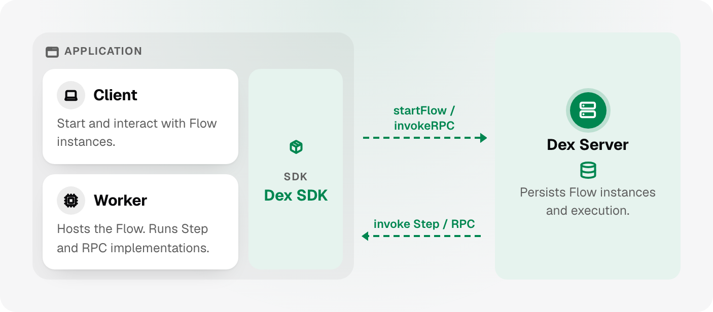

<p align="center">
  <a href="https://docs.superdurable.io"></a>
</p>

<h1 align="center">Dex</h1>

<h3 align="center">Durable Execution (D-Ex). No Replay, Zero Dependencies.</h3>

<p align="center">
  <a href="https://github.com/superdurable/dex/stargazers"></a>
  <a href="https://docs.superdurable.io"></a>
  <a href="https://discord.gg/V9cMHXts98"></a>
  <a href="LICENSING.md"></a>
</p>

**Dex** is a lightweight durable execution platform for AI agents and workflows. Write normal code as a Flow of Steps, and Dex keeps it running through crashes, deploys, and long waits: every finished Step is saved, so an agent or a workflow picks up exactly where it left off.

<p align="center">
  <picture>
    <source media="(prefers-color-scheme: dark)" srcset=".github/images/dex-system-dark.png" />
    
  </picture>
</p>

```bash
brew install superdurable/tap/dexcli   # macOS or Linux
dexcli dev                             # starts a local Dex Server and Dex Web, its web UI
```

Then follow the [Quick Start](https://docs.superdurable.io/quick-start), or let a coding agent build your first Flow with [Dex Skills](https://docs.superdurable.io/build-with-ai/dex-developer-skill).

## Durable agents

A common use of Dex is to make AI agents durable: model calls and tool calls are saved as Steps, and durable timers and retries carry a session through a killed instance or a service outage. Dex Web shows every Step's input and output and can rerun a session from an earlier point (time travel).

Keep your framework (Claude Agent SDK, OpenAI Agents SDK, and more) and start with the **[Agent Quick Start](https://docs.superdurable.io/agent-frameworks/quick-start)**.

## Why use Dex?

Dex runs *any* long-running agent or workflow to completion:

- **[No replay](https://docs.superdurable.io/intro/what-is-dex#how-this-differs-from-replay-based-durable-execution)**: Most durable execution engines recover a process by running your code again from the top, so your code must behave the same on every run. Dex saves each Step's result and continues from the next Step. A Flow is an explicit structure of Steps, so the API is smaller: fewer primitives, less code, and fewer bugs. Without replay, Dex:
  - eliminates non-determinism errors completely: a Step can read the clock, use random values, and call any library
  - supports long-running Flows without manual history rollover: Dex prunes old history itself
  - needs no "sticky cache": Workers keep no Flow state in memory
- **[Zero dependencies](https://docs.superdurable.io/components/server)**: Dex runs on object storage alone: Amazon S3 or an S3-compatible service, Azure Blob Storage, Google Cloud Storage, or Aliyun OSS. There is no database, message queue, or coordination service to run: just one binary and one bucket, or neither on [Dex Cloud](https://docs.superdurable.io/components/dex-cloud). It is fast too: in our [benchmark](benchmark/), one 16-vCPU node peaked at about 8.4K Steps/s and 67K read RPCs/s.
- **[Data native](https://docs.superdurable.io/concepts/primitives/attribute)**: No real process runs without data, so Dex has explicit primitives for it: Attributes and Streams. An agent keeps its whole LLM context, or thousands of messages, in Attributes, the Flow's durable key-value store, with no separate database, and streams model output live.
- **[Connectors](https://github.com/superdurable/dex-connectors-library)**: Call products such as Stripe and Gmail through a growing library of more than 200 connectors, as ready-made Steps, Triggers, or agent tools.
- **[Visualizable](https://docs.superdurable.io/reference/web/flow-visualization)**: See any Go, Python, or TypeScript Flow written with [Dex Skills](https://docs.superdurable.io/build-with-ai/dex-developer-skill) as a graph: a JSON file describing the Flow is uploaded to the server, and Dex Web draws it.

Dex is created by [Quanzheng Long](https://superdurable.io/about/), core contributor to Uber Cadence (forked as Temporal), and the original creator of [iWF](https://github.com/indeedeng/iwf).

## Under the hood

The [engine](https://docs.superdurable.io/components/server#how-it-works) is written in Rust for performance and keeps RocksDB as a local cache:

- Every write goes to object storage first, in a **command log** batched to save PUT costs, and is then applied to RocksDB.
- Snapshots are uploaded in the background. After a crash, a standby or a restarted node loads the latest one and re-applies the log. A standby [takes over](https://docs.superdurable.io/reference/server/high-availability#lease) within 11 seconds by default.
- The SDKs cache large Attribute values on local disk to cut network transfer.

## SDKs

```bash
pip install dex-python-sdk                          # Python
go get github.com/superdurable/dex/sdk-go@latest    # Go
npm install @superdurable/dex                       # TypeScript
cargo add dex-sdk                                   # Rust
```

Java: `io.superdurable:dex-sdk` on [Maven Central](https://central.sonatype.com/artifact/io.superdurable/dex-sdk).

## Documentation

[Quick Start](https://docs.superdurable.io/quick-start) · [Durable Agents](https://docs.superdurable.io/agent-frameworks) · [Run Dex](https://docs.superdurable.io/components) · [Concepts](https://docs.superdurable.io/concepts) · [Design Patterns](https://docs.superdurable.io/design-patterns) · [Evaluate Dex](https://docs.superdurable.io/evaluate) · [Developer Reference](https://docs.superdurable.io/reference) · [简体中文](https://docs.superdurable.io/zh-Hans/)

## Community

- [Discord](https://discord.gg/V9cMHXts98)
- **WeChat group**: add **prclqz** (龙全正) or **MUJIzz** (Zane), or scan the QR code.


## Contributing

See [CONTRIBUTING.md](CONTRIBUTING.md) to build and test. Contributors sign the [CLA](CLA.md).

<details>
<summary>Repository layout</summary>

| Path | Contents |
| --- | --- |
| [server-zd/](server-zd/) | Rust Dex Server |
| [server-zd/integ/](server-zd/integ/) | Go integration suite for the server-zd binary |
| [web/](web/) | Standalone Dex Web console and `dex-web` binary |
| [cli/](cli/) | `dexcli` local development environment |
| [protos/](protos/) | Protobuf IDL and codec server |
| [s3local/](s3local/) | Local S3-compatible object store for testing |
| [blob-cache-go/](blob-cache-go/) | Shared Go disk blob cache |
| [benchmark/](benchmark/) | Performance benchmarks |
| [packages/](packages/) | Shared Web packages |
| [agents/](agents/) | Adapters for agent frameworks |
| [sdk-go/](sdk-go/), [sdk-java/](sdk-java/), [sdk-python/](sdk-python/), [sdk-typescript/](sdk-typescript/), [sdk-rust/](sdk-rust/) | Application SDKs |
| [examples/](examples/), [docs/](docs/), [skills/](skills/) | Runnable examples, product docs, and AI skills |

</details>

## License

Dex is source-available under the Sustainable Use License 1.0. See the [licensing guide](LICENSING.md) and [legacy notices](LEGACY_NOTICES.md).
