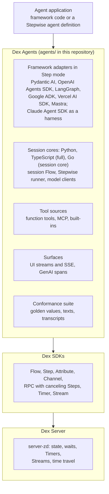
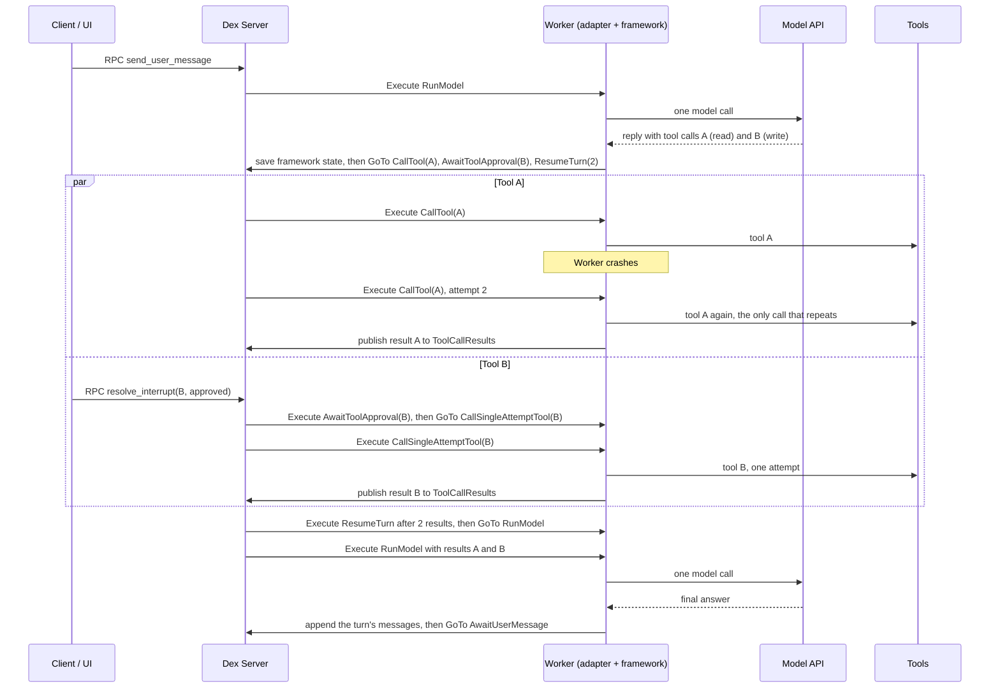

# Long-running Agents on Dex

Status: as built at agents/v0.2.0. Date: 2026-11-06.

Release state on 2026-11-06:

- The tag `agents/v0.2.0` and its GitHub release exist.
- PyPI serves 0.2.0 for all six Python packages.
- npm does not serve 0.2.0. `latest` is 0.1.0 for all five TypeScript packages,
  because the publish workflow failed twice
  ([42198865834](https://github.com/superdurable/dex/actions/runs/42198865834),
  [42202147426](https://github.com/superdurable/dex/actions/runs/42202147426)).
  The TypeScript 0.2.0 code is on main and in the tag.
- The Go core has no tag of its own. It is usable from source only.

Agents 0.2.0 needs Dex SDK 1.35.0 and server-zd v0.1.17 or later. This document
describes only what is built. Unbuilt work is in
[plan/agents-m3-operate.md](plan/agents-m3-operate.md).

Plans that implement this design, each with "As built" notes:

- [plan/agent-framework-adapters.md](plan/agent-framework-adapters.md): the
  session Flow contract, Step mode, and the adapters (M1). It is the current
  contract for every core.
- [plan/agents-m2-stepwise.md](plan/agents-m2-stepwise.md): Stepwise mode,
  contract additions A1 to A9, and the surfaces (M2).
- [plan/agents-go-java-rust.md](plan/agents-go-java-rust.md): the Go core,
  the Java and Rust deferral, and the conformance suite.

Where this document and a plan differ, the code on main decides.

## Decision

Dex supports long-running agents through three additions. None of them is a
new engine primitive.

1. **Dex Agents**, a library that packages the agent loop the AI Agent
   examples used to build by hand: a session Flow, model and tool Steps,
   approvals, questions, durable waits, steering, cancellation, plans,
   compaction, usage, session settings, and a standard event Stream.
   - Python and TypeScript have the full contract: Step mode (#1145, #1146),
     Stepwise mode and A1 to A4 (#1183, #1184), steering (#1191), plans
     (#1192, #1196), tool tasks (#1193), compaction (#1194), chunked messages
     with retention (#1221), session settings (#1222), and `cancel_turn`
     aborts (#1223).
   - Go has the session core only: approvals, single-attempt tools, A1,
     session settings, Stepwise, and in-process OpenAI and Anthropic clients
     (#1208 on #1200, #1222).
   - Java and Rust are deferred until users ask
     ([evidence](plan/agents-go-java-rust.md#decision-java-and-rust-are-deferred)).
2. **Framework adapters in Step mode.** The framework makes one model call
   per Dex Step and hands its tool calls to Dex, so every model call, tool
   call, and approval is an ordinary Step. Pydantic AI, OpenAI Agents SDK
   (Python and TypeScript), LangChain and LangGraph, Google ADK, Vercel AI
   SDK, and Mastra run this way. Claude Agent SDK (Python and TypeScript),
   whose loop runs in a CLI subprocess, runs as a whole-turn harness. All
   nine adapters are merged (#1137 to #1144, #1149) and were published in
   agents 0.1.0 (#1157).
3. **Agent surfaces.** Tool sources with an MCP client (#1179, #1202), UI
   stream adapters (#1181, #1187, #1218), OpenTelemetry GenAI spans (#1180), a
   cross-language conformance suite (#1207, #1217), and a deployment guide
   (#1177, #1190, #1228).

All of this is built on Steps, Attributes, Channels, Timers, and **WaitFor**.
Stop uses RPC canceling Steps, which the SDKs already had.

The Dex programming model does not change. Steps read and write Attributes.
Nothing here adds Flow replay, determinism rules, or history-size management
to application code.

In short:

> Builders keep the agent framework they chose. Dex makes each agent session
> a Flow that survives crashes, deploys, and waits of months.

### Owner decisions

These reviews set the direction. The sections below record what each one
decided.

- [Review of #1132](https://github.com/superdurable/dex/pull/1132#pullrequestreview-5724027276):
  rejected the Step Journal. "Dex will not add a new primitive for durable
  operations inside a Step."
- [Step mode comment on #1132](https://github.com/superdurable/dex/pull/1132#issuecomment-6547044614):
  most frameworks can stop after one model call, so each model call and each
  tool call is an ordinary Step. Nothing re-runs the loop.
- [Review of the M2 decisions on #1178](https://github.com/superdurable/dex/pull/1178#issuecomment-6592361866):
  steering, Stop, remote tasks, bounded state in 0.2.0, session settings, and
  the engine as the home of the single-attempt fix.

### What the build changed

The first revision of this design proposed some things that the review and
the build changed:

| First revision | Built or decided | Why | Where |
| --- | --- | --- | --- |
| A Step Journal (C1) to record calls inside one Step | Removed. Step mode on existing primitives | No new primitive for durable operations inside a Step | Owner review of #1132; #1145, #1146 |
| Turn replay as the default mode for frameworks | Not built | Most frameworks can stop after one model call, so a Step per call needs no replay. No adapter needs it | Step mode comment on #1132 |
| Go Dex Agents on the `llm` connector | Go calls models in-process, and stops at the session core | `llm` sends text only, with no tool calling | #1208; [Go scope](plan/agents-go-java-rust.md#decision-go-stops-at-the-session-core) |
| Java and Rust follow demand | Deferred, with evidence; a conformance suite makes a new language a port | Smaller agent frameworks in those languages | [Deferral](plan/agents-go-java-rust.md#decision-java-and-rust-are-deferred); #1207 |
| `AgentMessages`, one instance per message, with a later archive | A sequentially chunked AttributeMap with retention, in 0.2.0 | A persisted layout must settle before a release | #1221 |
| Model choice in the agent definition only | Per-session settings, applied at the next turn | One value for every model call of a turn | #1222 |
| `cancel_turn` stops at the next safe boundary | `cancel_turn` aborts model calls and waits, and abandons remote tasks; steering never aborts | Dex could already cancel a running Step from an RPC | #1191, #1223 |
| One trace per activation, root closes when the session parks | The root span ends with the Step that starts the activation | A span must end in the process that started it | #1180 |
| Hooks such as `before_model_call` | Not built | The runner interface, tool policies, and session settings covered every case | M2 plan, Scope |
| An agents-only marker for "tool started" | Rejected. The engine records attempt start | Every Dex application with a single-attempt Step has the same gap | #1253, #1259, #1265 |

## Context

Agent builders pick a framework for the loop and want the session to survive
crashes and long waits. Before this work Dex had no released framework
integration.

Dex already had what a durable session needs:

| Need | Dex primitive |
| --- | --- |
| Model calls that survive a lost Worker | Step retries with heartbeat timeouts |
| Waits of days or months | **WaitFor** on Timers and Channels; no process holds the wait |
| Approvals, answers, steering | Channel and ChannelMap; transactional RPCs with Attribute locks |
| Stop | RPC canceling Steps: an RPC ends active Steps of chosen types at its commit, including a running attempt |
| Conversation state | AttributeMap instances; values up to 16 MiB |
| Live output | Streams with resume tokens |
| Code changes while sessions wait | No replay: a waiting Flow runs the code of the Worker that takes its next Step |
| Debugging | Dex Web Step graph; time travel inside the history window |

What was missing was the agent loop itself. The Python AI Agent example was
3,917 lines of Flow, model adapter, MCP registry, and HTTP route code, plus its
UI. A team that already wrote its agent in a framework had no path at all.
Rebuilt on the library, the Python example is 474 lines of Python (#1199), and
the TypeScript example is 605 lines (#1198). Both add Stop and per-session
model choice.

The state model suits agents. A model call Step reads messages from Attributes
and writes new messages. History is a pruned window, not something a run must
replay, so its length costs nothing at runtime. A waiting session runs its next
Step on the current code.

## The missing pieces

Each row is a gap this work closed. The G numbers come from the first revision
and stay stable. G4, G12, G13, G14, and G16 are unused here, because nothing was
built for them.

| # | Missing piece | Before this work | Built |
| --- | --- | --- | --- |
| G1 | Framework integrations | None released | C3: nine adapters (#1137 to #1144, #1149), published in 0.1.0 (#1157) |
| G2 | Durable calls inside a framework loop | A framework loop had no Step boundary inside it | C3 Step mode, with no new primitive: each model call and tool call is its own Step (#1145, #1146) |
| G3 | A reusable agent loop | Two hand-built examples | C2: Python and TypeScript (#1183, #1184 and the A5 to A9 PRs); Go at session-core scope (#1208); examples on the library (#1199, #1198) |
| G5 | A tool side-effect contract | Connector **uncertain** branch only | C4 effect classes and tool Steps (#1134, #1136, #1145, #1146), with the engine's attempt start and attempt progress (#1253, #1259, #1265) |
| G6 | UI streaming protocols and resume | Resumable best-effort Streams; production default backend `disabled`; no protocol adapters | C6: AI SDK UI message stream and SSE (#1181, #1187, #1218). The backend defaults to `memory` (#1275) |
| G7 | MCP | Client in one example only | C4: client as a tool source (#1179, #1202, #1193, #1216) |
| G8 | Connectors outside Go | Go SDK only | Connectors support Go, Python, and TypeScript (#1224). No agent core uses them yet |
| G9 | Long-horizon state | 64 MiB run budget not enforced on every command; trimming deleted transcript | C7: provider-exact transcript, compaction (#1194), chunked messages and retention (#1221), and an enforced budget (#1234) |
| G10 | Tracing | No OpenTelemetry anywhere | C9: GenAI spans in Python and TypeScript (#1180) |
| G11 | Usage | None | C9: token usage ledger, `AgentUsage` (#1188) |
| G15 | Secrets in session state | Connection credentials per app | C13: session settings hold references only, never secrets (#1222) |

## Goals

Each goal below is met on main.

- A team with an agent in Pydantic AI, OpenAI Agents SDK, LangChain or
  LangGraph, Google ADK, the Vercel AI SDK, Mastra, or Claude Agent SDK makes
  it durable on Dex by wrapping it, in under 50 lines of change, and keeps its
  framework code. Each adapter README shows the change.
- A team without a framework writes a production agent with Dex Agents in a
  few hundred lines instead of a few thousand.
- Any session survives a Worker kill at any point, a deploy while it waits,
  and a wait of months. A non-idempotent tool does not run twice silently,
  apart from the two narrow cases in C4.
- A crash repeats at most the one model call or the one tool call that was
  running. A whole-turn harness repeats at most its current turn segment.
- A browser that reconnects resumes the live output without an extra store.
  After a server restart or takeover, it reloads the snapshot (C6).
- Operators see model calls, tool calls, and token usage in the tracing
  backends they already use.
- Every addition is an ordinary, additive Dex feature with Beta compatibility,
  and none is a new engine primitive.

## Non-goals

- A new general agent framework. Dex Agents is a thin durable harness; the
  adapters are the main path for teams that already chose a framework.
- Hosting models, a vector database, a memory service, an eval product, an
  LLM observability UI, or a sandbox service.
- Replay of a Flow or determinism rules in agent code.
- Bringing back push Workers.
- Agent cores for Java and Rust, and Go beyond the session core, until users
  ask for them.

## Architecture

### Layers



Dex Agents sits on the public SDKs. It adds no private hooks into the SDKs and
needs no new primitive in them. No core calls a Connector.

Each language has one core package and one package per framework adapter.
All packages share one version line and one changelog, tagged `agents/v*`
(#1157). New features ship as modules and subpath exports of the existing
packages, with extras and optional peer dependencies, so no new registry name
is needed.

A Flow type is served by Workers of one language. Clients work across
languages: a Python or TypeScript Client can drive a Go-served session. The
conformance suite (#1207) fixes every value that crosses a language boundary.

### One Flow per agent session

An agent session is one Flow execution. The Flow ID is the session ID. The
session Flow owns everything that has to survive a crash or a deploy. The
contract document's
[persistence schema](plan/agent-framework-adapters.md#persistence-schema) has
the exact names and value types; this table groups them:

| State | Dex primitive | Notes |
| --- | --- | --- |
| Messages, tool calls, tool results | **AttributeMap** `AgentMessages` (the newest messages, one instance per message), **AttributeMap** `AgentMessageChunks` (immutable chunks), **Attribute** `AgentMessageIndex` | A Sequentially Chunked AttributeMap. Retention deletes whole chunks behind the compaction summary (#1221) |
| Session status and the active turn | **Attribute** `AgentState`, `TurnReplySequence` | Small, rewritten often |
| Tool calls of the active turn | **AttributeMap** `AgentToolCalls`, keyed by tool call ID | Effect, status, result, task handle. Deleted when the turn ends; the results are already messages |
| Tool results within a turn | Internal **Channel** `ToolCallResults` | Each tool Step publishes one result. `ResumeTurn` consumes them |
| Context summary, plan | **Attribute** `ContextSummary`, `AgentPlan`, `PendingPlanExecution`; **ChannelMap** `PlanExecutions` | Survive compaction |
| Framework state between the Steps of a turn | **Attribute** `FrameworkRunState` | Step mode and whole-turn harness. Opaque to Dex. Cleared when the turn ends |
| Usage | **Attribute** `AgentUsage` | Model calls and tokens |
| Incoming user messages | **Channel** `QueuedUserMessages`, `SteeredUserMessages` | Pending messages stay editable |
| Turn control | Internal **Channel** `TurnControlRequests`, **Attribute** `TurnCancellationRequest`, internal **ChannelMap** `ToolCallCancellations` | Steering and Stop |
| Approvals and questions | **ChannelMap** `InterruptResolutions`, keyed by interrupt ID; **Attribute** `PendingInterrupts` | A decision releases only its own wait |
| Session settings | **Attribute** `SessionSettings`, `TurnSessionSettings` | The next turn's settings, and the running turn's copy |
| Trace context | **Attribute** `AgentTraceContext` | The current activation's root span |
| Live output | **Stream** `AgentEvents` | Best effort. Never the source of truth |

This schema is a public, persisted contract. Changes follow the Beta
compatibility rules, and the conformance suite checks them in every core.

### Execution modes

Agent frameworks own their loop. Asking a team to cut that loop into Dex Steps
means asking them to drop their framework.

Most frameworks do not need that. The state of an agent loop is the message
list plus the framework's own run state. Most frameworks can stop after one
model call, serialize that state, and continue later in a fresh process with
tool results computed elsewhere. Dex Agents builds on that ability. Every mode
shares one session Flow, one state schema, one event Stream, and one approval
contract.

| Mode | Used by | One Step runs | A crash repeats | PRs |
| --- | --- | --- | --- | --- |
| Stepwise | Dex Agents without a framework | One model call or one tool call | That one call | #1183, #1184, #1208 |
| Step mode | Framework adapters, by default | One model call or one tool call | That one call | #1145, #1146 |
| Whole-turn harness | Claude Agent SDK | One turn segment of the harness; deferred tools run in their own Steps | The segment's model calls and the tools the harness runs itself | #1144, #1149 |

**Stepwise mode** runs one Dex Step per model call and one per tool call.
`RunModel` calls the model through a small `ModelClient` interface: LiteLLM in
Python, the Vercel AI SDK **LanguageModel** in TypeScript, and the official
OpenAI and Anthropic SDKs in Go. Each call gets its own retry policy, timeout,
failure route, and history entry. Approvals, questions, and waits are
**WaitFor** conditions. Dex Web shows every call in the Step graph. Stepwise
is the native Dex Agents loop and the right choice for a new agent without a
framework.

**Step mode** is the default for framework adapters. The framework still runs
its own loop, one model call per Step:

- `RunModel` loads the framework's state from Attributes and calls
  `runner.run_model_step`. The adapter lets the framework make exactly one
  model call, with the tool results from the previous Steps, and saves the
  framework's new state.
- When the reply has no tool calls, the turn ends and the session moves to
  `AwaitUserMessage`.
- When the reply has tool calls, `RunModel` moves to one Step per call, all
  in parallel, and to one `ResumeTurn`. `CallTool` runs a READ or
  IDEMPOTENT_WRITE call with retries. `CallSingleAttemptTool` runs a
  NON_IDEMPOTENT_WRITE or UNCLASSIFIED call once.
- A call that needs approval goes to `AwaitToolApproval` first. That Step
  waits on the interrupt's Channel. It then moves to the call's tool Step, or
  it publishes a rejection result without running the tool.
- Each tool Step publishes its result to the internal Channel
  `ToolCallResults`. `ResumeTurn` waits for N messages on that Channel,
  records the results, and moves back to `RunModel`, which hands them to the
  framework.

Each model call and each tool call is an ordinary Step, with its own retry
policy, timeout, failure route, history entry, and node in Dex Web. A crash
reruns only the one model call or the one tool call that was running. Nothing
re-runs the framework loop, so there is no replay and no determinism rule of
any kind. A code change takes effect at the next Step, even in the middle of a
turn. The framework keeps its own features, such as handoffs, guardrails, and
structured output, because it still makes each step itself.

Stepwise mode and Step mode produce the same Step shapes. They differ only in
who makes the model call inside `RunModel`. One approval contract (C5)
therefore serves every framework.

**Whole-turn harness** is for a framework whose loop runs in a separate
process that cannot stop after one model call or take tool results from
outside. Claude Agent SDK is that case: its loop runs in the Claude Code CLI,
a **PreToolUse** hook's **defer** ends a turn only in `-p` mode and only for a
lone tool call, and a tool result cannot be injected. One Step runs the CLI
for a turn segment, resumed from the session transcript stored in Attributes.
A custom tool that is not READ is deferred, and the segment ends. The call
then uses the same `AwaitToolApproval` and tool Steps as Step mode. On resume,
the hook allows the re-run call, and the adapter's tool handler returns the
recorded result. Tools built into the CLI run inside the segment and are
at-least-once. A crash reruns the segment, including its model calls. A
segment must finish within the 15-minute `RunModel` method timeout.



## Component designs

Merged plans cite these numbers, so they never change. C1, the Step Journal,
was removed after the first review. C8, C10, and C12 are unused, because
nothing was built for them.

| # | Component | As built |
| --- | --- | --- |
| C1 | Unused | Step Journal, removed |
| C2 | Dex Agents library | Python and TypeScript in full; Go at session-core scope |
| C3 | Framework adapters | Nine adapters |
| C4 | Tools, connectors, and MCP | Effect classes, tool sources, MCP client, tool tasks |
| C5 | Human-in-the-loop contract | Approvals, questions, plan review, steering, Stop |
| C6 | Streaming and UI protocols | AI SDK UI message stream and SSE |
| C7 | Long-horizon state | Compaction, chunked messages, retention |
| C8 | Unused | Multi-agent, not built |
| C9 | Observability and usage | GenAI spans and token usage |
| C10 | Unused | Budgets and model concurrency, not built |
| C11 | Testing | Scripted model clients |
| C12 | Unused | Sandboxes, not built |
| C13 | Secrets | Secrets by reference |
| C14 | Deployment and versioning | Pull Workers, code changes, pinned frameworks, upgrade rules |

### C2. Dex Agents library

Dex Agents packages the loop that both AI Agent examples wrote by hand. An
application declares an agent definition and registers the generic session
Flow. This is the Python API:

```python
support_agent = AgentDefinition(
    name="support",
    instructions=SUPPORT_INSTRUCTIONS,
    model=LiteLLMModelClient("openai/gpt-5-mini"),
    tools=[lookup_order, refund_order],
    tool_sources=[McpToolSource(servers)],
    built_in_tools=frozenset(
        {BuiltInTool.ASK_USER, BuiltInTool.DURABLE_WAIT, BuiltInTool.WRITE_TODOS}
    ),
    plan_mode_enabled=True,
    compaction=CompactionPolicy(context_window_tokens=400_000),
)

flow = stepwise_agent_session_flow(support_agent, flow_type="SupportAgent")
```

The session Flow has the same Steps in Stepwise and Step mode:
`StartAgentSession`, `AwaitUserMessage`, `RunModel`, `CompactContext`,
`CallTool`, `CallSingleAttemptTool`, `AwaitToolApproval`,
`AwaitQuestionAnswer`, `AwaitTimer`, `PollToolTask`, `CancelToolTask`,
`ResumeTurn`, `ApplyTurnControl`, `FinishTurnCancellation`, and the failure
routes `RecordToolFailure`, `RecordToolOutcomeUnknown`, and
`RecordTurnFailure`. Parallel tool calls run as parallel Step executions.

RPCs, all snake_case and starting with a verb:

| RPC | Built in |
| --- | --- |
| `send_user_message`, `resolve_interrupt`, `get_agent_snapshot`, `list_agent_messages` | M1 |
| `answer_question` | A3, #1183, #1184 |
| `steer_user_message`, `delete_queued_message`, `cancel_turn` | A5, #1191, #1223 |
| `execute_plan` | A6, #1192 |
| `update_session_settings` | A9, #1222 |

Go serves only the RPCs of its scope. `describe_agent` was dropped, because
`get_agent_snapshot` and the session settings cover it.

The built-in tools are `ask_user`, `durable_wait`, and `write_todos` (A2 to
A4, A6).

Hooks such as `before_model_call` and `before_tool_call` are not built. The
runner interface, tool policies, and session settings covered every case in
M2.

**Model layer.** Each language follows its ecosystem instead of a new
provider abstraction. The client makes one request per call and no retries of
its own, so every retry is a visible `RunModel` attempt. No client reads
`Retry-After`: a rate-limited call fails its attempt, and the Step's retry
policy runs the next one. Dex owns the conversation: each call rebuilds its
input from Attributes, uses no provider-side conversation storage, and replays
provider items such as encrypted reasoning and thinking signatures unchanged.

- Python: `LiteLLMModelClient` in `dex_agents.litellm`.
- TypeScript: the AI SDK client in `@superdurable/dex-agents/ai-sdk`, so
  every AI SDK provider works.
- Go: in-process `openai-go` and `anthropic-sdk-go` clients (#1208), because
  the `llm` connector sends text only and has no tool calling.
- Scripted model clients in every core (C11).

**Session settings** (A9, #1222). A session can start with an optional
`session_settings` JSON object, and `update_session_settings` replaces it. A
change applies when the next turn starts, so every model call of one turn
sees one value. A resolver on the agent definition maps the settings to a
model client the Worker built. Settings hold references, such as a model or
credential name, never secrets.

**Languages.** Python and TypeScript come first, because that is where agent
builders are. Go goes ahead for Dex-specific reasons: the hand-built Go
example, `dexcli visualize`, Go-only tooling, and the application builder.
Go stops at the session core: approvals and deadlines, single-attempt tools,
the turn-failure note, A1, session settings, and Stepwise with the two model
clients. Questions, durable waits, steering, plans, compaction, tool tasks,
MCP, spans, UI streams, and adapters are not in Go. A guard fails a Go-served
session cleanly if it ever holds state Go does not implement. Java and Rust
are deferred: their agent frameworks are smaller and no durable engine ships
agent integrations for them. The
[deferral](plan/agents-go-java-rust.md#decision-java-and-rust-are-deferred)
records the evidence and when to revisit.

### C3. Framework adapters

All nine adapters merged on 2026-10-31 and were published in agents 0.1.0 on
2026-11-01. Every adapter reports model call metadata for spans and usage
(#1188).

Every framework in the set handles a human approval the same way: serialize the
run, stop, and resume with a decision. None provides the durable wait itself.
That is the gap a Dex session Flow fills.

#### Mode per framework

An adapter answers three questions about its framework. How does it stop
after one model call? How is its state serialized and restored? How do tool
results computed outside it go back in? A framework that answers all three
runs in Step mode. A framework whose loop runs in a subprocess that cannot
stop is a whole-turn harness.

| Framework | Stop after one model call | Serialize and restore state | Tool results back in | Mode | Adapter |
| --- | --- | --- | --- | --- | --- |
| Pydantic AI | An outermost capability defers every tool call with **CallDeferred**, so the run ends with **DeferredToolRequests** right after the model call | The turn's messages through **ModelMessagesTypeAdapter**, plus the deferred call IDs | **DeferredToolResults** with `message_history`: **ToolReturn**, **ToolDenied**, or the outcome text | Step mode | #1141 |
| Vercel AI SDK 7 | Tools reach the loop without **execute**, so **streamText** returns the model's tool calls | The plain-JSON **ModelMessage** list | A `tool` message with `tool-result` parts, then the next model call | Step mode | #1142 |
| LangChain `create_agent`, LangGraph | **DurableToolCallMiddleware** or **durable_tool_node** calls **interrupt()** for each tool call, so the graph stops after the model node | The latest checkpoint of each namespace and its pending writes, serialized with LangGraph's serializer | **Command(resume=...)** with the result for each interrupt | Step mode. In a custom graph, nodes between the model and the tools run inside `RunModel` | #1138 |
| OpenAI Agents SDK (Python, TypeScript) | A **needs_approval** gate on every function tool, so the SDK stops with `result.interruptions` after a reply that calls tools | **RunState.to_json** and **from_json** (TypeScript **fromStringWithContext**): the current agent after a handoff, turn counters, guardrail results, and pending calls | **approve** each interruption, and the gated tool's wrapper returns the Dex result instead of running the tool; **reject** with the rejection message | Step mode through the gate. In Python, an agent with tools the SDK cannot gate, such as MCP tools, is refused unless `allow_at_least_once_tools` is set; those tools then run inline and are at-least-once | #1137, #1140 |
| Google ADK (Python) | A plugin calls **request_confirmation** for each tool call, and the resumable App pauses the invocation | The turn's ADK events, rebuilt into a turn-local session service | Answer each `adk_request_confirmation` call; ADK re-executes the call, and the plugin returns the Dex result | Step mode | #1139 |
| Mastra (TypeScript) | Tools go to Mastra as client tools without **execute**, so its loop stops at the tool calls of a model response | Mastra messages (**MastraDBMessage** JSON), with no Memory thread | AI SDK tool-result messages, then **agent.stream()** again | Step mode. Tools Mastra adds outside the agent's tools run inline and are at-least-once | #1143 |
| Claude Agent SDK (Python, TypeScript) | No clean stop: **PreToolUse** **defer** ends the turn only in `-p` mode and only for a lone tool call | The transcript through a **SessionStore** on Attributes, resumed by session ID | No injection. On resume the hook allows the re-run call, and the adapter's handler returns the Dex result. Built-in CLI tools run inside the CLI | Whole-turn harness | #1144, #1149 |

Each adapter documents the tools its framework runs by itself. Those tools run
inside `RunModel` and are at-least-once, whatever their effect class.

Every adapter also feeds the framework's own approval settings, such as
**needs_approval**, **require_confirmation**, and **requireApproval**, into
the Dex tool policy, so `AwaitToolApproval` is the only approval wait. It
writes `AgentEvents`, records `AgentUsage`, and pairs every tool call with a
result, including an outcome-unknown result after a crash, because an orphaned
tool call can break a framework's transcript.

The M2 contract additions are optional for adapters. No adapter implements
incremental messages (A1), built-in tools, plan mode, or compaction. An
adapter works without them. An agent that needs one uses Stepwise.

#### Example: OpenAI Agents SDK

The application keeps its agent. The adapter supplies the session Flow:

```python
triage_agent = Agent(name="Triage", instructions=TRIAGE, tools=[lookup_order, refund_order])

registry.add_flow(
    openai_agents_session_flow(
        triage_agent,
        flow_type="TriageAgent",
        tool_policies={
            "lookup_order": ToolPolicy(ToolEffect.READ),
            "refund_order": ToolPolicy(ToolEffect.NON_IDEMPOTENT_WRITE),
        },
    )
)
```

The adapter copies the agent and gives every function tool a
**needs_approval** gate. The gate stops the SDK for every call, and the Dex
tool policy decides whether a person must approve. `lookup_order` runs in
`CallTool`, and `refund_order` runs once in `CallSingleAttemptTool` after
approval. A Worker killed during the refund records an unknown outcome and
reports it to the model instead of refunding twice. A Worker killed during
`RunModel` repeats only that model call.

#### Example: Vercel AI SDK

```ts
export const supportAgentFlow = createVercelAiAgentSessionFlow(
  {
    model: openai("gpt-5-mini"),
    instructions: SUPPORT_INSTRUCTIONS,
    tools: { get_order: getOrder, refund_order: refundOrder },
    toolPolicies: {
      get_order: { effect: "read" },
      refund_order: { effect: "idempotent_write", requiresApproval: true },
    },
  },
  "SupportAgent",
);
```

The adapter hands the AI SDK every tool without **execute**, so each model
call in `RunModel` returns the model's tool calls. Each call runs its original
**execute** in its own tool Step. The next `RunModel` appends the results as
`tool-result` parts and calls the model again. Text and reasoning parts go to
`AgentEvents`. A browser using **useChat** reads them through the UI stream
adapter (C6).

#### Example: Claude Agent SDK

The mechanics are under [Execution modes](#execution-modes). A **SessionStore**
mirrors the transcript into Attributes, and each turn segment starts a new CLI
process that resumes from it. Tools built into the CLI, such as **Bash**,
**Write**, and **Edit**, defer only for approval. Dex stores the transcript, not
the working directory, so the application must make that directory survive the
attempt. The resume path is tested against a scripted CLI and against the
bundled Claude Code CLI with a local scripted Messages API, in both languages.

#### Conformance

Two suites protect the contract.

**Cross-language conformance (#1207, #1217).** `agents/conformance/` holds
golden wire values for every Attribute, Channel, Step input, and RPC value; a
names manifest; every model-visible text; and nine scripted-turn transcripts.
It is generated from the Python core, and every core decodes, re-encodes, and
compares each value in its own CI. It replaced the manual value-by-value
checks of the M2 reviews, and it is what makes a new language core a port
instead of a design.

**Per-adapter conformance.** Each adapter's integration suite runs the same
matrix against a real Dex Server with a scripted model: Step shapes, parallel
tool calls, approval across a Worker restart, rejection, SIGKILL during a
single-attempt tool and during `RunModel`, and the turn-failure note. Each
adapter release pins the framework versions it passed against.

### C4. Tools, connectors, and MCP

#### Tool effect classes

Every tool, whatever its source, declares one effect class. The class decides
the tool Step, retries, idempotency keys, crash behavior, and the default
approval policy:

| Effect | Step | Retry | Crash mid-call | Default policy |
| --- | --- | --- | --- | --- |
| READ | `CallTool` | Up to 3 attempts; then `failed` | Runs again | Run |
| IDEMPOTENT_WRITE | `CallTool` | Up to 3 attempts, same idempotency key; then `outcome_unknown` | Runs again with the same key | Run unless the tool policy asks |
| NON_IDEMPOTENT_WRITE | `CallSingleAttemptTool` | One attempt | Outcome unknown, reported to the model | Ask for approval |
| UNCLASSIFIED | `CallSingleAttemptTool` | One attempt | Outcome unknown, reported to the model | Ask for approval |

A call that needs approval passes through `AwaitToolApproval` before its tool
Step. Tools that a framework runs by itself cannot be Steps; they run inside
`RunModel` and are at-least-once whatever their class (C3). The idempotency
key for a tool call is `<flowId>/<turnId>/<toolCallId>`, the same on every
attempt.

**Attempt start and attempt progress** (#1253, #1259, #1265). The first design
had two gaps. A Worker that died before its first heartbeat reached the server
got its attempt redelivered (#1232). A dispatch that found no Worker failed
with the same error as a Worker that disconnected mid-call (#1233). The owner
decided the fix belongs in the engine, because every Dex application with a
non-idempotent single-attempt Step has the same gap. An agents-only marker RPC
was rejected. The engine now works this way:

- Dex starts an attempt when it hands the attempt to a Worker. It never hands
  that attempt number to another Worker, except when it treats the attempt as
  never run.
- A Step with no Worker waits in the durable queue. It uses no attempt and does
  not fail.
- The recovery error carries `attempt_progress`. `NOT_STARTED` means no attempt
  reached a Worker, so the call records `failed` with
  `TOOL_CALL_NOT_RUN_ERROR_PREFIX`, and the model can call the tool again.
  `NOT_COMPLETED` and `UNSPECIFIED` keep the table above. No final status was
  added.

**Limits.** The contract's
[known limits](plan/agent-framework-adapters.md#known-limits) and the
deployment guide state them:

1. A single-attempt tool can still run twice in two narrow cases. An ASYNC Step
   can rerun at the same attempt number after a node crash; the packaged tool
   Steps use SYNC durability in all three cores, so this does not reach them.
   Cancellation is cooperative, so a cancelled run may keep running while the
   failure route starts.
2. `NOT_COMPLETED` is conservative. A call that never ran can still record
   `outcome_unknown`.

#### Tool sources

A Stepwise agent definition takes tool sources (#1202) next to its function
tools. A `ToolSource` lists tools, builds deferred calls with their own policy
and effect, runs them in the tool Steps, and can poll and cancel remote tasks.
Each source has a stable name, and the stored call records which source built
it, so any Worker reaches that source without a fresh listing. A source that
fails to list offers no tools for that model call instead of failing the turn.
The MCP client is the first source. Go has function tools only.

#### Connectors

Connectors support Go, Python, and TypeScript (#1224). No agent core calls a
Connector, and no Connector tool source exists. The `llm` connector's
`generateText` sends text only, so no core uses it as a model client.

#### MCP as a tool source

Built in #1179, #1202, #1193, #1216, and #1223.

`McpToolSource` in `dex_agents.mcp` and `@superdurable/dex-agents/mcp` lists
the tools of MCP servers registered in Worker configuration, never from a
browser, Flow input, or a model, over stdio or Streamable HTTP. Each MCP tool
call is a tool Step with its effect class from annotations: `readOnlyHint`
makes it READ and `idempotentHint` makes it IDEMPOTENT_WRITE. Annotations are
trusted by default, and `trusts_tool_annotations` turns that off per server.
Other tools are UNCLASSIFIED unless a `ToolPolicy` says otherwise.

- A broken response stream is re-issued as a new request only when the effect
  allows a retry; an UNCLASSIFIED call records `outcome_unknown`.
- A call answered with a task handle becomes a tool task (A8): the task ID is
  stored on the tool call record, and `PollToolTask` polls `tasks/get` on a
  Timer instead of holding a connection open. Tasks that only their own
  connection can reach are polled inside the tool Step.
- A task's input request becomes a session question (C5) in Python.
  TypeScript task input fails the call, because its SDK needs the answer on a
  live connection.
- Stop abandons a running task: a best-effort `tasks/cancel`, recorded as
  `outcome_unknown` (#1223).
- Resource and prompt tools are optional read tools (#1202).
- Printed configuration redacts environment and header values (#1216).

Framework adapters keep running the MCP tools their framework runs by itself,
at least once, as documented.

### C5. Human-in-the-loop contract

Every wait for a person is a Step with a **WaitFor**, so no process holds it
and it can last for months. A tool approval is the `AwaitToolApproval` Step in
Stepwise mode, Step mode, and the whole-turn harness alike, so one approval
contract serves every framework.

| Kind | Raised by | Resolved by RPC | Wait | Built in |
| --- | --- | --- | --- | --- |
| Tool approval | Tool policy, including the framework's own approval settings | `resolve_interrupt(interrupt_id, approved, rejection_message?)` | `AwaitToolApproval` on ChannelMap `InterruptResolutions[interrupt_id]` | M1 |
| Question | Built-in `ask_user`, or a tool that returns **ToolInputRequested** | `answer_question(interrupt_id, answer)`; `resolve_interrupt(approved=false)` declines | `AwaitQuestionAnswer` on the same ChannelMap | A3 |
| Plan review | Plan mode | `execute_plan(revision)` | `AwaitUserMessage` on ChannelMap `PlanExecutions` | A6 |

Each approval and question has an optional deadline. A passed deadline
records the call as `rejected` with a documented text, so the model sees it.
Resolution RPCs lock `PendingInterrupts` and delete the interrupt when they
publish, so a second click or a second approver is refused.

#### Steering and Stop

Built in #1191 and #1223. These are two different user actions with two rules.

**Steering** (`steer_user_message`) changes course and never aborts work in
flight. A steer is applied at safe Step boundaries. Calls that have not
started are cancelled, reads included, and recorded as `rejected`: the owner
chose one rule for all effect classes. A started tool call, a running model
call, and a running remote task finish first. The steered message then starts
a new turn through `ApplyTurnControl`.

**Stop** (`cancel_turn`) ends the turn now. The RPC writes
`TurnCancellationRequest` and returns canceling Steps for every Step type
that has no outside effect or only waits: `RunModel`, `CompactContext`,
`RecordTurnFailure`, `AwaitToolApproval`, `AwaitQuestionAnswer`,
`AwaitTimer`, and `PollToolTask`. server-zd ends those Steps at the RPC's
commit, including a running attempt, so a model call is aborted. A next Step,
`FinishTurnCancellation`, then decides from committed state, so exactly one
path ends the turn. A started synchronous tool Step still runs to the end. A
started remote task is abandoned: `CancelToolTask` sends a best-effort cancel
and records `outcome_unknown`, and a cancel that keeps failing still ends the
turn.

Locks close the race between the RPC's snapshot and a Step that commits
first. A test lands exactly that interleaving in both cores. Both RPCs work
only on turns that a 0.2.0 Worker started (`accepts_turn_control`), so a
rolling upgrade cannot steer an old Worker's turn. The core sets that flag for
every runner.

### C6. Streaming and UI protocols

Dex Streams give an ordered, resumable, best-effort channel with a resume
token. Dex Agents adds a canonical event type and protocol adapters.

`AgentEvent` carries a turn ID, a Step execution ID, an attempt number, a type,
and a small JSON payload. Event types cover turn lifecycle, text and
reasoning deltas, tool calls, interrupts, plans, compaction, steering,
cancellation, and tool tasks; the contract document lists them. The attempt
number lets a UI drop the partial text of an interrupted attempt.

Adapters read the Stream through the Client with the resume token:

- **Vercel AI SDK UI message stream** in `@superdurable/dex-agents/ui-stream`
  for React apps built with **useChat**. A new attempt maps to `reset-step`,
  so the client discards the interrupted attempt's parts. Approvals map to
  `tool-approval-request` and `tool-approval-response`, which call
  `resolve_interrupt`. A reload rebuilds `UIMessage` lists from the snapshot.
- **Plain server-sent events** in both cores (`dex_agents.ui_stream` in
  Python), with the resume token as the event ID and `Last-Event-ID` resume.

Event payloads stay small, and the adapters read tool arguments and outputs
from the snapshot RPC, because Attributes are the record. After a Stream gap,
the client reloads the snapshot and continues from the current token. Stop
calls `cancel_turn`; a closed tab is not a stop.

server-zd defaults to the `memory` Stream backend (#1275), so an agent
deployment needs no Stream configuration. With an explicit `disabled`, Client
Stream calls fail with `FAILED_PRECONDITION` and Step writes are dropped. A
failed Stream write never fails a Step. Streams live in the memory of the
active server process, so they start empty after a restart, takeover, or step
down. Losing them never loses a session.

`AgentEvents` capacity is 10 MiB by default and is shared by every session of a
Flow type. The deployment guide has a sizing formula and the 100 KiB
per-message cap.

### C7. Long-horizon state

A session that runs for months grows. Dex has no history replay, and the
history window prunes old events, so history length costs nothing at runtime.
State is bounded by `limits.maxFlowStateBytes` (64 MiB by default, counting
superseded values kept for time travel) and one value is at most 16 MiB. A
closed run is kept for 7 days by default.

- **Provider-exact transcript.** Each stored message keeps the provider's item
  as returned, including encrypted reasoning and thinking signatures, and
  replays it unchanged. A model switch replays other providers' items as text
  and drops their reasoning. A Dex-side retry never rewrites an earlier
  message.
- **Compaction** (A7, #1194). Before a model call whose input would reach 85
  percent of the context window, `CompactContext` summarizes older messages
  into `ContextSummary`, as its own Step with one model call. The plan is never
  summarized. A crash reruns only the summary call. Stepwise implements it.
  Since agents 0.3.0 the Python and TypeScript framework adapters do too, at
  turn boundaries only, through the core's turn-boundary helpers; the Claude
  Agent SDK adapter does not, because Claude Code compacts its own transcript.
- **Chunked messages and retention** (#1221). The owner asked to bound Flow
  state in 0.2.0, because the layout is persisted and changing it later would
  mean reading two layouts for every Beta session. `AgentMessages` keeps a
  window of the newest 64 messages, one instance each, so a store never
  rewrites the window. Older messages move into immutable
  `AgentMessageChunks` of at most 32 messages and 1 MiB. Retention deletes the
  oldest chunk once it lies behind the summary and at least 1,000 newer
  messages are stored. With a limit of 100, a measured session stayed between
  167 KB and 191 KB of live state from turn 200 to turn 800 while storing
  2.3 MB of messages over its life. Deleted messages leave
  `list_agent_messages`, and the guide tells applications that need the whole
  transcript to copy it out first.
- **Retention needs a summary.** Retention never deletes a chunk that no
  summary covers. An adapter session without a compaction policy, and every
  Claude Agent SDK session, has no summary, so retention does not bound its
  stored messages.
- **Upgrade rule** (owner decision). Stop every 0.1.0 Worker of a Flow type
  before any 0.2.0 Worker starts. A 0.1.0 session migrates over several
  commits, a few chunks at a time.
- **Enforced budget** (#1234). server-zd checks `limits.maxFlowStateBytes` when
  a command increases a run's storage while its total exceeds the budget. That
  covers a Flow start, Client writes, RPCs that change Flow state, Step
  heartbeats, and Step completions. A Step over budget fails without retry. A
  Step with no failure route, such as `AwaitUserMessage`, fails the Flow.
- **Failing at the budget.** A model or tool Step's failure route sees
  `ValueTooLarge` and `run state of <X> bytes exceeds the maximum of <Y> bytes`
  (`active run state of ...` since the limit counts only active state). In Python
  and TypeScript it sets status `failed` and closes the Flow in one commit. That
  commit meets the same budget, and it passes only while it fits or adds no
  active state. Measured at a 128 KiB budget with small turns, 20 of 24 sessions
  could not store it, and a close with no writes can also trip. Those Flows still
  close failed, because an attempt failure is not checked, and so do Steps with
  no failure route. So the guarantee is the Flow's close, for any session that
  stored a state: `get_agent_snapshot` on `AgentSessionClient`, `readAgentSnapshot`,
  and the UI streams read it. A send refused for size fails no Step, so the
  session stays open and only the caller sees it.

### C9. Observability and usage

- **GenAI spans** (#1180). Behind an optional dependency, the Python and
  TypeScript cores emit `invoke_agent` per activation, `chat` per `RunModel`
  and `CompactContext` attempt with token usage, and `execute_tool` per tool
  Step attempt. Every span carries the Flow ID as `gen_ai.conversation.id` and
  `session.id`, plus the Step type, Step execution ID, attempt, and turn ID.
  Content is by reference unless the application opts in. The convention
  version is pinned with a compatibility switch, because the GenAI conventions
  are marked Development. Go emits no spans.
- **Root span shape.** The first revision closed the activation's root span
  when the session parked. A span must end in the process that started it, and
  the Steps of one activation run on different Workers. The root therefore
  ends with the Step that starts the activation, its context is stored in
  `AgentTraceContext`, and later Steps parent their spans to it. Each root
  links to the previous activation's root.
- **Usage ledger.** Every model call adds model calls and input, output,
  cached, and reasoning tokens to `AgentUsage` (#1188 for the adapters). A
  framework that does not expose a count reports zero. There is no cost figure.

Dex Web shows an agent session as an ordinary Flow, with its Step graph. It has
no agent-specific view.

### C11. Testing

`ScriptedModelClient` in Python and TypeScript is exported from the Stepwise
modules as a supported client for running an agent without a model key (#1202).
Go has a scripted client in `agentstest`. The core suites run on them. The rest of the first revision's C11 was not built.

### C13. Secrets

Session settings hold only references that the Worker resolves (#1222). MCP
server credentials live in Worker configuration, and printed configuration
redacts them (#1216). The deployment guide keeps provider keys out of Flow
input, messages, tool I/O, and Attributes. The rest of the first revision's C13
was not built: `ToolPolicy` per tool name is the only tool policy.

### C14. Deployment and versioning

- **Workers.** Dex Workers pull work over outbound connections (PR #1023).
  Agent Workers are long-lived processes. The deployment guide covers Worker
  sizing, Step timeouts, and separate Worker pools.
- **One language per Flow type.** A Flow type is served by Workers of one
  language, so a session never meets a Worker that lacks its features.
- **Code changes.** A waiting session runs the code of the Worker that takes
  its next Step. In Step mode that holds inside a turn too: a deploy between
  two Steps takes effect at the next model call or tool call. Stepwise
  instructions are evaluated in every `RunModel`. A whole-turn harness segment
  that crashes reruns on the new code from the stored transcript.
- **Schema compatibility.** Agents 0.1.0 is the compatibility baseline. New
  fields have defaults or are optional, and the conformance suite decodes 0.1.0
  values. Two rollout rules apply to 0.2.0: stop every 0.1.0 Worker before
  starting a 0.2.0 Worker (chunked messages), and use steering, Stop, and
  session settings only after every Worker runs 0.2.0.
- **Framework upgrades.** `FrameworkRunState` holds framework-serialized state
  between the Steps of a turn, so a new framework version must read the state
  of turns in flight. Adapters pin framework versions, and the deployment guide
  says to upgrade an adapter and its framework together.

## Shipped

**M0. Contracts.** The session state schema, Step and RPC names, `AgentEvent`
schema, interrupt contract, tool effect classes
([agent-framework-adapters.md](plan/agent-framework-adapters.md)), and the Step
mode contract (#1145, #1146).

**M1. Bring your framework.** Published as agents 0.1.0 to PyPI and npm on
2026-11-01. The GitHub release `agents/v0.1.0` is a draft; the packages are
published.

- Python core (#1134, #1146) and TypeScript core (#1136, #1145).
- OpenAI Agents SDK, Python (#1137) and TypeScript (#1140).
- LangChain and LangGraph (#1138), Google ADK (#1139), Pydantic AI (#1141).
- Vercel AI SDK (#1142), Mastra (#1143).
- Claude Agent SDK, Python (#1144) and TypeScript (#1149).
- Packaging and release workflows (#1157).

**M2. A durable agent loop without a framework.** The plan is
[agents-m2-stepwise.md](plan/agents-m2-stepwise.md) (#1178). The owner's review
moved chunked messages, session settings, and Stop aborts into 0.2.0. Go and a
conformance suite were added. Tagged `agents/v0.2.0`; see the release state at
the top.

- Stepwise, model clients, and A1 to A4 (#1183, #1184).
- A5 steering and cancellation (#1191), A6 plans (#1192, #1196), A7 compaction
  (#1194), A8 tool tasks (#1193), A9 session settings (#1222).
- Chunked messages and retention (#1221). `cancel_turn` aborts (#1223).
- UI streams (#1181, #1187, #1218), MCP and tool sources (#1179, #1202, #1216),
  GenAI spans (#1180, #1188).
- Conformance suite (#1207, #1217). Go session core (#1208, #1200). Parity
  fixes (#1189, #1195).
- Examples on the library (#1199, #1219, #1198). Deployment guide (#1177,
  #1190), RPC canceling Steps and redelivery docs (#1228), skills (#1227).

**Engine work the agents contract rests on.** An enforced state budget (#1234),
attempt start at hand-out (#1253), a durable Step queue (#1259), and the `memory`
Stream default (#1275). All are in server-zd v0.1.19; agents 0.2.0 needs v0.1.17
or later. #1265 is the agents side of the attempt work.

Unbuilt work is planned in [plan/agents-m3-operate.md](plan/agents-m3-operate.md).

## Tests

Step mode, Stepwise, and Stop use existing primitives, so they added no
server-zd test. The engine PRs #1234, #1253, #1259, and #1275 carry their own.

### Dex Agents core suites

These run against a real Dex Server with a scripted model, so no model key is
needed. Among others:

- **Kill during a model call**: a Worker killed with SIGKILL during `RunModel`
  reruns only that model call, and finished tool calls do not run again.
- **Parallel tool calls**: three tool Steps run in parallel, and `ResumeTurn`
  moves on only after all three results, in any order.
- **Single-attempt writes**: a Worker killed during `CallSingleAttemptTool`
  records an unknown outcome, the tool does not run again, and the model sees
  the unknown outcome.
- **Approval and questions**: waits survive a Worker restart; an approved
  call runs once; a rejected call never runs; a passed deadline reaches the
  model.
- **Steering and Stop**: the A5 race tests, including a `RunModel` that
  commits between `cancel_turn`'s read and its commit, a cancel that aborts a
  model call within seconds, and a Worker killed in
  `FinishTurnCancellation`.
- **Bounded state**: a long session with retention keeps its live state
  bounded, measured directly. A nightly job runs a 2,000-turn session.
- **Upgrades**: sessions started by the released 0.1.0 Workers continue on
  0.2.0 Workers.
- **Conformance**: every core decodes, re-encodes, and compares the golden
  values and replays the scripted transcripts.

### Crash matrix

The crash matrix is published in the deploy guide:
[Crashes and redeploys](../content/agent-frameworks/deploy-agents.mdx#worker-failures).
It lists each Step, the moment it is interrupted, what happens, and which tests
cover a Worker kill, a server restart, and a takeover. Each case checks that a
crash repeats at most the one call that was running (a whole segment for a
harness), that no write repeats, and that an interrupted write reaches the model
as an unknown outcome.

Worker kills are SIGKILL tests in the core and adapter suites. Server failures
run in `agents/python/core/tests/test_server_failures.py` and
`agents/typescript/core/test/fixtures/server-failure-suite.ts`, with the Worker
running. A takeover runs two `dex-server-zd serve` nodes against the S3 emulator
of a third `dex-server-zd dev` process, behind a TCP relay, so CI needs no
container. The kill-in-window tests block the event loop in the tool, so the
queued `tool_call_started` event and heartbeat never reach Dex (#1282).

### UI and tracing

- A **useChat** client resumes mid-stream from its token, a retried attempt
  produces `reset-step`, an approval round trip goes through
  `tool-approval-response`, and SSE resumes from `Last-Event-ID`.
- An in-memory span exporter receives one trace per activation, every span has
  the conversation ID, content is absent by default, and a retry produces two
  attempt spans.

## Documentation

- Product docs, English and zh-Hans:
  [Deploy agents](../content/agent-frameworks/deploy-agents.mdx), the
  [Agent Frameworks](../content/agent-frameworks.mdx) page, the
  [AI Agent](../content/use-cases/ai-agent.mdx) use case on the Python and
  TypeScript examples, and RPC canceling Steps and Step redelivery limits (#1228).
- Package READMEs and `agents/CHANGELOG.md`.
- Skills: `skills/dex-sdk/references/core/patterns.md`, section Durable AI
  agents.
- Design docs: the contract, the M2 plan, and the Go, Java, and Rust addendum
  under `docs/design/plan/`, each with "As built" notes.

## UI/UX

Both AI Agent examples have a chat page with approvals, question answers with
choice buttons, queued messages with Steer and Delete, Stop, plan review with
Execute, older-message paging, and a per-session model choice. Both examples
build against the local packages in this repository, not the registry.

## Resolved questions

The numbers come from earlier revisions and stay stable. Questions 10, 11, 12,
14, and 15 are unresolved, so they are not in this document.

1. **Where Dex Agents lives.** `agents/` in this repository, one package per
   language core and per adapter, one version line and one changelog, released
   as `agents/v*` (#1157). Go needs path-prefixed tags (`agents/go/core/v*`)
   before its first release
   ([decision 7](plan/agents-go-java-rust.md#needs-the-owner)).
2. **Steering and calls that have not started.** Resolved by the owner: a
   steer cancels them, reads included (#1191).
3. **`cancel_turn` and a running model call.** Resolved by the owner: Stop
   aborts it through RPC canceling Steps, with `FinishTurnCancellation`
   deciding from committed state (#1223).
4. **Long remote tasks.** Resolved by the owner: steering waits for the task;
   Stop abandons it with a best-effort cancel and records `outcome_unknown`
   (#1223).
5. **Long sessions.** Resolved by the owner: chunked messages and retention
   ship in 0.2.0 (#1221), with the upgrade rule to stop 0.1.0 Workers first.
6. **Per-session settings.** Resolved by the owner: `session_settings` and
   `update_session_settings` ship in 0.2.0 (#1222).
7. **Root span duration.** The root ends with the Step that starts the
   activation (#1180).
8. **Languages.** Python and TypeScript in full, Go at session-core scope, Java
   and Rust deferred with evidence ([addendum](plan/agents-go-java-rust.md)).
9. **Exactly-once for single-attempt tools.** The owner put the fix in the
   engine, for every Dex application, not in an agents-only marker. It shipped
   in #1253, #1259, and #1265.
13. **Stream backend default.** server-zd defaults to `memory`, and an explicit
    `disabled` fails Client Stream calls (#1275).

## Consequences

- Builders can bring an existing agent to Dex without rewriting it. Agents
  0.1.0 shipped that.
- Every model call, tool call, and approval of a framework agent is an
  ordinary Step, with its own retry policy and a node in Dex Web. Dex added no
  engine primitive, replay, or determinism rule for agents.
- Each model call and each tool call costs a Step round trip, and the packaged
  Steps use SYNC durability. The published benchmarks predate #1253.
- Step mode depends on each framework's public ability to stop after one model
  call and take tool results from outside. Adapter tests catch a change before
  an adapter release pins it.
- Tools a framework runs by itself, such as MCP tools under the OpenAI Agents
  SDK and the built-in tools of Claude Agent SDK, stay at-least-once. Each
  adapter documents them.
- Single-attempt tools keep the two narrow limits in C4. The docs state them
  and how to reconcile `outcome_unknown`.
- Dex takes on adapters for fast-moving frameworks. Pinned framework versions
  per adapter release contain the cost.
- The session state schema is a public, persisted contract, now in the
  chunked layout, and so is each adapter's `FrameworkRunState` format while a
  turn is in flight. The conformance suite checks the schema in every core.
- Upgrading to 0.2.0 needs a stop of every 0.1.0 Worker of a Flow type. Later
  layout changes would need the same care, which is why the layout was
  settled before 0.2.0.
- New contract features land in Python and TypeScript first. Go, Java, and
  Rust users get them only on demand.
