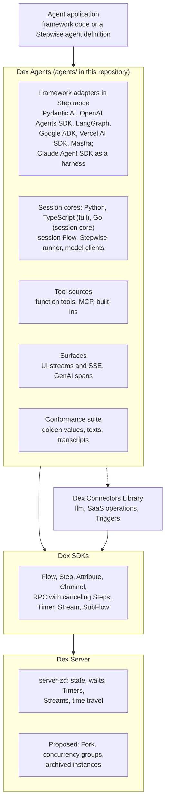
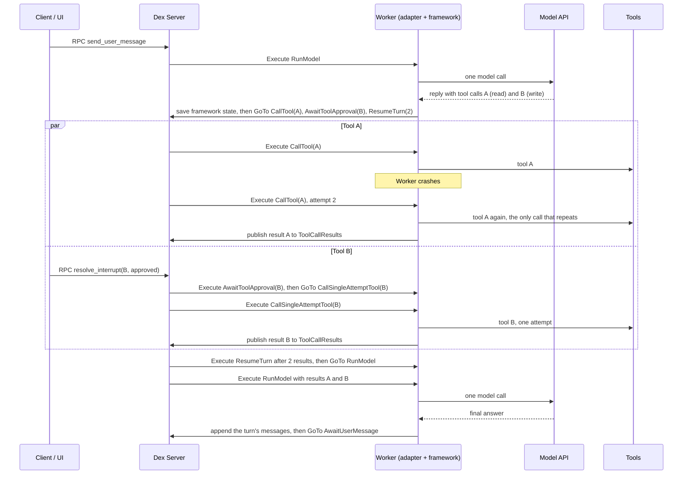
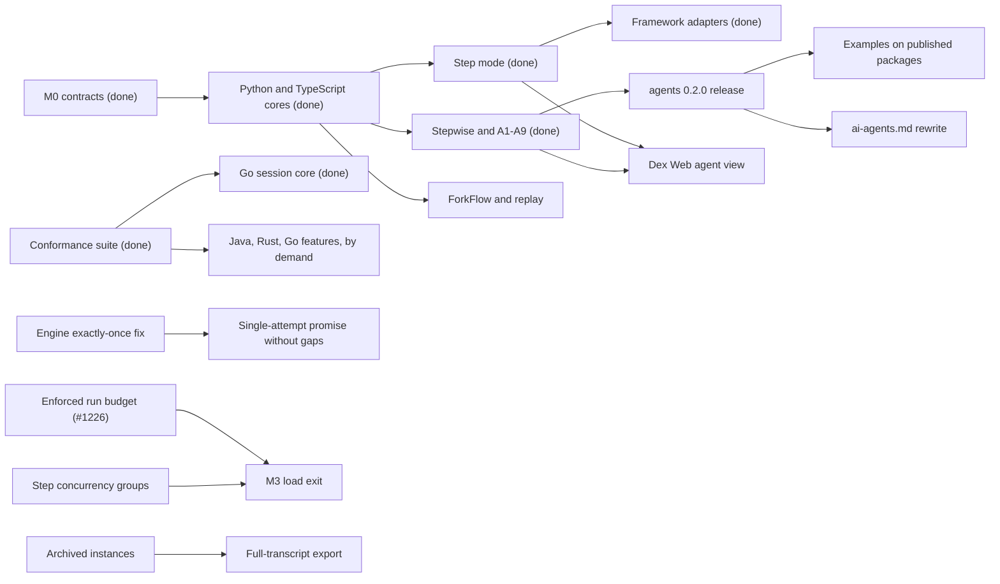

# Long-running Agents on Dex

Status: M1 and M2 built and merged (2026-11-03); the `agents/v0.2.0` release
is pending. M3 and M4 are proposed. This document is in re-review (#1132).

Companion evidence: [long-running-agents-landscape.md](long-running-agents-landscape.md).
Plans that implement this design, each with "As built" notes:

- [plan/agent-framework-adapters.md](plan/agent-framework-adapters.md): the
  session Flow contract, Step mode, and the adapters (M1). It is the current
  contract for every core.
- [plan/agents-m2-stepwise.md](plan/agents-m2-stepwise.md): Stepwise mode,
  contract additions A1 to A9, and the surfaces (M2).
- [plan/agents-go-java-rust.md](plan/agents-go-java-rust.md): the Go core,
  the Java and Rust deferral, and the conformance suite.

Where this document and a plan differ, the plan's "As built" notes describe
the code on main.

## Decision

Dex supports long-running agents through three additions. None of them is a
new engine primitive.

1. **Dex Agents**, a library that packages the agent loop the AI Agent
   examples used to build by hand: a session Flow, model and tool Steps,
   approvals, questions, durable waits, steering, cancellation, plans,
   compaction, usage, session settings, and a standard event Stream.
   - Python and TypeScript have the full contract: Step mode (#1145, #1146),
     Stepwise mode and A1 to A4 (#1183, #1184), steering (#1191), plans
     (#1192, #1196), tool tasks (#1193), compaction (#1194), chunked messages
     with retention (#1221), session settings (#1222), and `cancel_turn`
     aborts (#1223).
   - Go has the session core only: approvals, single-attempt tools, A1,
     Stepwise, and in-process OpenAI and Anthropic clients (#1208, on #1200).
   - Java and Rust are deferred until users ask
     ([evidence](plan/agents-go-java-rust.md#decision-java-and-rust-are-deferred)).
2. **Framework adapters in Step mode.** The framework makes one model call
   per Dex Step and hands its tool calls to Dex, so every model call, tool
   call, and approval is an ordinary Step. Pydantic AI, OpenAI Agents SDK
   (Python and TypeScript), LangChain and LangGraph, Google ADK, Vercel AI
   SDK, and Mastra run this way. Claude Agent SDK (Python and TypeScript),
   whose loop runs in a CLI subprocess, runs as a whole-turn harness. All
   nine adapters are merged (#1137 to #1144, #1149) and were published in
   agents 0.1.0 (#1157).
3. **Agent surfaces and operations.**
   - Built: tool sources with an MCP client (#1179, #1202), UI stream
     adapters (#1181, #1187, #1218), OpenTelemetry GenAI spans (#1180), a
     cross-language conformance suite (#1207, #1217), and a deployment
     guide (#1177, #1190, #1228).
   - Proposed for M3 and M4: tool calling in the `llm` connector, a Dex MCP
     server, AG-UI, a Dex Web agent view, budgets, Step concurrency groups,
     archived AttributeMap instances, ForkFlow, sub-agents, sandboxes, and
     identity.

Step mode is built on Steps, Attributes, Channels, Timers, and **WaitFor** as
they exist today. Stop uses RPC canceling Steps, which the SDKs already had.
The proposed server features in item 3 are operational features that any Dex
application can use.

The Dex programming model does not change. Nothing here adds Flow replay,
determinism rules, or history-size management to application code.

In short:

> Builders keep the agent framework they chose. Dex makes each agent session
> a Flow that survives crashes, deploys, and waits of months.

### What the build changed

The first revision of this design proposed some things that the review and
the build changed. The sections below are updated. In summary:

| Proposed | Built or decided | Where |
| --- | --- | --- |
| A Step Journal (C1) to record calls inside one Step | Removed. Step mode on existing primitives | Owner review of #1132; #1145, #1146 |
| Go Dex Agents on the `llm` connector, in M3 | Go calls models in-process, and stops at the session core | #1208; [Go scope](plan/agents-go-java-rust.md#decision-go-stops-at-the-session-core) |
| Java and Rust follow demand | Deferred, with evidence; a conformance suite makes a new language a port | [Deferral](plan/agents-go-java-rust.md#decision-java-and-rust-are-deferred); #1207 |
| `AgentMessages`, one instance per message, archived in M3 | A sequentially chunked AttributeMap with retention, in 0.2.0 | #1221 |
| Model choice in the agent definition only | Per-session settings, applied at the next turn | #1222 |
| `cancel_turn` stops at the next safe boundary | `cancel_turn` aborts model calls and waits, and abandons remote tasks; steering never aborts | #1191, #1223 |
| One trace per activation, root closes when the session parks | The root span ends with the Step that starts the activation | #1180 |
| Hooks such as `before_model_call` | Deferred until a concrete need | M2 plan, Scope |
| A non-idempotent tool never runs twice | Holds except two engine gaps, documented; the engine fix is deferred | #1190, #1228; #1232, #1233 |

## Context

### How builders build agents now

Agent builders pick a framework for the loop and, increasingly, a durable
execution engine underneath it. The engines compete on framework coverage.
Temporal announced seven integrations as GA on 2026-10-30, covering OpenAI
Agents SDK, Google ADK, Strands, LangGraph, LangSmith, Vercel AI SDK, and the
Gemini SDK, with Claude Agent SDK and MCP packages in pre-release. Restate
ships six integrations, DBOS five, and Pydantic AI exposes one durability
interface that eight engines implement. Vercel, Cloudflare, Trigger.dev, and
Microsoft each ship a durable agent harness on their own runtime. Hosted agent
APIs from AWS, Anthropic, and OpenAI cap a session at hours and hand longer
waits back to the caller.

When this design was first written, Dex had no released framework
integration. Agents 0.1.0, with the two cores and nine adapters, was
published to PyPI and npm on 2026-11-01. The landscape document has the
evidence for the market, with dates and sources.

### What Dex already had

| Need | Dex primitive |
| --- | --- |
| Model calls that survive a lost Worker | Step retries with heartbeat timeouts; `llm` connector `generateText` with outcome branches, `Retry-After`, usage in the Receipt |
| Waits of days or months | **WaitFor** on Timers, Channels, and SubFlows; no process holds the wait |
| Approvals, answers, steering | Channel and ChannelMap; transactional RPCs with Attribute locks |
| Stop | RPC canceling Steps: an RPC ends active Steps of chosen types at its commit, including a running attempt |
| Non-idempotent writes | Connector Mutations with an **uncertain** branch and Call ID idempotency keys |
| Conversation state | AttributeMap instances stored as separate blobs; values up to 16 MiB with blob offload |
| Live output | Streams with resume tokens and a buffered text writer |
| Sub-agents and fan-out | SubFlows and the parallel SubFlow patterns |
| Code changes while sessions wait | No replay: a waiting Flow runs the code of the Worker that takes its next Step |
| Debugging | Dex Web Step graph and Display RPCs; time travel to a Step execution |
| Search across sessions | Attribute indexes, **SearchFlows**, Attribute Store sync |

### What building an agent cost before Dex Agents

The Python AI Agent example was 3,917 lines of Flow, model adapter, MCP
registry, and HTTP route code, plus its UI. The Go example is 1,604 lines and
lists no streaming, no compaction, no steering, and no parallel tool calls as
limits. Both implemented the same pieces: a tool-calling model client, the
agent loop's Steps, a tool registry with read and write policies, message
storage, token counting and compaction, outcome-unknown handling for tools
that are not connectors, activity Streams, a snapshot RPC, and a chat UI.
Neither recorded token usage. A team that already wrote its agent in a
framework had no path at all.

Rebuilt on the library, the Python example is 432 lines of Python (#1199),
and the new TypeScript example is 605 lines (#1198). Both keep every feature
of the old Python example and add Stop and per-session model choice.

### Where the Dex model fits agents better

Replay-based engines put each model call's input into workflow history. On
2026-09-21 a Temporal user's agent hit the 50 MB history limit at tool call 53
of 100, with model inputs at 99.8% of the history; the recommended fix,
external payload storage, is in preview. Dex records state, not a replay log.
A model call Step reads messages from Attributes and writes new messages, and
the history window prunes old events instead of failing the run.

Replay also makes code changes hard. Temporal patches workflows or pins them
with Worker Versioning, Restate and Vercel pin a run to the deployment it
started on, and DBOS recovers only workflows whose version hash matches.
Temporal's streaming OpenAI Agents integration had an open replay failure on
2026-10-27 whose fix itself needs a patch gate, and a Pydantic AI release
changed the order of durable operations under in-flight runs. A waiting Dex
session simply runs the next Step on the current code.

Streaming has the same split that Dex already has. Anthropic's hosted agents
treat the buffered message as the record and send deltas best effort, never
persisted or replayed. Dex Streams are best effort and Attributes are the
record. Temporal routes stream batches through workflow history, DBOS writes
every token to Postgres, and Restate does not stream tokens yet.

## The missing pieces

Status values: **Built** (merged, with PRs), **Changed** (built in a
different shape than first proposed), **Deferred** (with the reason), and
**Open** (not started).

| # | Missing piece | Before this work | Proposal | Status |
| --- | --- | --- | --- | --- |
| G1 | Framework integrations | None released | C3 adapters | **Built** in M1: nine adapters (#1137 to #1144, #1149), published in 0.1.0 (#1157). More frameworks by demand in M4 |
| G2 | Durable calls inside a framework loop | A framework loop had no Step boundary inside it | C3 Step mode | **Built** with no new primitive: each model call and tool call is its own Step (#1145, #1146) |
| G3 | A reusable agent loop | Two hand-built examples | C2 Dex Agents | **Built** for Python and TypeScript (#1183, #1184 and the A5 to A9 PRs); Go at session-core scope (#1208); examples on the library (#1199, #1198). Ships in 0.2.0 |
| G4 | Tool calling in model calls | `generateText` sends text only | C4 `llm` connector tools | **Open** (M3). **Changed**: no longer on the Go core's path, which calls models in-process |
| G5 | A tool side-effect contract | Connector **uncertain** branch only | C4 effect classes and tool Steps | **Built** (#1134, #1136, #1145, #1146). Two engine gaps remain; the fix is **deferred** to an engine change (#1232, #1233) |
| G6 | UI streaming protocols and resume | Resumable best-effort Streams; production default backend `disabled`; no protocol adapters | C6 | **Built**: AI SDK UI message stream and SSE (#1181, #1187, #1218); the guide covers the Stream backend (#1177). AG-UI is **open** (M3) |
| G7 | MCP | Client in one example only | C4 MCP client and Dex MCP server | Client **built** as a tool source (#1179, #1202, #1193, #1216). Dex MCP server **open** (M3) |
| G8 | Connectors outside Go | Go SDK only | C4 connector host, then cross-language Step routing | **Open** (M3, M4) |
| G9 | Long-horizon state | 64 MiB run budget including superseded values; trimming deletes transcript; closed runs kept 7 days | C7 archive, provider-exact transcript | **Changed**: compaction (#1194) plus chunked messages and retention (#1221) bound live state. Provider-exact transcript **built**. Archived instances **open** (M3). The run budget itself is not enforced as documented (#1226, **open**) |
| G10 | Tracing and an agent view | No OpenTelemetry anywhere; Dex Web generic Display | C9 | GenAI spans **built** in Python and TypeScript (#1180). Step spans in the SDKs and the Dex Web agent view are **open** (M3) |
| G11 | Usage, budgets, model concurrency | None | C9, C10 | Token usage ledger **built** (`AgentUsage`, #1188). Cost, budgets, and concurrency groups **open** (M3) |
| G12 | Fork and eval replay | Time travel in place | C11 | **Open** (M3) |
| G13 | Multi-agent and A2A | SubFlow primitive | C8 | **Open** (M3, M4) |
| G14 | Sandboxes and hosted sessions | None | C12 | **Open** (M4) |
| G15 | Identity and policy | Connection credentials per app | C13 | **Open** (M4). Session settings hold references only, never secrets (#1222) |
| G16 | Serverless Workers | Pull Workers only (PR #1023) | Open question | **Open** |

## Goals

- A team with an agent in Pydantic AI, OpenAI Agents SDK, LangChain or
  LangGraph, Google ADK, the Vercel AI SDK, Mastra, or Claude Agent SDK makes
  it durable on Dex by wrapping it, in under 50 lines of change, and keeps its
  framework code. **Met in M1**: each adapter README shows the change.
- A team without a framework writes a production agent with Dex Agents in a
  few hundred lines instead of a few thousand. **Met in M2**: the Python
  example is 432 lines (#1199).
- Any session survives a Worker kill at any point, a deploy while it waits,
  and a wait of months. A non-idempotent tool never runs twice silently.
  **Met, with two documented engine gaps** (#1232, #1233).
- A crash repeats at most the one model call or the one tool call that was
  running. A whole-turn harness repeats at most its current turn segment.
  **Met** in the core and adapter kill tests.
- A browser that reconnects resumes the live output without an extra store.
  **Met** (#1181).
- Operators see sessions, tool calls, approvals, usage, and cost, in Dex Web
  and in the tracing backends they already use. **Partly met**: tracing
  backends get GenAI spans with token usage (#1180). Cost and the Dex Web
  view are M3.
- Every addition is an ordinary, additive Dex feature with Beta compatibility,
  and none is a new engine primitive. **Met so far.**

## Non-goals

- A new general agent framework. Dex Agents is a thin durable harness; the
  adapters are the main path for teams that already chose a framework.
- Hosting models, a vector database, a memory service, an eval product, an
  LLM observability UI, or a sandbox service. Dex integrates them.
- Replay of a Flow, determinism rules, or Continue-As-New in agent code. Turn
  replay is documented as a fallback, and it is not built.
- Bringing back push Workers in this plan.
- Agent cores for Java and Rust, and Go beyond the session core, until users
  ask for them.

## Architecture

### Layers



Dex Agents sits on the public SDKs. It adds no private hooks into the SDKs and
needs no new primitive in them. The dotted edge to the connectors is
proposed: no core calls a connector yet. The server features in the last row
are proposed operational features that any application can use.

Each language has one core package and one package per framework adapter.
All packages share one version line and one changelog, tagged `agents/v*`
(#1157). New features ship as modules and subpath exports of the existing
packages, with extras and optional peer dependencies, so no new registry name
is needed.

A Flow type is served by Workers of one language. Clients work across
languages: a Python or TypeScript Client can drive a Go-served session. The
conformance suite (#1207) fixes every value that crosses a language boundary.

### One Flow per agent session

An agent session is one Flow execution. The Flow ID is the session ID. A
session can be a chat conversation, one delegated task, or a standing agent
that wakes on a Timer or a Trigger. The session Flow owns everything that has
to survive a crash or a deploy. The contract document's
[persistence schema](plan/agent-framework-adapters.md#persistence-schema) has
the exact names and value types; this table groups them:

| State | Dex primitive | Notes |
| --- | --- | --- |
| Messages, tool calls, tool results | **AttributeMap** `AgentMessages` (the newest messages, one instance per message), **AttributeMap** `AgentMessageChunks` (immutable chunks), **Attribute** `AgentMessageIndex` | A Sequentially Chunked AttributeMap. Retention deletes whole chunks behind the compaction summary (#1221) |
| Session status and the active turn | **Attribute** `AgentState`, `TurnReplySequence` | Small, rewritten often |
| Tool calls of the active turn | **AttributeMap** `AgentToolCalls`, keyed by tool call ID | Effect, status, result, task handle. Deleted when the turn ends; the results are already messages |
| Tool results within a turn | Internal **Channel** `ToolCallResults` | Each tool Step publishes one result. `ResumeTurn` consumes them |
| Context summary, plan | **Attribute** `ContextSummary`, `AgentPlan`, `PendingPlanExecution`; **ChannelMap** `PlanExecutions` | Survive compaction |
| Framework state between the Steps of a turn | **Attribute** `FrameworkRunState` | Step mode and whole-turn harness. Opaque to Dex. Cleared when the turn ends |
| Usage | **Attribute** `AgentUsage` | Model calls and tokens |
| Incoming user messages | **Channel** `QueuedUserMessages`, `SteeredUserMessages` | Pending messages stay editable |
| Turn control | Internal **Channel** `TurnControlRequests`, **Attribute** `TurnCancellationRequest`, internal **ChannelMap** `ToolCallCancellations` | Steering and Stop |
| Approvals and questions | **ChannelMap** `InterruptResolutions`, keyed by interrupt ID; **Attribute** `PendingInterrupts` | A decision releases only its own wait |
| Session settings | **Attribute** `SessionSettings`, `TurnSessionSettings` | The next turn's settings, and the running turn's copy |
| Trace context | **Attribute** `AgentTraceContext` | The current activation's root span |
| Live output | **Stream** `AgentEvents` | Best effort. Never the source of truth |

This schema is a public, persisted contract. Changes follow the Beta
compatibility rules, and the conformance suite checks them in every core.

### Execution modes

Agent frameworks own their loop. OpenAI Agents SDK runs it in **Runner.run**,
LangGraph in the compiled graph, Pydantic AI in **Agent.run**, and the Vercel
AI SDK in **generateText** with a stop condition. Asking a team to cut that
loop into Dex Steps means asking them to drop their framework.

Most frameworks do not need that. The state of an agent loop is the message
list plus the framework's own run state. Most frameworks can stop after one
model call, serialize that state, and continue later in a fresh process with
tool results computed elsewhere. Dex Agents builds on that ability. Every mode
shares one session Flow, one state schema, one event Stream, and one approval
contract.

| Mode | Used by | One Step runs | A crash repeats | Status |
| --- | --- | --- | --- | --- |
| Stepwise | Dex Agents without a framework | One model call or one tool call | That one call | Built (#1183, #1184, #1208) |
| Step mode | Framework adapters, by default | One model call or one tool call | That one call | Built (#1145, #1146) |
| Whole-turn harness | Claude Agent SDK | One turn segment of the harness; deferred tools run in their own Steps | The segment's model calls and the tools the harness runs itself | Built (#1144, #1149) |
| Turn replay | A documented fallback | Replays the loop up to the next unrecorded call | Nothing already recorded | Not built; no framework needs it |

**Stepwise mode** runs one Dex Step per model call and one per tool call.
`RunModel` calls the model through a small `ModelClient` interface: LiteLLM in
Python, the Vercel AI SDK **LanguageModel** in TypeScript, and the official
OpenAI and Anthropic SDKs in Go. Each call gets its own retry policy, timeout,
failure route, and history entry. Approvals, questions, and waits are
**WaitFor** conditions. Dex Web shows every call in the Step graph. Stepwise
is the native Dex Agents loop and the right choice for a new agent without a
framework.

**Step mode** is the default for framework adapters. The framework still runs
its own loop, one model call per Step:

- `RunModel` loads the framework's state from Attributes and calls
  `runner.run_model_step`. The adapter lets the framework make exactly one
  model call, with the tool results from the previous Steps, and saves the
  framework's new state.
- When the reply has no tool calls, the turn ends and the session moves to
  `AwaitUserMessage`.
- When the reply has tool calls, `RunModel` moves to one Step per call, all
  in parallel, and to one `ResumeTurn`. `CallTool` runs a READ or
  IDEMPOTENT_WRITE call with retries. `CallSingleAttemptTool` runs a
  NON_IDEMPOTENT_WRITE or UNCLASSIFIED call once.
- A call that needs approval goes to `AwaitToolApproval` first. That Step
  waits on the interrupt's Channel. It then moves to the call's tool Step, or
  it publishes a rejection result without running the tool.
- Each tool Step publishes its result to the internal Channel
  `ToolCallResults`. `ResumeTurn` waits for N messages on that Channel,
  records the results, and moves back to `RunModel`, which hands them to the
  framework.

Each model call and each tool call is an ordinary Step, with its own retry
policy, timeout, failure route, history entry, and node in Dex Web. A crash
reruns only the one model call or the one tool call that was running. Nothing
re-runs the framework loop, so there is no replay and no determinism rule of
any kind. A code change takes effect at the next Step, even in the middle of a
turn. The framework keeps its own features, such as handoffs, guardrails, and
structured output, because it still makes each step itself.

Stepwise mode and Step mode produce the same Step shapes: `RunModel`, the
tool Steps, `AwaitToolApproval`, and `ResumeTurn`. M2 added
`AwaitQuestionAnswer`, `AwaitTimer`, `PollToolTask`, `CancelToolTask`,
`CompactContext`, `ApplyTurnControl`, and `FinishTurnCancellation` to the
same Flow. They differ only in who makes the model call inside `RunModel`.
One approval contract (C5) therefore serves every framework, and a Dex Web
agent view (C9) could too.

**Whole-turn harness** is for a framework whose loop runs in a separate
process that cannot stop after one model call or take tool results from
outside. Claude Agent SDK is that case: its loop runs in the Claude Code CLI,
a **PreToolUse** hook's **defer** ends a turn only in `-p` mode and only for a
lone tool call, and a tool result cannot be injected. One Step runs the CLI
for a turn segment, resumed from the session transcript stored in Attributes.
A custom tool that is not READ is deferred, and the segment ends. The call
then uses the same `AwaitToolApproval` and tool Steps as Step mode. On resume,
the hook allows the re-run call, and the adapter's tool handler returns the
recorded result. Tools built into the CLI run inside the segment and are
at-least-once. A crash reruns the segment, including its model calls.

**Turn replay** is a documented fallback, and it is not built. It is for a
framework that cannot stop after one model call or cannot take external tool
results. A `RunTurn` Step runs the framework loop from the start of the turn,
with the model provider and the tool wrappers replaced. A replaced call whose
key (`model#<n>`, `tool:<toolCallId>`) and request fingerprint match a result
recorded in the turn's Attributes returns that result. The first unrecorded
calls park the loop. `RunTurn` then stops the loop and moves to one Step per
pending call, and `ResumeTurn` records their results and moves back to
`RunTurn`. The Step shapes match Step mode.

Turn replay has two costs that Step mode avoids. Within one turn, the loop
must issue the same calls in the same order when it gets the same results.
Every side effect must also go through a replaced call. A mismatch reruns the
mismatched call and the calls after it, and it never fails the Flow. No
framework in the current adapter set needs turn replay. It is built only for a
concrete framework that needs it, shown with a reproduction.



## Component designs

Component numbers start at C2 so that references from the first review stay
valid. C1, the Step Journal, was removed after that review. Nothing in this
design, in the plans, or on main depends on it.

| # | Component | Status |
| --- | --- | --- |
| C2 | Dex Agents library | **Built** for Python and TypeScript; Go at session-core scope; Java and Rust **deferred** |
| C3 | Framework adapters | **Built**: nine adapters. Per-adapter framework-upgrade tests **open** |
| C4 | Tools, connectors, and MCP | Effect classes, tool sources, MCP client, and tool tasks **built**. `llm` tools, connector host, async model calls, and Dex MCP server **open** |
| C5 | Human-in-the-loop contract | Approvals, questions, plan review, steering, and Stop **built**. Budget stops and outside approvals **open** |
| C6 | Streaming and UI protocols | AI SDK UI message stream and SSE **built**. AG-UI **open** |
| C7 | Long-horizon state | **Changed**: compaction, chunked messages, and retention built. Archive and memory **open** |
| C8 | Multi-agent | **Open** |
| C9 | Observability and usage | GenAI spans and token usage **built**. SDK Step spans, cost, and the Dex Web view **open** |
| C10 | Budgets and model concurrency | **Open** |
| C11 | Fork, evals, and testing | Scripted model clients **built**. Fork, replay, and export **open** |
| C12 | Sandboxes and hosted sessions | **Open** |
| C13 | Identity, secrets, and policy | Secrets by reference **built** for settings and the guide. The rest **open** |
| C14 | Deployment and versioning | Pull Workers, code changes, pinned frameworks, and the upgrade rules **built**. Agent definition versions **open** |

### C2. Dex Agents library

Status: **built** for Python and TypeScript in M1 and M2; Go at session-core
scope; Java and Rust deferred.

Dex Agents packages the loop that both AI Agent examples wrote by hand. An
application declares an agent definition and registers the generic session
Flow. This is the Python API as built (M2 plan, Part 1):

```python
support_agent = AgentDefinition(
    name="support",
    instructions=SUPPORT_INSTRUCTIONS,
    model=LiteLLMModelClient("openai/gpt-5-mini"),
    tools=[lookup_order, refund_order],
    tool_sources=[McpToolSource(servers)],
    built_in_tools={BuiltInTool.ASK_USER, BuiltInTool.DURABLE_WAIT, BuiltInTool.WRITE_TODOS},
    plan_mode_enabled=True,
    compaction=CompactionPolicy(context_window_tokens=400_000),
)

flow = stepwise_agent_session_flow(support_agent, flow_type="SupportAgent")
```

The session Flow has the same Steps in Stepwise and Step mode:
`StartAgentSession`, `AwaitUserMessage`, `RunModel`, `CallTool`,
`CallSingleAttemptTool`, `AwaitToolApproval`, `ResumeTurn`, the failure-route
Steps that record a failed or unknown outcome, and, from M2,
`AwaitQuestionAnswer`, `AwaitTimer`, `PollToolTask`, `CancelToolTask`,
`CompactContext`, `ApplyTurnControl`, and `FinishTurnCancellation`. Parallel
tool calls run as parallel Step executions.

RPCs, all snake_case and starting with a verb:

| RPC | Status |
| --- | --- |
| `send_user_message`, `resolve_interrupt`, `get_agent_snapshot`, `list_agent_messages` | Built in M1 |
| `answer_question` | Built (A3, #1183, #1184) |
| `steer_user_message`, `delete_queued_message`, `cancel_turn` | Built (A5, #1191, #1223) |
| `execute_plan` | Built (A6, #1192) |
| `update_session_settings` | Built (A9, #1222) |
| `extend_budget` | Open, with budgets (C10) |
| `describe_agent` | Dropped: `get_agent_snapshot` and the session settings cover it |

Built-in tools `ask_user`, `durable_wait`, and `write_todos` are built (A2 to
A4, A6). `spawn_subagent` waits for C8.

Hooks such as `before_model_call` and `before_tool_call` are deferred until a
concrete need. The runner interface, tool policies, and session settings
covered every case in M2.

**Model layer.** Each language follows its ecosystem instead of a new
provider abstraction. The client makes one request per call and no retries of
its own, so every retry is a visible `RunModel` attempt. Dex owns the
conversation: each call rebuilds its input from Attributes, uses no
provider-side conversation storage, and replays provider items such as
encrypted reasoning and thinking signatures unchanged.

- Python: `LiteLLMModelClient` in `dex_agents.litellm`.
- TypeScript: the AI SDK client in `@superdurable/dex-agents/ai-sdk`, so
  every AI SDK provider works.
- Go: in-process `openai-go` and `anthropic-sdk-go` clients (#1208). This
  **changed** from the `llm` connector, which has no tool calling.
- Scripted model clients for tests and demos in every core.

**Session settings** (A9, #1222). A session can start with an optional
`session_settings` JSON object, and `update_session_settings` replaces it. A
change applies when the next turn starts, so every model call of one turn
sees one value. A resolver on the agent definition maps the settings to a
model client the Worker built. Settings hold references, such as a model or
credential name, never secrets.

**Languages.** Python and TypeScript come first, because that is where agent
builders are. Go goes ahead for Dex-specific reasons: the hand-built Go
example, `dexcli visualize`, Go-only connectors, and the application builder.
Go stops at the session core: approvals and deadlines, single-attempt tools,
the turn-failure note, A1, and Stepwise with the two model clients (#1208).
Questions, durable waits, steering, plans, compaction, tool tasks, MCP,
spans, UI streams, and adapters are not planned for Go; they follow only if
users ask. A guard fails a Go-served session cleanly if it ever holds state
Go does not implement. Java and Rust are deferred: their agent frameworks are
smaller and no durable engine ships agent integrations for them. The
[deferral](plan/agents-go-java-rust.md#decision-java-and-rust-are-deferred)
records the evidence and when to revisit.

### C3. Framework adapters

Status: **built**. All nine adapters merged on 2026-10-31 and were published
in agents 0.1.0 on 2026-11-01. Every adapter reports model call metadata for
spans and usage (#1188).

Builders use LangChain and LangGraph, OpenAI Agents SDK, Vercel AI SDK, and
Claude Agent SDK most, followed by Google ADK and Pydantic AI (adoption data
in the landscape document). Every one of them has a state-store interface,
and all of them handle a human approval the same way: serialize the run,
stop, and resume with a decision. None of them provides the durable wait
itself. That is the gap a Dex session Flow fills.

#### Mode per framework

An adapter answers three questions about its framework. How does it stop
after one model call? How is its state serialized and restored? How do tool
results computed outside it go back in? A framework that answers all three
runs in Step mode. A framework whose loop runs in a subprocess that cannot
stop is a whole-turn harness. A framework that can do neither would need turn
replay; none in the current set does.

| Framework | Stop after one model call | Serialize and restore state | Tool results back in | Mode | Adapter |
| --- | --- | --- | --- | --- | --- |
| Pydantic AI | An outermost capability defers every tool call with **CallDeferred** or **ApprovalRequired**, so the run ends with **DeferredToolRequests** right after the model call | The turn's messages through **ModelMessagesTypeAdapter**, plus the deferred call IDs | **DeferredToolResults** with `message_history`: **ToolReturn**, **ToolDenied**, or the outcome text | Step mode | #1141 |
| Vercel AI SDK 7 | Tools reach the loop without **execute**, so **streamText** returns the model's tool calls | The plain-JSON **ModelMessage** list | A `tool` message with `tool-result` parts, then the next model call | Step mode | #1142 |
| LangChain `create_agent`, LangGraph | **DurableToolCallMiddleware** or **durable_tool_node** calls **interrupt()** for each tool call, so the graph stops after the model node | The latest checkpoint of each namespace and its pending writes, serialized with LangGraph's serializer | **Command(resume=...)** with the result for each interrupt | Step mode. In a custom graph, nodes between the model and the tools run inside `RunModel` | #1138 |
| OpenAI Agents SDK (Python, TypeScript) | A **needs_approval** gate on every function tool, so the SDK stops with `result.interruptions` after a reply that calls tools | **RunState.to_json** and **from_json** (TypeScript **fromStringWithContext**): the current agent after a handoff, turn counters, guardrail results, and pending calls | **approve** each interruption, and the gated tool's wrapper returns the Dex result instead of running the tool; **reject** with the rejection message | Step mode through the gate. Tools the SDK cannot gate, such as MCP tools, run inline and are at-least-once | #1137, #1140 |
| Google ADK (Python) | A plugin calls **request_confirmation** for each tool call, and the resumable App pauses the invocation | The turn's ADK events, rebuilt into a turn-local session service | Answer each `adk_request_confirmation` call; ADK re-executes the call, and the plugin returns the Dex result | Step mode | #1139 |
| Mastra (TypeScript) | Tools go to Mastra as client tools without **execute**, so its loop stops at the tool calls of a model response | Mastra messages (**MastraDBMessage** JSON), with no Memory thread | AI SDK tool-result messages, then **agent.stream()** again | Step mode. Tools Mastra adds outside the agent's tools run inline and are at-least-once | #1143 |
| Claude Agent SDK (Python, TypeScript) | No clean stop: **PreToolUse** **defer** ends the turn only in `-p` mode and only for a lone tool call | The transcript through a **SessionStore** on Attributes, resumed by session ID | No injection. On resume the hook allows the re-run call, and the adapter's handler returns the Dex result. Built-in CLI tools run inside the CLI | Whole-turn harness | #1144, #1149 |
| Microsoft Agent Framework, Strands, CrewAI, LlamaIndex Workflows | Checked per framework | **CheckpointStorage**, **SessionRepository**, **FlowPersistence**, context snapshots | Checked per framework | Decided by the same three questions; M4, by demand | none |

Interface names are those in each framework's current documentation and in
the adapter packages; the landscape document links the documentation. Each
adapter documents the tools its framework runs by itself, such as MCP tools
under the OpenAI Agents SDK, provider-hosted tools, and tools that Mastra adds
outside the agent's tools. Those tools run inside `RunModel` and are
at-least-once, whatever their effect class.

Every adapter also feeds the framework's own approval settings, such as
**needs_approval**, **require_confirmation**, and **requireApproval**, into
the Dex tool policy, so `AwaitToolApproval` is the only approval wait. It
writes `AgentEvents`, records `AgentUsage`, and pairs every tool call with a
result, including an outcome-unknown result after a crash. A transcript with
an orphaned tool call can break a framework: Google ADK permanently blocked
compaction after a pod restart left one behind (adk-python #7236).

The M2 contract additions are optional for adapters. An adapter that does not
implement a capability, such as compaction or plan mode, keeps working
without it. Adapters opting in to unfinished-turn messages and built-in tools
is still open (M2 plan, PR 17); it was not required for the M2 exit.

#### Example: OpenAI Agents SDK

The application keeps its agent. The adapter supplies the session Flow:

```python
triage_agent = Agent(name="Triage", instructions=TRIAGE, tools=[lookup_order, refund_order])

registry.add_flow(
    openai_agents_session_flow(
        triage_agent,
        flow_type="TriageAgent",
        tool_policies={
            "lookup_order": ToolPolicy(ToolEffect.READ),
            "refund_order": ToolPolicy(ToolEffect.NON_IDEMPOTENT_WRITE),
        },
    )
)
```

The adapter copies the agent and gives every function tool a
**needs_approval** gate. The gate stops the SDK for every call, and the Dex
tool policy decides whether a person must approve. Inside `RunModel`, the
adapter's `run_model_step` runs the stock runner until the SDK stops. This is
a sketch; the adapter plan has the core's type names:

```python
async def run_model_step(self, step):
    if step.framework_run_state is None:
        run_input = step.turn_input  # the turn's first model call
    else:
        run_input = await RunState.from_json(self.starting_agent, step.framework_run_state)
        for interruption in run_input.get_interruptions():
            tool_result = step.tool_results[interruption.call_id]
            if tool_result.is_rejected:
                run_input.reject(interruption, rejection_message=tool_result.text)
            else:
                run_input.approve(interruption)  # the gated tool returns tool_result.text
    result = await Runner.run(self.starting_agent, run_input, run_config=self.run_config)
    if result.interruptions:
        return step.call_tools(result.to_state().to_json(), result.interruptions)
    return step.complete_turn(result.to_input_list())
```

`lookup_order` runs in `CallTool`, and `refund_order` runs once in
`CallSingleAttemptTool` after approval. A Worker killed during the refund
records an unknown outcome and reports it to the model instead of refunding
twice. A Worker killed during `RunModel` repeats only that model call. The
OpenAI Agents SDK documentation states that approval does not guarantee
exactly-once execution; this closes that gap for every function tool, up to
the engine limits in C4. Tools of **Agent.mcp_servers** are listed at run
time and cannot be gated, so they run inside `RunModel` and are at-least-once.

#### Example: Vercel AI SDK

```ts
export const supportAgentFlow = createVercelAiAgentSessionFlow(
  {
    model: openai("gpt-5-mini"),
    instructions: SUPPORT_INSTRUCTIONS,
    tools: { get_order: getOrder, refund_order: refundOrder },
    toolPolicies: {
      get_order: { effect: "read" },
      refund_order: { effect: "idempotent_write", requiresApproval: true },
    },
  },
  "SupportAgent",
);
```

The adapter hands the AI SDK every tool without **execute**, so each model
call in `RunModel` returns the model's tool calls. Each call runs its original
**execute** in its own tool Step. The next `RunModel` appends the results as
`tool-result` parts and calls the model again. Text and reasoning parts go to
`AgentEvents`. A browser using **useChat** reads them through the UI stream
adapter (C6).

#### Example: Claude Agent SDK

The SDK runs its loop in a CLI subprocess, so the adapter is a whole-turn
harness. A **SessionStore** mirrors the transcript into Attributes, and each
turn segment starts a new CLI process that resumes from it. A **PreToolUse**
hook applies the tool policy. For a custom tool that is not READ, it returns
**defer**, which ends the segment. The call runs in its own tool Step, after
`AwaitToolApproval` when the policy asks. On resume, the hook allows the
re-run call, and the adapter's wrapped tool handler returns the recorded
result without running the tool. Tools built into the CLI, such as **Bash**,
**Write**, and **Edit**, defer only for approval, run inside the resumed
segment, and are at-least-once. If the Worker dies, the next attempt resumes
the session from the store and reruns the segment. The working directory must
survive the attempt, so file-editing agents pair this adapter with a sandbox
(C12). The resume path is tested against a scripted CLI and against the
bundled Claude Code CLI with a local scripted Messages API, in both
languages.

#### Conformance

Two suites protect the contract.

**Cross-language conformance (built, #1207, #1217).** `agents/conformance/`
holds golden wire values for every Attribute, Channel, Step input, and RPC
value; a names manifest; every model-visible text; and nine scripted-turn
transcripts. It is generated from the Python core, and every core decodes,
re-encodes, and compares each value in its own CI. It replaced the manual
value-by-value checks of the M2 reviews, and it is what makes a new language
core a port instead of a design.

**Per-adapter conformance (partly built).** Each adapter's integration suite
runs the same matrix against a real Dex Server with a scripted model: Step
shapes, parallel tool calls, approval across a Worker restart, rejection,
SIGKILL during a single-attempt tool and during `RunModel`, and the
turn-failure note. Still open: restoring a `FrameworkRunState` written by the
previously pinned framework version. Each adapter release pins the framework
versions it passed against. Temporal's own integrations moved packages and
import roots within a year, and a Pydantic AI release changed the order of
durable operations under in-flight runs (pydantic-ai #11767), so pinning and
this test are not optional.

### C4. Tools, connectors, and MCP

#### Tool effect classes

Status: **built** in M1.

Every tool, whatever its source, declares one effect class. The class decides
the tool Step, retries, idempotency keys, crash behavior, and the default
approval policy:

| Effect | Step | Retry | Crash mid-call | Default policy |
| --- | --- | --- | --- | --- |
| READ | `CallTool` | Up to 3 attempts; then `failed` | Runs again | Run |
| IDEMPOTENT_WRITE | `CallTool` | Up to 3 attempts, same idempotency key; then `outcome_unknown` | Runs again with the same key | Run unless the tool policy asks |
| NON_IDEMPOTENT_WRITE | `CallSingleAttemptTool` | One attempt | Outcome unknown, reported to the model | Ask for approval |
| UNCLASSIFIED | `CallSingleAttemptTool` | One attempt | Outcome unknown, reported to the model | Ask for approval |

A call that needs approval passes through `AwaitToolApproval` before its tool
Step. Tools that a framework runs by itself cannot be Steps; they run inside
`RunModel` and are at-least-once whatever their class (C3). The idempotency
key for a tool call is `<flowId>/<turnId>/<toolCallId>`, the same on every
attempt.

**Known limits (deferred to an engine fix).** Two engine gaps break the
single-attempt promise. Both are documented in the contract's
[known limits](plan/agent-framework-adapters.md#known-limits), the deployment
guide (#1190), and the product docs on Step redelivery (#1228):

1. **A single-attempt tool can run twice** (#1232). Heartbeats are not
   acknowledged and checkpoints are lossy, so a Worker that dies after the
   tool starts and before its first heartbeat reaches the server gets its
   attempt redelivered. Partition rebuild after a server restart or failover
   also redispatches running attempts.
2. **A call that never ran records `outcome_unknown`** (#1233). A dispatch
   that found no Worker fails with the same error type as a Worker that
   disconnected mid-call, so the failure route cannot tell them apart.

The owner decided that the fix belongs in the engine, because every Dex
application with a non-idempotent single-attempt Step has the same gap. It
needs a committed "attempt started" record that recovery routes to failure
instead of redispatch, and a recovery error that says whether the attempt
was ever assigned. An agents-only marker RPC was rejected. The owner tracks
the engine change.

#### Tool sources

Status: **built** (#1202).

A Stepwise agent definition takes tool sources next to its function tools. A
`ToolSource` lists tools, builds deferred calls with their own policy and
effect, runs them in the tool Steps, and can poll and cancel remote tasks.
Each source has a stable name, and the stored call records which source built
it, so any Worker reaches that source without a fresh listing. A source that
fails to list offers no tools for that model call instead of failing the
turn. The MCP client is the first source.

#### Model calls with tools

Status: **open** (M3).

The `llm` connector's `generateText` accepts text-only user and assistant
messages and never sends tools. The connector gains:

- tool definitions, tool choice, tool calls in the result, and tool-result
  messages, for every provider in its catalog;
- reasoning items kept for stateless replay and reasoning summaries on a
  separate Stream;
- prompt-cache controls where the provider has them;
- image and file inputs, behind the existing request-feature checks.

The existing Branch table, the Receipt with usage, and the retry rules stay as
they are. This **changed** in priority: the Go core now calls models
in-process, so connector tool calling is connector work that may add a Go
model client later, not a blocker for Go.

#### Connectors from every language

Status: **open** (M3, M4).

Connectors run only in the Go SDK today. Most agent builders write Python or
TypeScript. Two steps close the gap:

1. **Connector host SubFlows** (no engine change): a Go connector host Worker
   registers one small Flow per enabled connector operation. A Python or
   TypeScript agent calls an operation as a SubFlow and receives the
   operation's branch and Receipt as the SubFlow result. Credentials and
   configuration stay in the host. This fits the tool source interface.
2. **Cross-language Step routing** (engine change, later): a Flow declares a
   connector Step that a different Worker serves. This work turns per-Worker
   Step registration into a supported contract with registration checks, so a
   connector Step runs in the Flow's own history without a SubFlow.

Connector operations map to effect classes directly: a Query is READ, a
Mutation with required idempotency is IDEMPOTENT_WRITE, and a Mutation with an
**uncertain** branch is NON_IDEMPOTENT_WRITE whose uncertain branch becomes
the outcome-unknown result.

#### Asynchronous model calls

Status: **open** (M3).

Background responses and batch APIs suit durable agents. A Step submits the
request, stores the response or batch ID in an Attribute, and moves to a Step
that waits on a Channel fed by the provider's webhook, with a Timer that polls
as a fallback. The webhook ingress is the existing webhook Trigger. No Step
holds an HTTP connection for a long generation, and batch pricing becomes
available to agents that can wait. The tool task path (A8) already has the
Timer-polling half of this shape.

#### MCP as a tool source

Status: **built** (#1179, #1202, #1193, #1216, #1223).

`McpToolSource` in `dex_agents.mcp` and `@superdurable/dex-agents/mcp` lists
the tools of MCP servers registered in Worker configuration, never from a
browser, Flow input, or a model, over stdio or Streamable HTTP. Each MCP tool
call is a tool Step with its effect class from annotations: `readOnlyHint`
and `idempotentHint` count only for a trusted server, and the rest are
UNCLASSIFIED unless a `ToolPolicy` says otherwise.

- A broken response stream is re-issued as a new request only when the effect
  allows a retry; an UNCLASSIFIED call records `outcome_unknown`.
- A call answered with a task handle becomes a tool task (A8): the task ID is
  stored on the tool call record, and `PollToolTask` polls `tasks/get` on a
  Timer instead of holding a connection open. Tasks that only their own
  connection can reach are polled inside the tool Step.
- A task's input request becomes a session question (C5) in Python.
  TypeScript task input still fails the call, because its SDK needs the
  answer on a live connection.
- Stop abandons a running task: a best-effort `tasks/cancel`, recorded as
  `outcome_unknown` (#1223).
- Resource and prompt tools are optional read tools (#1202).
- Printed configuration redacts environment and header values (#1216).

Framework adapters keep running the MCP tools their framework runs by itself,
at least once, as documented.

#### Dex as an MCP server

Status: **open** (M3).

A Dex MCP server exposes registered agent session Flows and selected Flow
RPCs as MCP tools, so an MCP client can start a Dex agent, send it messages,
and read its result. A long-running session maps to a task whose ID is the
Flow ID: `tools/call` starts the Flow and returns the task, `tasks/get` reads
the snapshot, `tasks/update` publishes to the session's Channel, and
`tasks/cancel` calls `cancel_turn`. The tasks extension requires that a task
be durably created before the server replies, which a started Flow is. A
pending interrupt appears as the task's `input_required` state.

### C5. Human-in-the-loop contract

Status: approvals, questions, plan review, steering, and Stop are **built**.
Budget stops and approvals from outside the UI are **open**.

Every wait for a person is a Step with a **WaitFor**, so no process holds it
and it can last for months. A tool approval is the `AwaitToolApproval` Step in
Stepwise mode, Step mode, and the whole-turn harness alike, so one approval
contract serves every framework.

| Kind | Raised by | Resolved by RPC | Wait | Status |
| --- | --- | --- | --- | --- |
| Tool approval | Tool policy, including the framework's own approval settings | `resolve_interrupt(interrupt_id, approved, rejection_message?)` | `AwaitToolApproval` on ChannelMap `InterruptResolutions[interrupt_id]` | Built (M1) |
| Question | Built-in `ask_user`, or a tool that returns **ToolInputRequested** | `answer_question(interrupt_id, answer)`; `resolve_interrupt(approved=false)` declines | `AwaitQuestionAnswer` on the same ChannelMap | Built (A3) |
| Plan review | Plan mode | `execute_plan(revision)` | `AwaitUserMessage` on ChannelMap `PlanExecutions` | Built (A6) |
| Budget stop | Budget policy (C10) | `extend_budget(interrupt_id, amount)` | same ChannelMap | Open (M3) |

Each approval and question has an optional deadline. A passed deadline
records the call as `rejected` with a documented text, so the model sees it.
Escalations and reminders on a deadline are still open. Resolution RPCs lock
`PendingInterrupts` and delete the interrupt when they publish, so a second
click or a second approver is refused.

Approvals from outside the UI are open: a Slack approval is a connector
Trigger that calls the same RPC; an MCP client answers an `input_required`
task (C4); an A2A client answers by sending the task its input (C8).

#### Steering and Stop

Status: **built** (#1191, #1223). These are two different user actions with
two rules.

**Steering** (`steer_user_message`) changes course and never aborts work in
flight. A steer is applied at safe Step boundaries. Calls that have not
started are cancelled, reads included, and recorded as `rejected`. A started
tool call, a running model call, and a running remote task finish first. The
steered message then starts a new turn through `ApplyTurnControl`.

**Stop** (`cancel_turn`) ends the turn now. The RPC writes
`TurnCancellationRequest` and returns canceling Steps for every Step type
that has no outside effect or only waits: `RunModel`, `CompactContext`,
`RecordTurnFailure`, `AwaitToolApproval`, `AwaitQuestionAnswer`,
`AwaitTimer`, and `PollToolTask`. server-zd ends those Steps at the RPC's
commit, including a running attempt, so a model call is aborted. A next Step,
`FinishTurnCancellation`, then decides from committed state, so exactly one
path ends the turn. A started synchronous tool Step still runs to the end. A
started remote task is abandoned: `CancelToolTask` sends a best-effort cancel
and records `outcome_unknown`, and a cancel that keeps failing still ends the
turn.

Locks close the race between the RPC's snapshot and a Step that commits
first. A test lands exactly that interleaving in both cores. Both RPCs work
only on turns that a 0.2.0 Worker started (`accepts_turn_control`), so a
rolling upgrade cannot steer an old Worker's turn.

### C6. Streaming and UI protocols

Status: AI SDK UI message stream and SSE **built** (#1181, #1187, #1218).
AG-UI is **open** (M3).

Dex Streams give an ordered, resumable, best-effort channel with a resume
token. Dex Agents adds a canonical event type and protocol adapters.

`AgentEvent` carries a turn ID, a Step execution ID, an attempt number, a type,
and a small JSON payload. Event types cover turn lifecycle, text and
reasoning deltas, tool calls, interrupts, plans, compaction, steering,
cancellation, and tool tasks; the contract document lists them. The attempt
number lets a UI drop the partial text of an interrupted attempt.

Adapters read the Stream through the Client with the resume token:

- **Vercel AI SDK UI message stream** in `@superdurable/dex-agents/ui-stream`
  for React apps built with **useChat**. A new attempt maps to `reset-step`,
  so the client discards the interrupted attempt's parts. Approvals map to
  `tool-approval-request` and `tool-approval-response`, which call
  `resolve_interrupt`. A reload rebuilds `UIMessage` lists from the snapshot.
- **Plain server-sent events** in both cores (`dex_agents.ui_stream` in
  Python), with the resume token as the event ID and `Last-Event-ID` resume.
- **AG-UI** is open: snapshots on connect from Attributes, then live events
  from the token.

Neither UI protocol defines offset-based replay. A Dex Stream resume token
gives both of them resume from an offset with no extra store. Event payloads
stay small, and the adapters read tool arguments and outputs from the
snapshot RPC, because Attributes are the record. After a Stream gap, the
client reloads the snapshot and continues from the current token. Stop calls
`cancel_turn`; a closed tab is not a stop.

The deployment guide (#1177) covers the two operational defaults that matter
for agents. The production Stream backend defaults to `disabled`, which drops
writes, so an agent deployment sets `memory`. `AgentEvents` capacity is
shared by every session of a Flow type, and the guide has a sizing formula
and the 100 KiB per-message cap.

### C7. Long-horizon state

Status: **changed**. Compaction (#1194) and chunked messages with retention
(#1221) are built and bound live Flow state. Archived instances and agent
memory are **open**.

A session that runs for months grows. Dex has no history replay, and the
history window prunes old events, so history length costs nothing at runtime.
State is bounded by `limits.maxFlowStateBytes` (64 MiB by default, counting
superseded values kept for time travel) and one value is at most 16 MiB. A
closed run is kept for 7 days by default.

- **Provider-exact transcript** (built). Each stored message keeps the
  provider's item as returned, including encrypted reasoning and thinking
  signatures, and replays it unchanged. A model switch replays other
  providers' items as text and drops their reasoning. A Dex-side retry never
  rewrites an earlier message.
- **Compaction** (built, A7). At a share of the model's context window,
  `CompactContext` summarizes older messages into `ContextSummary`, as its
  own Step with one model call. The plan is never summarized. A crash reruns
  only the summary call.
- **Chunked messages and retention** (built, #1221). This **changed** from
  "archive in M3": the owner asked to bound Flow state before 0.2.0, because
  the layout is persisted and changing it later would mean reading two
  layouts for every Beta session. `AgentMessages` keeps a window of the
  newest 64 messages, one instance each, so a store never rewrites the
  window. Older messages move into immutable `AgentMessageChunks` of at most
  32 messages and 1 MiB. Retention deletes the oldest chunk once it lies
  behind the summary and at least 1,000 newer messages are stored. A
  measured session stays between 167 KB and 191 KB of live state from turn
  200 to turn 800 while storing 2.3 MB of messages over its life. Deleted
  messages leave `list_agent_messages`, and the guide tells applications
  that need the whole transcript to copy it out first.
- **Upgrade rule** (built, owner decision). Stop every 0.1.0 Worker of a Flow
  type before any 0.2.0 Worker starts. A 0.1.0 session migrates over several
  commits, a few chunks at a time.
- **Run budget not enforced as documented** (open, #1226). server-zd rejects
  a command over `limits.maxFlowStateBytes` only when that command itself
  grows active storage. A session can therefore run past the budget before a
  check fires. The agents tests measure live state directly instead of
  relying on the budget. The fix is a server-zd change.
- **Archiving** (open, M3). Retention deletes, and audits and evals may need
  the full transcript. A server feature, archived AttributeMap instances,
  would move an instance to blob storage, keep it readable through an
  explicit load and the history page RPC, and stop counting it toward the run
  budget. Retention would then archive a chunk instead of deleting it.
- **Memory across sessions** (open). An `AgentMemory` interface with a
  session-local and a cross-session implementation through the Attribute
  Store and **SearchFlows**. External memory services plug in as tools.

### C8. Multi-agent

Status: **open** (M3, M4).

- **Sub-agent as a tool**: `spawn_subagent` and `subagent(definition)` start
  a child session Flow as a SubFlow. The parent waits in a **WaitFor** on the
  SubFlow condition, so a sub-agent can run for days without holding the
  parent's Worker. Several calls in one model reply start several SubFlows and
  wait for all of them. The SubFlow ID derives from the parent and the tool
  call ID, so a retried dispatch does not start a second child.
- **Handoff**: a handoff changes the active agent definition inside the same
  session Flow and records the change as a message. Framework adapters keep
  their framework's own handoffs inside `RunModel`.
- **Interrupts across levels**: a child's interrupt is visible on the parent's
  snapshot RPC and resolved by the same RPC on the child, so one UI serves the
  whole tree.
- **Peer agents**: long-lived agents talk through RPCs and Channels on each
  other's Flows. Fan-out beyond `maxConcurrentStepsPerFlow` (1,000) uses the
  partitioning SubFlow pattern.
- **A2A**: an A2A server adapter exposes a session Flow as an A2A agent, with
  the Flow ID as the task ID. An A2A client tool lets a Dex agent call remote
  agents, with a polling Step for long tasks.

### C9. Observability and usage

- **GenAI spans** (built, #1180). Behind an optional dependency, the Python
  and TypeScript cores emit `invoke_agent` per activation, `chat` per
  `RunModel` and `CompactContext` attempt with token usage, and
  `execute_tool` per tool Step attempt. Every span carries the Flow ID as
  `gen_ai.conversation.id` and `session.id`, plus the Step type, Step
  execution ID, attempt, and turn ID. Content is by reference unless the
  application opts in. The convention version is pinned with a compatibility
  switch, because the GenAI conventions are marked Development.
- **Root span shape** (changed). The first revision closed the activation's
  root span when the session parked. A span must end in the process that
  started it, and the Steps of one activation run on different Workers. The
  root therefore ends with the Step that starts the activation, its context
  is stored in `AgentTraceContext`, and later Steps parent their spans to it.
  Each root links to the previous activation's root.
- **Step spans in the SDKs** (open). One span per Step attempt, with OTLP
  export, for every Flow, is an SDK change with its own design. When it
  lands, agent spans become children of Step attempt spans.
- **Usage ledger** (partly built). Every model call adds model calls and
  input, output, cached, and reasoning tokens to `AgentUsage` (#1188 for the
  adapters). Estimated cost per model, an indexed Attribute for
  **SearchFlows**, and the `llm` connector Receipt as a source are open.
- **Dex Web agent view** (open, M3): a Conversation view next to the Step
  graph (see UI/UX). Because Stepwise and Step mode produce the same Steps,
  the view would serve every framework.

### C10. Governance: budgets and model concurrency

Status: **open** (M3). Until it ships, `RunModel` retries with
`Retry-After` handle model rate limits, as the deployment guide says.

- **Budgets**: an agent definition can set token or cost limits per turn and
  per session. Before each model call the library reserves the call's
  estimated cost against `AgentUsage` and settles it after the call. An
  exhausted budget raises a budget interrupt (C5) instead of failing, so a
  person can extend it or stop the session. When a gateway such as LiteLLM
  also enforces budgets, one of the two owns enforcement and the other only
  reports.
- **Prompt cache and long waits**: provider caches live for minutes to a day,
  and durable waits last longer. A resumed session pays a full cache write.
  `AgentUsage` records it as a cold resume, and an optional pre-warm call
  before a Timer fires trades a small cost for latency where it matters.
- **Model concurrency**: provider rate limits apply to an API key across every
  Flow. A new server feature, Step concurrency groups, lets a Step type
  declare a group key and a limit, for example `model:<provider>/<model>`
  with 50 concurrent executions across all Flows. Matching dispatches beyond
  the limit only when a slot frees up, and the wait does not consume a retry.
  With session settings, the group key would come from the turn's model.

### C11. Fork, evals, and testing

- **Scripted models** (built). `ScriptedModelClient` in Python and
  TypeScript, exported from the Stepwise modules as a supported client for
  running an agent without a model key (#1202), and a scripted client in Go.
  Every core and adapter test runs on them.
- **Fork** (open, M3): a new server API, **ForkFlow**, starts a new Flow from a
  history point of an existing run, with an optional configuration override,
  such as a new model or prompt version. A fork replays nothing: it copies
  the committed state at that point and starts the chosen Step. Session
  settings give the override a natural place.
- **Counterfactual replay** (open, M3): a forked session can run in replay
  mode. A tool call whose name and arguments match a call recorded in the
  source session returns the recorded result. Any other READ tool runs live.
  Any other write is denied with a result that says the run is a replay.
- **Trajectory export** (open, M3): export a session's messages, tool calls,
  interrupts, and usage as JSONL for eval tools. With retention, export runs
  before chunks are deleted, or after archiving ships.

### C12. Sandboxes and hosted agent sessions

Status: **open** (M4).

Code-executing agents need a sandbox, and every sandbox provider caps
continuous runtime, at about 24 hours for E2B, Modal, and Vercel, and expires
snapshots after 7 to 30 days. A months-long session therefore cannot own one
sandbox for its whole life. Dex Agents treats a sandbox as a resource that the
session owns:

- A sandbox connector interface (get or create by name, exec, read and write
  files, pause, resume, snapshot, delete) with implementations in the
  connectors library.
- The handle lives in an Attribute: provider, name, snapshot ID, and lease
  expiry. Creation is idempotent because the name derives from the Flow ID.
- The session pauses its sandbox when it parks on a long wait and resumes it
  on wake. A Timer renews a snapshot before it expires.
- Outputs that matter are Step results or blobs, never only files on the
  sandbox disk, because any sandbox can be lost.
- A finalizer in the session's completion and timeout handlers deletes the
  sandbox and its snapshots, and its cost goes into `AgentUsage`.

Hosted agent runtimes have the same shape. A Dex session Flow can drive a
hosted session as a tool or as the whole turn: start or resume it
idempotently, store its session ID in an Attribute, and wait for its webhook
on a Channel. Dex then owns the parts that outlive the vendor session:
schedules, approvals that wait for days, budgets across sessions, and the
audit history.

### C13. Identity, secrets, and policy

- **Secrets by reference** (built where it applies). Session settings hold
  only references that the Worker resolves (#1222). MCP server credentials
  live in Worker configuration, and printed configuration redacts them
  (#1216). The deployment guide keeps provider keys out of Flow input,
  messages, tool I/O, and Attributes.
- **Acting for a user** (open, M4): a session records the end user and tenant
  it acts for. Tools fetch that user's token at call time from a connection
  or an external token vault. When a refresh fails or a provider asks for
  more scope, the session raises a re-authorization interrupt (C5).
- **Policy hook** (open, M4): before each tool call, Dex Agents calls a policy
  function with the tool, arguments, effect class, principal, and session
  state. It returns run, ask, or deny, and the decision is stored with the
  tool call. Static `ToolPolicy` per tool name is what exists today.
- **Audit**: the Flow history and the stored messages record what the agent
  saw and did, within retention. Trajectory export (C11) doubles as the audit
  export.

### C14. Deployment and versioning

- **Workers** (built): Dex Workers pull work over outbound connections (PR
  #1023). Agent Workers are long-lived processes. The deployment guide covers
  Worker sizing, Step timeouts, and separate Worker pools. Serverless hosting
  is an open question.
- **One language per Flow type** (decided): a Flow type is served by Workers
  of one language, so a session never meets a Worker that lacks its features.
- **Code changes** (built): a waiting session runs the code of the Worker that
  takes its next Step. In Step mode that holds inside a turn too: a deploy
  between two Steps takes effect at the next model call or tool call. Stepwise
  instructions are evaluated in every `RunModel`. A whole-turn harness segment
  that crashes reruns on the new code from the stored transcript.
- **Schema compatibility** (built): agents 0.1.0 is the compatibility
  baseline. New fields have defaults or are optional, and the conformance
  suite decodes 0.1.0 values. Two rollout rules apply to 0.2.0: stop every
  0.1.0 Worker before starting a 0.2.0 Worker (chunked messages), and use
  steering, Stop, and session settings only after every Worker runs 0.2.0.
- **Framework upgrades** (partly built): `FrameworkRunState` holds
  framework-serialized state between the Steps of a turn, so a new framework
  version must read the state of turns in flight. Adapters pin framework
  versions. The test that restores the previous pin's state is open (C3).
- **Agent versions** (open): an agent definition version that a session can
  pin at start, with Workers that register several versions. Session
  settings can carry a version reference today, and a resolver can choose by
  it.

## Roadmap

Each milestone ends with something a builder can use. Sizes use the issue
labels: S is a day, M a few days, L a week or more.

### M0. Contracts (done)

| Item | Size | Status |
| --- | --- | --- |
| This design, reviewed | M | In re-review (#1132) |
| Session state schema, Step and RPC names, `AgentEvent` schema, interrupt contract, and tool effect classes | M | Done: [agent-framework-adapters.md](plan/agent-framework-adapters.md) |
| Step mode contract: `RunModel`, `CallTool`, `CallSingleAttemptTool`, `AwaitToolApproval`, `ResumeTurn`, the `ToolCallResults` Channel, and `runner.run_model_step` | S | Done (#1145, #1146) |

### M1. Bring your framework (done)

| Item | Area | Size | Status |
| --- | --- | --- | --- |
| Python core: session Flow, persistence schema, RPCs, events, usage, effect classes | agents | L | Merged (#1134), Step mode (#1146) |
| TypeScript core, the same contract | agents | L | Merged (#1136), Step mode (#1145) |
| OpenAI Agents SDK adapter (Python) | adapters | L | Merged (#1137) |
| OpenAI Agents SDK adapter (TypeScript) | adapters | M | Merged (#1140) |
| LangChain `create_agent` and LangGraph adapter (Python) | adapters | L | Merged (#1138) |
| Google ADK adapter (Python) | adapters | L | Merged (#1139) |
| Pydantic AI adapter (Python) | adapters | M | Merged (#1141) |
| Vercel AI SDK adapter (TypeScript) | adapters | L | Merged (#1142) |
| Mastra adapter (TypeScript) | adapters | M | Merged (#1143) |
| Claude Agent SDK adapter (Python), whole-turn harness | adapters | L | Merged (#1144) |
| Claude Agent SDK adapter (TypeScript), whole-turn harness | adapters | L | Merged (#1149) |
| Packaging and release workflows | agents | M | Merged (#1157); agents 0.1.0 published to PyPI and npm on 2026-11-01 |

Exit, met: every adapter passes its integration matrix against a real Dex
Server, a Worker kill during `RunModel` repeats only that model call, and
each adapter README shows the change against a stock framework agent. The
GitHub release `agents/v0.1.0` is still a draft; the packages themselves are
published.

### M2. A durable agent loop without a framework (built; 0.2.0 release pending)

The plan is [agents-m2-stepwise.md](plan/agents-m2-stepwise.md). Its scope
grew after the owner's review of the M2 decisions on #1178: chunked messages,
session settings, and Stop aborts moved into 0.2.0, and Go and a conformance
suite were added.

| Item | Area | Size | Status |
| --- | --- | --- | --- |
| M2 plan | docs/design | S | Merged (#1178) |
| Stepwise mode, model clients, A1 to A4 (incremental messages, built-in routing, questions, durable waits), Python and TypeScript | agents | L | Merged (#1183, #1184) |
| A5 steering and cancellation | agents | L | Merged (#1191) |
| A6 plans and plan mode | agents | M | Merged (#1192, #1196) |
| A7 compaction | agents | L | Merged (#1194) |
| A8 tool tasks | agents | M | Merged (#1193) |
| A9 session settings (new) | agents | M | Merged (#1222) |
| Chunked messages and retention (moved from M3) | agents | L | Merged (#1221) |
| `cancel_turn` aborts model calls and abandons tasks (new) | agents | M | Merged (#1223) |
| AI SDK UI message stream and SSE adapters | agents | M | Merged (#1181, #1187, #1218) |
| MCP client tool source, tool sources | agents | M | Merged (#1179, #1202, #1216) |
| GenAI spans | agents | L | Merged (#1180); adapters report model call metadata (#1188) |
| Cross-language conformance suite (new) | agents | M | Merged (#1207, #1217) |
| Go session core with Stepwise and model clients (moved from M3, reduced) | agents, sdk-go | L | Merged (#1208, #1200) |
| Python AI Agent example on the library | examples, docs | M | Merged (#1199, #1219): 432 lines |
| TypeScript AI Agent example on the library (new) | examples, docs | M | Merged (#1198) |
| Agent deployment guide, English and zh-Hans | docs | S | Merged (#1177, #1190) |
| RPC canceling Steps and Step redelivery docs | docs | S | Merged (#1228) |
| Skills: Stop guidance, chunked storage, session settings, design review checklist | skills | S | Merged (#1227), skills 0.66.0 |
| Parity fixes between the cores | agents | S | Merged (#1189, #1195) |
| Release `agents/v0.2.0` | agents | S | **Pending**: the owner publishes |
| Move the examples from local paths to the published 0.2.0 packages | examples | S | Pending, after the release |
| `dex-sdk` skill: rewrite `core/ai-agents.md` around Dex Agents | skills | S | Pending, after the release |
| Adapters opt in to unfinished-turn messages and built-ins | adapters | M each | Open; not required for the exit |
| Go: A2 to A8, MCP, spans, SSE helpers | agents | L | Dropped from M2; only on user demand |

Exit: the crash matrix passes for Stepwise mode in both languages, and the
rebuilt Python example is under 500 lines of application code. The example
is met (432 lines). The kill cases of the crash matrix run in both core
suites; the mid-turn deploy case is still to add (see Tests). M2 closes when
`agents/v0.2.0` is published.

### M3. Operate agents at scale (proposed)

| Item | Area | Size | Status |
| --- | --- | --- | --- |
| Engine fix for single-attempt exactly-once: a committed "attempt started" record, and a recovery error that says whether the attempt was assigned (#1232, #1233) | server-zd, SDKs | L | Deferred; the owner tracks it |
| Enforce `limits.maxFlowStateBytes` on every command (#1226) | server-zd | M | Open |
| Dex Web agent view | web | L | Open |
| Tool calling, reasoning items, and cache controls in the `llm` connector | connectors | L | Open |
| Budgets, cost estimates, and budget interrupts | agents | M | Open |
| Step concurrency groups | server-zd, SDKs | L | Open |
| Archived AttributeMap instances, and retention that archives | server-zd, SDKs, agents | L | Open |
| ForkFlow and counterfactual replay | server-zd, SDKs, agents | L | Open |
| Sub-agents as tools and handoffs | agents | M | Open |
| Dex MCP server | agents | M | Open |
| AG-UI adapter | agents | M | Open |
| Asynchronous model calls through webhook Triggers | agents, connectors | M | Open |
| Connector host SubFlows for Python and TypeScript | connectors | M | Open |
| Trajectory export | agents | S | Open |
| Step attempt spans with OTLP export in the SDKs, own design | SDKs | L | Open |
| Adapter test that restores the previous framework pin's state | adapters | M | Open |

"Dex Agents for Go on the `llm` connector" is removed from M3: Go shipped in
M2 with in-process model clients.

Exit: a load test of 10,000 concurrent sessions, each with a Timer wait and an
approval, stays inside one model's concurrency group and inside an enforced
run budget, and the agent view shows each session's usage.

### M4. Breadth (proposed)

| Item | Area | Size |
| --- | --- | --- |
| Google ADK adapter for TypeScript and Go | adapters | M |
| Microsoft Agent Framework, Strands, CrewAI, and LlamaIndex Workflows adapters, by demand | adapters | M each |
| Go contract features (A2 to A8, MCP, spans), by demand | agents | L |
| Java and Rust cores, by demand, as ports through the conformance suite | agents | L each |
| A2A server and client | agents | M |
| Sandbox connectors and the sandbox lifecycle | connectors, agents | L |
| Acting for a user, policy hook, re-authorization interrupt | agents, connectors | L |
| Agent definition versions and per-session pinning | agents | M |
| Cross-language Step routing for connector Steps | server-zd, SDKs | L |

### Dependencies



Step mode and Stepwise mode share the cores' Steps, so the agent view and the
GenAI spans serve both. No item waits on a new engine primitive. The engine
items in M3 fix existing behavior for every Dex application.

## Tests

### server-zd integration (`server-zd/integ/`)

Step mode, Stepwise, and Stop use existing primitives, so M1 and M2 added no
server-zd test. The open server items each get one:

- **Exactly-once fix**: a Worker killed after a single-attempt Step starts and
  before its first heartbeat lands is routed to the failure route, not
  redelivered; the same holds after partition rebuild; and a Step that was
  never assigned reports that in its recovery error. Needed because #1232 and
  #1233 are the remaining gaps in the tool contract.
- **Run budget**: a command that does not grow active storage, applied to a
  Flow over `limits.maxFlowStateBytes`, is still rejected (#1226).
- **Concurrency groups**: a limit holds across Flows, waiting does not consume
  a retry, and a freed slot dispatches the oldest waiter.
- **ForkFlow**: the fork starts from the chosen point with the override, and
  the source run is unchanged.
- **Archived instances**: archived bytes leave `limits.maxFlowStateBytes`, an
  explicit load reads them, and history pages still return them.

### Dex Agents core suites (Python, TypeScript, Go)

These run against a real Dex Server with a scripted model, so no model key is
needed. Built in M1 and M2, among others:

- **Kill during a model call**: a Worker killed with SIGKILL during `RunModel`
  reruns only that model call, and finished tool calls do not run again.
- **Parallel tool calls**: three tool Steps run in parallel, and `ResumeTurn`
  moves on only after all three results, in any order.
- **Single-attempt writes**: a Worker killed during `CallSingleAttemptTool`
  records an unknown outcome, the tool does not run again, and the model sees
  the unknown outcome.
- **Approval and questions**: waits survive a Worker restart; an approved
  call runs once; a rejected call never runs; a passed deadline reaches the
  model.
- **Steering and Stop**: the A5 race tests, including a `RunModel` that
  commits between `cancel_turn`'s read and its commit, a cancel that aborts a
  model call within seconds, and a Worker killed in
  `FinishTurnCancellation`.
- **Bounded state**: a long session with retention keeps its live state
  bounded, measured directly rather than through the run budget (#1226).
- **Upgrades**: sessions started by the released 0.1.0 Workers continue on
  0.2.0 Workers.
- **Conformance**: every core decodes, re-encodes, and compares the golden
  values and replays the scripted transcripts.

### Dex Agents and adapter end-to-end

One crash matrix runs against Stepwise mode and against every adapter. It
kills the Worker with SIGKILL during a streamed model call, a read tool, a
non-idempotent tool, an approval wait, a Timer wait, a question wait, and
compaction. Each case checks that a crash repeats at most the one call that
was running (a whole segment for a harness), that no write repeats, that an
interrupted write reaches the model as an unknown outcome, that the snapshot
RPC is consistent, and that the UI stream resumes. The kill cases for model
calls, single-attempt writes, approvals, questions, Timers, task polls, and
`FinishTurnCancellation` are built. Still to add:
- a deploy of a changed system prompt between two `RunModel` Steps of one
  turn, and during an approval wait (M2 plan S-2);

- each adapter restores a `FrameworkRunState` written by its previously
  pinned framework version;
- a running sub-agent, once C8 exists;
- a budget interrupt and its extension, once C10 exists;
- a cold resume after a Timer of more than a day, simulated with
  **SkipTimer**, with cache usage recorded.

### UI and tracing

- Built: a **useChat** client resumes mid-stream from its token, a retried
  attempt produces `reset-step`, an approval round trip goes through
  `tool-approval-response`, and SSE resumes from `Last-Event-ID`.
- Built: an in-memory span exporter receives one trace per activation, every
  span has the conversation ID, content is absent by default, and a retry
  produces two attempt spans.
- Open: an AG-UI client receives snapshots on connect.
- Open: Dex Web agent view end-to-end tests cover the conversation, tool
  calls, interrupt resolution, and usage.

Unit tests are limited to protocol event translation, where integration tests
cannot reach every edge case.

## Documentation

Done:

- Product docs, English and zh-Hans: **Deploy agents** under Production
  (#1177), with tool call limits (#1190); the Agent Frameworks page; the AI
  Agent use case page on the rebuilt Python and TypeScript examples (#1199,
  #1198); RPC canceling Steps and Step redelivery limits in every SDK
  language (#1228).
- Package READMEs and `agents/CHANGELOG.md`, with a 0.2.0 (Unreleased) entry
  that lists every M2 change and the upgrade rules.
- Skills 0.66.0 (#1227): Stop versus steering, chunked message storage,
  per-session settings, and a design review checklist.
- Design docs: the contract, the M2 plan, and the Go, Java, and Rust
  addendum under `docs/design/plan/`, each with "As built" notes.

Still to do:

- After `agents/v0.2.0`, rewrite `skills/dex-sdk/references/core/ai-agents.md`
  around Dex Agents, Step mode, Stepwise, and the adapters, and add the agent
  route to `dex-app-builder`, following the skill release rules.
- After `agents/v0.2.0`, switch the examples to the published packages and
  run `generate:flow-definitions`.
- A plan document per M3 component under `docs/design/plan/` before its
  implementation starts, and product docs for each feature as it ships.

## UI/UX

The examples' own pages are built: both AI Agent examples have a chat page
with approvals, question answers with choice buttons, queued messages with
Steer and Delete, Stop, plan review with Execute, older-message paging, and a
per-session model choice.

Dex Web gains an agent view for any Flow that uses the Dex Agents schema
(open, M3):

- **Conversation**: messages, tool calls with arguments, results, effect
  class, approval decision, and unknown outcomes, in order, with the Step
  execution that produced each one. Messages behind retention show as
  deleted.
- **Turns as Steps**: each model call, tool call, and approval of a turn is a
  node in the Step graph. Stepwise and Step mode use the same Steps, so a turn
  reads the same for every framework. A retried Step shows its attempts, and
  the conversation keeps only the last attempt's text.
- **Interrupts**: pending approvals and questions with their deadlines,
  resolved through the session's RPCs under the existing Action permissions.
- **Controls**: Steer and Stop through the session's RPCs.
- **Usage**: tokens per model for the session, and later cost, with a
  sortable usage column in the Flow list through **SearchFlows**.
- **Trace link**: a link to the configured tracing backend for each
  activation.

The view reads the standard RPCs and Attributes. It adds no agent logic to Dex
Web.

## Open questions

Resolved:

1. **Where Dex Agents lives.** Resolved: `agents/` in this repository, one
   package per language core and per adapter, one version line and one
   changelog, released as `agents/v*` (#1157). Go needs path-prefixed tags
   (`agents/go/core/v*`) before its first release; that tag scheme still
   needs the owner
   ([decision 7](plan/agents-go-java-rust.md#needs-the-owner)).
2. **Steering and calls that have not started.** Resolved by the owner: a
   steer cancels them, reads included (#1191).
3. **`cancel_turn` and a running model call.** Resolved by the owner: Stop
   aborts it through RPC canceling Steps, with `FinishTurnCancellation`
   deciding from committed state (#1223).
4. **Long remote tasks.** Resolved by the owner: steering waits for the task;
   Stop abandons it with a best-effort cancel and records `outcome_unknown`
   (#1223).
5. **Long sessions before archiving.** Resolved by the owner: chunked
   messages and retention ship in 0.2.0 (#1221), with the upgrade rule to
   stop 0.1.0 Workers first.
6. **Per-session settings.** Resolved by the owner: `session_settings` and
   `update_session_settings` ship in 0.2.0 (#1222).
7. **Root span duration.** Resolved: the root ends with the Step that starts
   the activation (#1180).
8. **Languages.** Resolved: Python and TypeScript in full, Go at
   session-core scope, Java and Rust deferred with evidence
   ([addendum](plan/agents-go-java-rust.md)).
9. **Exactly-once for single-attempt tools.** Resolved as deferred: the fix
   is an engine change for every Dex application, not an agents-only marker.
   The owner tracks it; the gaps are #1232 and #1233.

Still open:

10. **Framework state across a long turn.** `RunModel` rewrites
    `FrameworkRunState` after every model call, and superseded values count
    toward `limits.maxFlowStateBytes`. A framework whose state holds the
    whole turn input, such as the OpenAI Agents SDK **RunState**, writes one
    copy per model call. Chunked messages do not cover this Attribute. The
    measurement is also blocked by #1226, because the budget is not checked
    on every command. Recommendation: measure live state per adapter, as the
    core tests now do, before choosing a fix.
11. **Serverless Workers.** Pull Workers are the only mode since PR #1023.
    Builders on Vercel, Cloudflare, and Lambda expect push or scale-to-zero,
    and Temporal now previews serverless Workers. This plan leaves it out and
    asks for a separate decision.
12. **Version pinning default.** Following the latest agent definition is the
    Dex default. Pinning protects a session from a prompt or tool schema
    change that silently alters its meaning. Recommendation: follow latest,
    with pinning per session through session settings.
13. **Stream backend default.** Should server-zd enable the memory Stream
    backend by default, given that every agent needs it? Today the
    deployment guide tells operators to set it.
14. **Agent view detection.** Detect the Dex Agents schema, or require an
    explicit Display contract.
15. **Budget ownership with a gateway.** When a gateway such as LiteLLM also
    enforces budgets, which one is authoritative by default.

## Consequences

- Builders can bring an existing agent to Dex without rewriting it, which the
  engines Dex is compared with already allow. Agents 0.1.0 shipped that.
- Every model call, tool call, and approval of a framework agent is an
  ordinary Step, with its own retry policy and a node in Dex Web. Dex added no
  engine primitive, replay, or determinism rule for agents.
- Each model call and each tool call costs a Step round trip. Next to model
  latency this is small.
- Step mode depends on each framework's public ability to stop after one model
  call and take tool results from outside. A framework that loses it moves to
  the whole-turn harness or to turn replay. Adapter tests catch the change
  before an adapter release pins it.
- Tools a framework runs by itself, such as MCP tools under the OpenAI Agents
  SDK and the built-in tools of Claude Agent SDK, stay at-least-once. Each
  adapter documents them.
- Single-attempt tools keep two engine gaps until the engine fix lands. The
  docs state both and how to reconcile `outcome_unknown`.
- Dex takes on adapters for fast-moving frameworks. Pinned framework versions
  per adapter release contain the cost.
- The session state schema is a public, persisted contract, now in the
  chunked layout, and so is each adapter's `FrameworkRunState` format while a
  turn is in flight. The conformance suite checks the schema in every core.
- Upgrading to 0.2.0 needs a stop of every 0.1.0 Worker of a Flow type. Later
  layout changes would need the same care, which is why the layout was
  settled before 0.2.0.
- New contract features land in Python and TypeScript first. Go, Java, and
  Rust users get them only on demand.
- The proposed server features, the exactly-once fix, an enforced run budget,
  concurrency groups, ForkFlow, and archived instances, are useful beyond
  agents and are designed as general Dex features.
