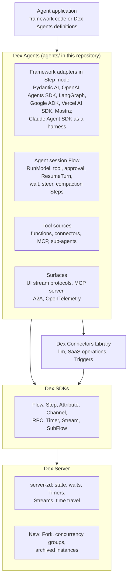
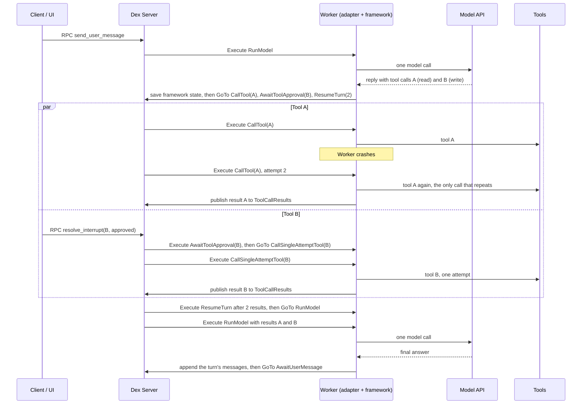
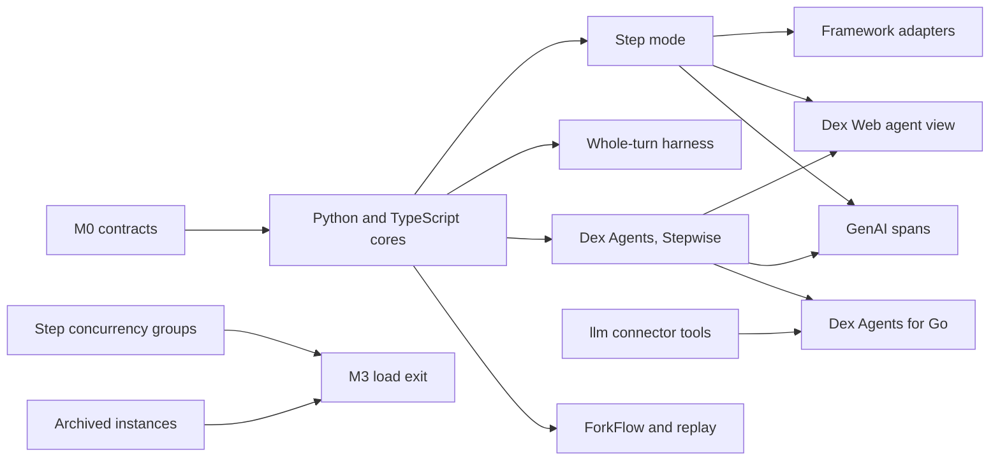

# Long-running Agents on Dex

Status: proposed.

Companion evidence: [long-running-agents-landscape.md](long-running-agents-landscape.md).
Implementation plan for the cores and adapters:
[plan/agent-framework-adapters.md](plan/agent-framework-adapters.md).

## Decision

Dex will support long-running agents through three additions:

1. **Dex Agents**, a library that packages the agent loop the AI Agent
   examples build by hand: a session Flow, model and tool Steps, approvals,
   durable waits, steering, compaction, usage, and a standard event Stream.
   The Python core (#1134) and the TypeScript core (#1136) are on main. Go
   follows.
2. **Framework adapters in Step mode** that run Pydantic AI, OpenAI Agents
   SDK, LangChain and LangGraph, Google ADK, Vercel AI SDK, and Mastra agents
   on Dex by wrapping the agent instead of rewriting it. The framework makes
   one model call per Dex Step and hands its tool calls to Dex, so every model
   call, tool call, and approval is an ordinary Step. Claude Agent SDK, whose
   loop runs in a CLI subprocess, runs as a whole-turn harness. The adapters
   are under way in #1137 to #1144.
3. **Agent surfaces and operations**: tool calling in the `llm` connector,
   MCP in both directions, UI stream protocols over Dex Streams,
   OpenTelemetry GenAI traces, a Dex Web agent view, budgets and model
   concurrency limits, archived conversation state, and Fork for evals.

No new engine primitive is needed. Step mode is built on Steps, Attributes,
Channels, and **WaitFor** as they exist today. The server additions in item 3
are operational features that any Dex application can use.

The Dex programming model does not change. Nothing here adds Flow replay,
determinism rules, or history-size management to application code.

In short:

> Builders keep the agent framework they chose. Dex makes each agent session
> a Flow that survives crashes, deploys, and waits of months.

## Context

### How builders build agents now

Agent builders pick a framework for the loop and, increasingly, a durable
execution engine underneath it. The engines compete on framework coverage.
Temporal announced seven integrations as GA on 2026-10-30, covering OpenAI
Agents SDK, Google ADK, Strands, LangGraph, LangSmith, Vercel AI SDK, and the
Gemini SDK, with Claude Agent SDK and MCP packages in pre-release. Restate
ships six integrations, DBOS five, and Pydantic AI exposes one durability
interface that eight engines implement. Vercel, Cloudflare, Trigger.dev, and
Microsoft each ship a durable agent harness on their own runtime. Hosted agent
APIs from AWS, Anthropic, and OpenAI cap a session at hours and hand longer
waits back to the caller.

Dex has no released framework integration. The landscape document has the
evidence, with dates and sources.

### What Dex already has

| Need | Dex today |
| --- | --- |
| Model calls that survive a lost Worker | Step retries with heartbeat timeouts; `llm` connector `generateText` with outcome branches, `Retry-After`, usage in the Receipt |
| Waits of days or months | **WaitFor** on Timers, Channels, and SubFlows; no process holds the wait |
| Approvals, answers, steering | Channel and ChannelMap; transactional RPCs with Attribute locks |
| Non-idempotent writes | Connector Mutations with an **uncertain** branch and Call ID idempotency keys |
| Conversation state | AttributeMap instances stored as separate blobs; values up to 16 MiB with blob offload |
| Live output | Streams with resume tokens and a buffered text writer |
| Sub-agents and fan-out | SubFlows and the parallel SubFlow patterns |
| Code changes while sessions wait | No replay: a waiting Flow runs the code of the Worker that takes its next Step |
| Debugging | Dex Web Step graph and Display RPCs; time travel to a Step execution |
| Search across sessions | Attribute indexes, **SearchFlows**, Attribute Store sync |

### What building an agent costs today

The Python AI Agent example is 3,917 lines of Flow, model adapter, MCP
registry, and HTTP route code, plus its UI. The Go example is 1,604 lines and
lists no streaming, no compaction, no steering, and no parallel tool calls as
limits. Both implement the same pieces: a tool-calling model client, the
agent loop's Steps, a tool registry with read and write policies, message
storage, token counting and compaction, outcome-unknown handling for tools
that are not connectors, activity Streams, a snapshot RPC, and a chat UI.
Neither records token usage. A team that already wrote its agent in a
framework has no path at all: it would have to rewrite the loop as Steps.

### Where the Dex model fits agents better

Replay-based engines put each model call's input into workflow history. On
2026-09-21 a Temporal user's agent hit the 50 MB history limit at tool call 53
of 100, with model inputs at 99.8% of the history; the recommended fix,
external payload storage, is in preview. Dex records state, not a replay log.
A model call Step reads messages from Attributes and writes one new message,
and the history window prunes old events instead of failing the run.

Replay also makes code changes hard. Temporal patches workflows or pins them
with Worker Versioning, Restate and Vercel pin a run to the deployment it
started on, and DBOS recovers only workflows whose version hash matches.
Temporal's streaming OpenAI Agents integration had an open replay failure on
2026-10-27 whose fix itself needs a patch gate, and a Pydantic AI release
changed the order of durable operations under in-flight runs. A waiting Dex
session simply runs the next Step on the current code.

Streaming has the same split that Dex already has. Anthropic's hosted agents
treat the buffered message as the record and send deltas best effort, never
persisted or replayed. Dex Streams are best effort and Attributes are the
record. Temporal routes stream batches through workflow history, DBOS writes
every token to Postgres, and Restate does not stream tokens yet.

These are reasons to keep the model, not features builders can use yet. The
gaps below are what stands between a builder and these properties.

## The missing pieces

| # | Missing piece | Dex today | What builders get elsewhere | Proposal | Milestone |
| --- | --- | --- | --- | --- | --- |
| G1 | Framework integrations | None released | Temporal 7 GA plus previews; Restate 6; DBOS 5; Pydantic AI durability interface | C3 adapters | M1 (under way), M4 |
| G2 | Durable calls inside a framework loop | Steps; a framework loop has no Step boundary inside it | Activities, `ctx.run`, DBOS steps | Closed by C3 Step mode on existing primitives: each model call and tool call is its own Step | M1 (under way) |
| G3 | A reusable agent loop | Two hand-built examples; session cores in `agents/` (#1134, #1136) | Vercel DurableAgent, Cloudflare harnesses, Trigger.dev chat agents | C2 Dex Agents | M1, M2 |
| G4 | Tool calling in model calls | `generateText` sends text only, no tools | Every framework's model layer | C4 `llm` connector tools | M3 |
| G5 | A tool side-effect contract | Connector **uncertain** branch only | At-least-once everywhere; Cloudflare Pi marks replay-safe tools | C4 effect classes and tool Steps | M1 |
| G6 | UI streaming protocols and resume | Resumable best-effort Streams; production default backend is `disabled`; no protocol adapters | Vercel and Cloudflare resumable streams; Trigger.dev cursors | C6 | M1, M2 |
| G7 | MCP | Client in one example only | Temporal MCP (pre-release), DBOS durable MCP tools | C4 MCP client and Dex MCP server | M2, M3 |
| G8 | Connectors outside Go | Go SDK only | n/a | C4 connector host, then cross-language Step routing | M3, M4 |
| G9 | Long-horizon state | 64 MiB run budget including superseded values; trimming deletes transcript; closed runs kept 7 days | Cloudflare Sessions; DBOS tables; Temporal 50 MB | C7 archive, provider-exact transcript | M3 |
| G10 | Tracing and an agent view | No OpenTelemetry anywhere; Dex Web generic Display | Temporal LangSmith; Restate OTel spans | C9 | M2, M3 |
| G11 | Usage, budgets, model concurrency | None | DBOS queues and rate limiters; hosted session budgets | C9, C10 | M1, M3 |
| G12 | Fork and eval replay | Time travel in place | DBOS fork and rewind; Restate restart from prefix | C11 | M3 |
| G13 | Multi-agent and A2A | SubFlow primitive | Child workflows, Nexus, A2A in hosted platforms | C8 | M3, M4 |
| G14 | Sandboxes and hosted sessions | None | Vendor sandboxes capped at about 24 hours | C12 | M4 |
| G15 | Identity and policy | Connection credentials per app | Token vaults, Cedar policies | C13 | M4 |
| G16 | Serverless Workers | Pull Workers only (PR #1023) | Temporal serverless Workers (preview); Restate and Vercel push | Open question | none |

## Goals

- A team with an agent in Pydantic AI, OpenAI Agents SDK, LangChain or
  LangGraph, Google ADK, the Vercel AI SDK, Mastra, or Claude Agent SDK makes
  it durable on Dex by wrapping it, in under 50 lines of change, and keeps its
  framework code.
- A team without a framework writes a production agent with Dex Agents in a
  few hundred lines instead of a few thousand.
- Any session survives a Worker kill at any point, a deploy while it waits,
  and a wait of months. A non-idempotent tool never runs twice silently.
- A crash repeats at most the one model call or the one tool call that was
  running. A whole-turn harness repeats at most its current turn segment.
- A browser that reconnects resumes the live output without an extra store.
- Operators see sessions, tool calls, approvals, usage, and cost, in Dex Web
  and in the tracing backends they already use.
- Every addition is an ordinary, additive Dex feature with Beta compatibility,
  and none is a new engine primitive.

## Non-goals

- A new general agent framework. Dex Agents is a thin durable harness; the
  adapters are the main path for teams that already chose a framework.
- Hosting models, a vector database, a memory service, an eval product, an
  LLM observability UI, or a sandbox service. Dex integrates them.
- Replay of a Flow, determinism rules, or Continue-As-New in agent code. Turn
  replay is documented as a fallback, and it is not built.
- Bringing back push Workers in this plan.

## Architecture

### Layers



Dex Agents sits on the public SDKs and the released connectors. It adds no
private hooks into the SDKs and needs no new primitive in them. The server
features in the last row are operational features that any application can
use.

### One Flow per agent session

An agent session is one Flow execution. The Flow ID is the session ID. A
session can be a chat conversation, one delegated task, or a standing agent
that wakes on a Timer or a Trigger. The session Flow owns everything that has
to survive a crash or a deploy:

| State | Dex primitive | Notes |
| --- | --- | --- |
| Messages, tool calls, tool results | **AttributeMap** `AgentMessages`, one instance per message | Each message is its own blob. Long sessions archive old instances (see Long-horizon state). |
| Session status, sequence ranges, the active turn | **Attribute** `AgentState` | Small, rewritten often. |
| Tool calls of the active turn | **AttributeMap** `AgentToolCalls`, keyed by tool call ID | Effect, status, and result. Deleted when the turn ends; the results are already messages. |
| Tool results within a turn | Internal **Channel** `ToolCallResults` | Each tool Step publishes one result. `ResumeTurn` consumes them. |
| Context summary, plan | **Attribute** `ContextSummary`, `AgentPlan` | Survive compaction. |
| Framework state between the Steps of a turn | **Attribute** `FrameworkRunState` | Step mode and whole-turn harness. Opaque to Dex. Rewritten after each model call and cleared when the turn ends. |
| Usage and cost | **Attribute** `AgentUsage` | Indexed for search. |
| Incoming user messages | **Channel** `QueuedUserMessages`, `SteeredUserMessages` | Pending messages stay editable. |
| Approvals, answers, plan executions | **ChannelMap** `InterruptResolutions`, keyed by interrupt ID; **Attribute** `PendingInterrupts` | A decision releases only its own wait. |
| Live output | **Stream** `AgentEvents` | Best effort. Never the source of truth. |

The Python AI Agent example already uses this layout. Dex Agents makes it the
standard schema so that the UI adapters, the Dex Web agent view, the MCP and
A2A surfaces, and the eval exporter can read any agent built with the library.
The adapter plan fixes the names and value types that the cores implement.

### Execution modes

Agent frameworks own their loop. OpenAI Agents SDK runs it in **Runner.run**,
LangGraph in the compiled graph, Pydantic AI in **Agent.run**, and the Vercel
AI SDK in **generateText** with a stop condition. Asking a team to cut that
loop into Dex Steps means asking them to drop their framework.

Most frameworks do not need that. The state of an agent loop is the message
list plus the framework's own run state. Most frameworks can stop after one
model call, serialize that state, and continue later in a fresh process with
tool results computed elsewhere. Dex Agents builds on that ability. Every mode
shares one session Flow, one state schema, one event Stream, and one approval
contract.

| Mode | Used by | One Step runs | A crash repeats |
| --- | --- | --- | --- |
| Stepwise | Dex Agents without a framework | One model call or one tool call | That one call |
| Step mode | Framework adapters, by default | One model call or one tool call | That one call |
| Whole-turn harness | Claude Agent SDK | One turn segment of the harness; deferred tools run in their own Steps | The segment's model calls and the tools the harness runs itself |
| Turn replay | A documented fallback, not built | Replays the loop up to the next unrecorded call | Nothing already recorded |

**Stepwise mode** runs one Dex Step per model call and one per tool call. It is
how the AI Agent examples work today. `RunModel` calls the model through the
Dex Agents model layer (C2). Each call gets its own retry policy, timeout,
failure route, and history entry. Approvals, questions, and waits are
**WaitFor** conditions. Dex Web shows every call in the Step graph. Stepwise is
the native Dex Agents loop and the right choice for a new agent without a
framework.

**Step mode** is the default for framework adapters. The framework still runs
its own loop, one model call per Step:

- `RunModel` loads the framework's state from Attributes and calls
  `runner.run_model_step`. The adapter lets the framework make exactly one
  model call, with the tool results from the previous Steps, and saves the
  framework's new state.
- When the reply has no tool calls, the turn ends and the session moves to
  `AwaitUserMessage`.
- When the reply has tool calls, `RunModel` moves to one Step per call, all
  in parallel, and to one `ResumeTurn`. `CallTool` runs a READ or
  IDEMPOTENT_WRITE call with retries. `CallSingleAttemptTool` runs a
  NON_IDEMPOTENT_WRITE or UNCLASSIFIED call once.
- A call that needs approval goes to `AwaitToolApproval` first. That Step
  waits on the interrupt's Channel. It then moves to the call's tool Step, or
  it publishes a rejection result without running the tool.
- Each tool Step publishes its result to the internal Channel
  `ToolCallResults`. `ResumeTurn` waits for N messages on that Channel,
  records the results, and moves back to `RunModel`, which hands them to the
  framework.

Each model call and each tool call is an ordinary Step, with its own retry
policy, timeout, failure route, history entry, and node in Dex Web. A crash
reruns only the one model call or the one tool call that was running. Nothing
re-runs the framework loop, so there is no replay and no determinism rule of
any kind. A code change takes effect at the next Step, even in the middle of a
turn. The framework keeps its own features, such as handoffs, guardrails, and
structured output, because it still makes each step itself.

Stepwise mode and Step mode produce the same Step shapes: `RunModel`, the
tool Steps, `AwaitToolApproval`, and `ResumeTurn`. They differ only in who
makes the model call inside `RunModel`. One Dex Web agent view (C9) and one
approval contract (C5) therefore serve every framework.

**Whole-turn harness** is for a framework whose loop runs in a separate
process that cannot stop after one model call or take tool results from
outside. Claude Agent SDK is that case: its loop runs in the Claude Code CLI,
a **PreToolUse** hook's **defer** ends a turn only in `-p` mode and only for a
lone tool call, and a tool result cannot be injected. One Step runs the CLI
for a turn segment, resumed from the session transcript stored in Attributes.
A custom tool that is not READ is deferred, and the segment ends. The call
then uses the same `AwaitToolApproval` and tool Steps as Step mode. On resume,
the hook allows the re-run call, and the adapter's tool handler returns the
recorded result. Tools built into the CLI run inside the segment and are
at-least-once. A crash reruns the segment, including its model calls.

**Turn replay** is a documented fallback, and it is not built. It is for a
framework that cannot stop after one model call or cannot take external tool
results. A `RunTurn` Step runs the framework loop from the start of the turn,
with the model provider and the tool wrappers replaced. A replaced call whose
key (`model#<n>`, `tool:<toolCallId>`) and request fingerprint match a result
recorded in the turn's Attributes returns that result. The first unrecorded
calls park the loop. `RunTurn` then stops the loop and moves to one Step per
pending call, and `ResumeTurn` records their results and moves back to
`RunTurn`. The Step shapes match Step mode.

Turn replay has two costs that Step mode avoids. Within one turn, the loop
must issue the same calls in the same order when it gets the same results.
Every side effect must also go through a replaced call. A mismatch reruns the
mismatched call and the calls after it, and it never fails the Flow. No
framework in the current adapter set needs turn replay. It is built only for a
concrete framework that needs it, shown with a reproduction.



## Component designs

Component numbers start at C2 so that references from the first review stay
valid.

### C2. Dex Agents library

Dex Agents packages the loop that both AI Agent examples write by hand. The
Python example is 3,917 lines of Flow, model, MCP, and route code. The Go
example is 1,604 lines and still lists no streaming, no compaction, no steering,
and no parallel tool calls as limits. Every application that wants an agent
writes the same Steps again.

An application declares an agent definition and registers the generic session
Flow:

```python
support_agent = AgentDefinition(
    name="support",
    version="3",
    instructions=SUPPORT_INSTRUCTIONS,
    model=LiteLLMModel("openai/gpt-5-mini"),
    tools=[lookup_order, refund_order, mcp_tools("crm"), subagent(research_agent)],
    tool_policy=ToolPolicy.approve_writes(),
    context_policy=CompactionPolicy(threshold=0.85),
    budget=AgentBudget(max_cost_usd_per_session=20),
)

registry.add_flow(AgentSessionFlow(support_agent))
```

`AgentSessionFlow` contains the Steps from the examples, generalized, with the
same names in Stepwise and Step mode: `AwaitUserMessage`, `RunModel`,
`CallTool`, `CallSingleAttemptTool`, `AwaitToolApproval`, `ResumeTurn`, and
the failure-route Steps that record a failed or unknown outcome. Later
additions are `AwaitTimer`, `AwaitSubAgent`, `CompactContext`, and
`FinishSession`. Parallel tool calls run as parallel Step executions. It
defines the standard state schema from the session table above. The cores
implement four RPCs: `send_user_message`, `resolve_interrupt`,
`get_agent_snapshot`, and `list_agent_messages`. Later RPCs use the same
snake_case style: `steer_message`, `delete_queued_message`, `answer_question`,
`execute_plan`, `extend_budget`, `cancel_turn`, and `describe_agent`. Built-in
tools are `ask_user`, `durable_wait`, `write_todos`, and `spawn_subagent`.

Hooks let applications change behavior without forking the Flow:
`before_model_call`, `after_model_call`, `before_tool_call` (policy and
argument edits), `after_tool_call`, and `on_turn_finished`. Hooks run inside
Step Execute, so they can read and write Attributes.

The model layer follows each language's ecosystem instead of a new provider
abstraction:

- Python: a LiteLLM-compatible model interface, as the Python example uses
  today, with OpenAI Responses reasoning items kept for stateless replay.
- TypeScript: the Vercel AI SDK **LanguageModel** interface, so every AI SDK
  provider works.
- Go: the Dex `llm` connector, after it gains tool calling (C4).

Dex owns the conversation. Each model call rebuilds its input from
Attributes and does not use provider-side conversation storage, so a session
can switch provider or model between turns.

Order of delivery: Python and TypeScript first, because that is where agent
builders are (see the landscape document), then Go. Java and Rust follow
demand. The Python and TypeScript cores are on main (#1134, #1136), and the
framework adapters run on them first; the Stepwise model layer follows.

### C3. Framework adapters

Builders use LangChain and LangGraph, OpenAI Agents SDK, Vercel AI SDK, and
Claude Agent SDK most, followed by Google ADK and Pydantic AI (adoption data
in the landscape document). Every one of them has a state-store interface,
and all of them handle a human approval the same way: serialize the run,
stop, and resume with a decision. None of them provides the durable wait
itself. That is the gap a Dex session Flow fills.

#### Mode per framework

An adapter answers three questions about its framework. How does it stop
after one model call? How is its state serialized and restored? How do tool
results computed outside it go back in? A framework that answers all three
runs in Step mode. A framework whose loop runs in a subprocess that cannot
stop is a whole-turn harness. A framework that can do neither would need turn
replay; none in the current set does.

| Framework | Stop after one model call | Serialize and restore state | Tool results back in | Mode | Adapter |
| --- | --- | --- | --- | --- | --- |
| Pydantic AI | An outermost capability defers every tool call with **CallDeferred** or **ApprovalRequired**, so the run ends with **DeferredToolRequests** right after the model call | The turn's messages through **ModelMessagesTypeAdapter**, plus the deferred call IDs | **DeferredToolResults** with `message_history`: **ToolReturn**, **ToolDenied**, or the outcome text | Step mode | #1141 |
| Vercel AI SDK 7 | Tools reach the loop without **execute**, so **streamText** returns the model's tool calls | The plain-JSON **ModelMessage** list | A `tool` message with `tool-result` parts, then the next model call | Step mode | #1142 |
| LangChain `create_agent`, LangGraph | **DurableToolCallMiddleware** or **durable_tool_node** calls **interrupt()** for each tool call, so the graph stops after the model node | The latest checkpoint of each namespace and its pending writes, serialized with LangGraph's serializer | **Command(resume=...)** with the result for each interrupt | Step mode. In a custom graph, nodes between the model and the tools run inside `RunModel` | #1138 |
| OpenAI Agents SDK (Python, TypeScript) | A **needs_approval** gate on every function tool, so the SDK stops with `result.interruptions` after a reply that calls tools | **RunState.to_json** and **from_json** (TypeScript **fromStringWithContext**): the current agent after a handoff, turn counters, guardrail results, and pending calls | **approve** each interruption, and the gated tool's wrapper returns the Dex result instead of running the tool; **reject** with the rejection message | Step mode through the gate. Tools the SDK cannot gate, such as MCP tools, run inline and are at-least-once | #1137, #1140 |
| Google ADK (Python) | A plugin calls **request_confirmation** for each tool call, and the resumable App pauses the invocation | The turn's ADK events, rebuilt into a turn-local session service | Answer each `adk_request_confirmation` call; ADK re-executes the call, and the plugin returns the Dex result | Step mode | #1139 |
| Mastra (TypeScript) | Tools go to Mastra as client tools without **execute**, so its loop stops at the tool calls of a model response | Mastra messages (**MastraDBMessage** JSON), with no Memory thread | AI SDK tool-result messages, then **agent.stream()** again | Step mode. Tools Mastra adds outside the agent's tools run inline and are at-least-once | #1143 |
| Claude Agent SDK (Python, TypeScript) | No clean stop: **PreToolUse** **defer** ends the turn only in `-p` mode and only for a lone tool call | The transcript through a **SessionStore** on Attributes, resumed by session ID | No injection. On resume the hook allows the re-run call, and the adapter's handler returns the Dex result. Built-in CLI tools run inside the CLI | Whole-turn harness | #1144; TypeScript in progress |
| Microsoft Agent Framework, Strands, CrewAI, LlamaIndex Workflows | Checked per framework | **CheckpointStorage**, **SessionRepository**, **FlowPersistence**, context snapshots | Checked per framework | Decided by the same three questions; M4, by demand | none |

Interface names are those in each framework's current documentation and in
the adapter packages; the landscape document links the documentation. Each
adapter documents the tools its framework runs by itself, such as MCP tools
under the OpenAI Agents SDK, provider-hosted tools, and tools that Mastra adds
outside the agent's tools. Those tools run inside `RunModel` and are
at-least-once, whatever their effect class.

Every adapter also feeds the framework's own approval settings, such as
**needs_approval**, **require_confirmation**, and **requireApproval**, into
the Dex tool policy, so `AwaitToolApproval` is the only approval wait. It
writes `AgentEvents`, records `AgentUsage`, and pairs every tool call with a
result, including an outcome-unknown result after a crash. A transcript with
an orphaned tool call can break a framework: Google ADK permanently blocked
compaction after a pod restart left one behind (adk-python #7236).

#### Example: OpenAI Agents SDK

The application keeps its agent. The adapter supplies the session Flow:

```python
triage_agent = Agent(name="Triage", instructions=TRIAGE, tools=[lookup_order, refund_order])

registry.add_flow(
    openai_agents_session_flow(
        triage_agent,
        flow_type="TriageAgent",
        tool_policies={
            "lookup_order": ToolPolicy(ToolEffect.READ),
            "refund_order": ToolPolicy(ToolEffect.NON_IDEMPOTENT_WRITE),
        },
    )
)
```

The adapter copies the agent and gives every function tool a
**needs_approval** gate. The gate stops the SDK for every call, and the Dex
tool policy decides whether a person must approve. Inside `RunModel`, the
adapter's `run_model_step` runs the stock runner until the SDK stops. This is
a sketch; the adapter plan has the core's type names:

```python
async def run_model_step(self, step):
    if step.framework_run_state is None:
        run_input = step.turn_input  # the turn's first model call
    else:
        run_input = await RunState.from_json(self.starting_agent, step.framework_run_state)
        for interruption in run_input.get_interruptions():
            tool_result = step.tool_results[interruption.call_id]
            if tool_result.is_rejected:
                run_input.reject(interruption, rejection_message=tool_result.text)
            else:
                run_input.approve(interruption)  # the gated tool returns tool_result.text
    result = await Runner.run(self.starting_agent, run_input, run_config=self.run_config)
    if result.interruptions:
        return step.call_tools(result.to_state().to_json(), result.interruptions)
    return step.complete_turn(result.to_input_list())
```

`lookup_order` runs in `CallTool`, and `refund_order` runs once in
`CallSingleAttemptTool` after approval. A Worker killed during the refund
records an unknown outcome and reports it to the model instead of refunding
twice. A Worker killed during `RunModel` repeats only that model call. The
OpenAI Agents SDK documentation states that approval does not guarantee
exactly-once execution; this closes that gap for every function tool. Tools of
**Agent.mcp_servers** are listed at run time and cannot be gated, so they run
inside `RunModel` and are at-least-once.

#### Example: Vercel AI SDK

```ts
export const supportAgentFlow = createVercelAiAgentSessionFlow(
  {
    model: openai("gpt-5-mini"),
    instructions: SUPPORT_INSTRUCTIONS,
    tools: { get_order: getOrder, refund_order: refundOrder },
    toolPolicies: {
      get_order: { effect: "read" },
      refund_order: { effect: "idempotent_write", requiresApproval: true },
    },
  },
  "SupportAgent",
);
```

The adapter hands the AI SDK every tool without **execute**, so each model
call in `RunModel` returns the model's tool calls. Each call runs its original
**execute** in its own tool Step. The next `RunModel` appends the results as
`tool-result` parts and calls the model again. Text and reasoning parts go to
`AgentEvents`. A browser using **useChat** reads them through the UI stream
adapter (C6).

#### Example: Claude Agent SDK

The SDK runs its loop in a CLI subprocess, so the adapter is a whole-turn
harness. A **SessionStore** mirrors the transcript into Attributes, and each
turn segment starts a new CLI process that resumes from it. A **PreToolUse**
hook applies the tool policy. For a custom tool that is not READ, it returns
**defer**, which ends the segment. The call runs in its own tool Step, after
`AwaitToolApproval` when the policy asks. On resume, the hook allows the
re-run call, and the adapter's wrapped tool handler returns the recorded
result without running the tool. Tools built into the CLI, such as **Bash**,
**Write**, and **Edit**, defer only for approval, run inside the resumed
segment, and are at-least-once. If the Worker dies, the next attempt resumes
the session from the store and reruns the segment. The working directory must
survive the attempt, so file-editing agents pair this adapter with a sandbox
(C12). The resume path is tested against a scripted CLI; a test against the
real CLI is still open.

#### Conformance

One conformance suite runs against every adapter: the crash matrix in Tests,
plus interrupt round trips, steering, compaction, and stream resume. Each
adapter release pins the framework versions it passed against. Temporal's own
integrations moved packages and import roots within a year, and a Pydantic AI
release changed the order of durable operations under in-flight runs
(pydantic-ai #11767), so pinning and a conformance suite are not optional.

For Step mode, the suite also checks the three abilities the mode relies on.
The framework makes exactly one model call per `RunModel` Step when Dex runs
all of its tool calls. Its state round-trips through JSON into a fresh
process. The results from `ToolCallResults` reach the model unchanged. Step
mode has no ordering rule, because nothing re-runs the loop. The framework's
serialized state is persisted between Steps, though, so a framework upgrade
must read the state of turns in flight. The suite restores states written by
the previously pinned framework version.

### C4. Tools, connectors, and MCP

#### Tool effect classes

Every tool, whatever its source, declares one effect class. The class decides
the tool Step, retries, idempotency keys, crash behavior, and the default
approval policy:

| Effect | Step | Retry | Crash mid-call | Default policy |
| --- | --- | --- | --- | --- |
| READ | `CallTool` | Up to the tool's retry policy | Runs again | Run |
| IDEMPOTENT_WRITE | `CallTool` | Up to the policy, same idempotency key | Runs again with the same key | Run unless the tool policy asks |
| NON_IDEMPOTENT_WRITE | `CallSingleAttemptTool` | One attempt | Outcome unknown, reported to the model | Ask for approval |
| UNCLASSIFIED | `CallSingleAttemptTool` | One attempt | Outcome unknown, reported to the model | Ask for approval |

A call that needs approval passes through `AwaitToolApproval` before its tool
Step. Tools that a framework runs by itself cannot be Steps; they run inside
`RunModel` and are at-least-once whatever their class (C3).

Connector operations map directly: a Query is READ, a Mutation with required
idempotency is IDEMPOTENT_WRITE, and a Mutation with an **uncertain** branch is
NON_IDEMPOTENT_WRITE whose uncertain branch becomes the outcome-unknown result.
MCP tools map from their annotations: `readOnlyHint` is READ, `idempotentHint`
is IDEMPOTENT_WRITE, and the rest are UNCLASSIFIED. The idempotency key for a
tool call is `<flowId>/<turnId>/<toolCallId>`, the same on every attempt, as
the connector Call ID is today.

#### Model calls with tools

The `llm` connector's `generateText` accepts text-only user and assistant
messages and never sends tools. An agent needs more. The connector gains:

- tool definitions, tool choice, tool calls in the result, and tool-result
  messages, for every provider in its catalog;
- reasoning items kept for stateless replay and reasoning summaries on a
  separate Stream;
- prompt-cache controls where the provider has them;
- image and file inputs, behind the existing request-feature checks.

The existing Branch table, the Receipt with usage, and the retry rules stay as
they are. A tool call is a model output, so it does not change the operation's
idempotency.

#### Connectors from every language

Connectors run only in the Go SDK today. Most agent builders write Python or
TypeScript. Two steps close the gap:

1. **Connector host SubFlows** (no engine change): a Go connector host Worker
   registers one small Flow per enabled connector operation. A Python or
   TypeScript agent calls an operation as a SubFlow and receives the
   operation's branch and Receipt as the SubFlow result. Credentials and
   configuration stay in the host.
2. **Cross-language Step routing** (engine change, later): a Flow declares a
   connector Step that a different Worker serves. Matching already declines
   unregistered Step types per Worker. This work turns that into a supported
   contract with registration checks, so a connector Step runs in the Flow's
   own history without a SubFlow.

#### Asynchronous model calls

Background responses and batch APIs suit durable agents. A Step submits the
request, stores the response or batch ID in an Attribute, and moves to a Step
that waits on a Channel fed by the provider's webhook, with a Timer that polls
as a fallback. The webhook ingress is the existing webhook Trigger, which
already verifies Standard Webhooks signatures and delivers at least once. No
Step holds an HTTP connection for a long generation, and batch pricing becomes
available to agents that can wait. Rate-limit waits longer than a few seconds
use the same shape: a durable Timer instead of a retry that holds a Worker.

#### MCP as a tool source

Dex Agents includes the MCP client from the Python example: stdio and
Streamable HTTP servers registered in Worker configuration, never from a
browser or a model. Each MCP tool call is a tool Step in Stepwise and Step
mode, with its effect class from annotations, unless the framework runs MCP
tools by itself (C3). MCP progress goes to `AgentEvents`. The client follows
the 2026-07-28 specification, which removed sessions and stream resumption:

- A broken response stream must be re-issued as a new request, so a re-issue
  follows the tool's effect class; an UNCLASSIFIED tool reports an unknown
  outcome instead of calling again.
- A tool call answered with a task handle from the tasks extension stores the
  task ID in an Attribute and moves to a Step that polls `tasks/get` on a
  Timer, instead of holding a connection open.
- An `input_required` result becomes a Dex interrupt (C5). The answer is sent
  when the call is retried with its input responses.
- `traceparent` goes into `_meta`, so MCP servers join the session's trace.

#### Dex as an MCP server

The other direction matters as much. A Dex MCP server exposes registered agent
session Flows and selected Flow RPCs as MCP tools, so an MCP client can start
a Dex agent, send it messages, and read its result. A long-running session maps
to a task in the tasks extension whose ID is the Flow ID: `tools/call` starts
the Flow and returns the task, `tasks/get` reads the snapshot, `tasks/update`
publishes to the session's Channel, and `tasks/cancel` calls `cancel_turn`.
The extension requires that a task be durably created before the server
replies, which a started Flow is. A pending interrupt appears as the task's
`input_required` state.

### C5. Human-in-the-loop contract

Every wait for a person is a Step with a **WaitFor**, so no process holds it
and it can last for months. A tool approval is the `AwaitToolApproval` Step in
Stepwise mode, Step mode, and the whole-turn harness alike, so one approval
contract serves every framework. Dex Agents defines four interrupt kinds with
one shape, so UIs, Slack approvals, and MCP clients render them the same way:

| Kind | Raised by | Resolved by RPC | Wait |
| --- | --- | --- | --- |
| Tool approval | Tool policy, including the framework's own approval settings | `resolve_interrupt(interrupt_id, approved, rejection_message?)` | `AwaitToolApproval` on ChannelMap `InterruptResolutions[interrupt_id]` |
| Question | Built-in `ask_user` tool | `answer_question(interrupt_id, answer)` | same ChannelMap |
| Plan review | Plan mode | `execute_plan(revision)` | ChannelMap `PlanExecutions` |
| Budget stop | Budget policy (C10) | `extend_budget(interrupt_id, amount)` | same ChannelMap |

Each interrupt has an optional deadline. A Timer condition alongside the
Channel condition turns a missed deadline into an escalation, a reminder, or a
default decision, using the existing Reminder pattern. Resolution RPCs lock the
pending interrupt and delete it when they publish, so a second click or a
second approver is refused, as `DecideToolApproval` does today.

Approvals can come from outside the UI. A Slack approval is a connector Trigger
that calls the same RPC; an MCP client answers an `input_required` task (C4);
an A2A client answers by sending the task its input (C8).

### C6. Streaming and UI protocols

Dex Streams already give an ordered, resumable, best-effort channel with a
resume token. Dex Agents adds a canonical event type and protocol adapters.

`AgentEvent` carries a turn ID, a Step execution ID, and an attempt number on
every event, and one of: text delta, reasoning-summary delta, tool call
started, tool call finished, interrupt raised, interrupt resolved, status
changed, usage recorded, and compaction started or finished. The attempt
number lets a UI drop the partial text of an interrupted attempt. The
connector README already warns that a retry leaves that text on the Stream.

Protocol adapters read the Stream through the Client with the resume token
and translate events:

- **Vercel AI SDK UI message stream** for React apps built with **useChat**.
  A new attempt maps to `reset-step`, so the client discards the interrupted
  attempt's parts. Interrupts map to `tool-approval-request`, and
  `tool-approval-response` calls the resolution RPC.
- **AG-UI** events for CopilotKit and other AG-UI clients. On connect the
  adapter sends `MessagesSnapshot` and `StateSnapshot` from Attributes, then
  live events from the token. Interrupts ride on `RunFinished`, and a `resume`
  input calls the resolution RPC.
- Plain **server-sent events** with the resume token as `Last-Event-ID`.

Neither UI protocol defines offset-based replay. The AI SDK keeps resumable
streams in Redis with an expiry, and AG-UI resynchronizes from snapshots. A
Dex Stream resume token gives both of them resume from an offset with no extra
store. Stop is a durable action: the adapter's stop endpoint calls
`cancel_turn`, which is different from a closed browser tab.

The adapters are HTTP handlers that an application mounts in its own server.
They need no server change. A reconnecting browser resumes from its last
token. After a Stream gap, the client reloads the snapshot RPC, which reads
Attributes, and continues from the current token. Multi-replica Stream reads
follow the STREAMROUTE plan in `worker-pull-mode.md`.

Two operational defaults matter for agents. The production Stream backend
defaults to `disabled`, which drops writes, and one Stream message is at most
100 KiB. The agent guide states that an agent deployment enables a Stream
backend, and the buffered writer already keeps chunks well under the cap.
Because Stream capacity is shared by every Flow of a type, Dex Agents sizes
`AgentEvents` from the expected number of concurrent sessions and documents
the formula.

### C7. Long-horizon state

A session that runs for months grows. Dex has no history replay, and the
history window prunes old events, so history length costs nothing at runtime.
State is bounded: `limits.maxFlowStateBytes` is 64 MiB by default, it counts
the superseded values kept for time travel as well as current values, and one
value is at most 16 MiB. A conversation kept in one Attribute, as the Go
example does, rewrites the whole list every turn and fills the budget with
superseded copies. One AttributeMap instance per message writes each message
once. A closed run is kept for 7 days by default, so a transcript that must
outlive the session goes to an Attribute Store.

- **Provider-exact transcript**: `AgentMessages` stores each model reply as
  the provider returned it, including encrypted reasoning items, thinking
  signatures, and compaction items, and replays it unchanged. Providers now
  reject edited history or silently lose compaction state when only text is
  kept. A Dex-side retry never rewrites an earlier message.
- **Compaction**: Dex Agents ships the compaction Step from the Python example:
  at a configurable share of the model's context window, summarize older
  messages into `ContextSummary`, keep the plan, and trim summarized instances.
  Provider compaction APIs plug in as an alternative strategy.
- **Archiving**: trimming loses the transcript, which audits and evals need. A
  new server feature, archived AttributeMap instances, moves an instance to
  blob storage, keeps it readable through an explicit load and the history
  page RPC, and stops counting it toward `limits.maxFlowStateBytes`. Until it
  ships, Dex Agents syncs `AgentMessages` to an Attribute Store before it
  trims.
- **Memory across sessions**: Dex Agents defines an `AgentMemory` interface
  with two implementations: session-local (Attributes) and cross-session
  through the Attribute Store and **SearchFlows**. External memory services and
  vector stores plug in as tools or connectors. Dex does not build a memory
  service.

### C8. Multi-agent

- **Sub-agent as a tool**: `spawn_subagent` and `subagent(definition)` start
  a child session Flow as a SubFlow. The parent waits in a **WaitFor** on the
  SubFlow condition, so a sub-agent can run for days without holding the
  parent's Worker. Several calls in one model reply start several SubFlows and
  wait for all of them, using the existing parallel SubFlow patterns. The
  SubFlow ID derives from the parent and the tool call ID, so a retried
  dispatch does not start a second child.
- **Handoff**: a handoff changes the active agent definition inside the same
  session Flow and records the change as a message. It is a state change, not a
  new Flow, so the history stays in one place.
- **Interrupts across levels**: a child's interrupt is visible on the parent's
  snapshot RPC and resolved by the same RPC on the child, so one UI serves the
  whole tree.
- **Peer agents**: long-lived agents talk through RPCs and Channels on each
  other's Flows. Fan-out beyond `maxConcurrentStepsPerFlow` (1,000) uses the
  partitioning SubFlow pattern.
- **A2A**: an A2A server adapter exposes a session Flow as an A2A agent. A2A
  task states map from `AgentState`, the task ID is the Flow ID, and A2A push
  notifications are fed from `AgentEvents`. An A2A client tool lets a Dex
  agent call remote agents, with a polling Step for long tasks.

### C9. Observability and usage

- **OpenTelemetry**: no SDK, server-zd, Dex Web, or connector emits traces
  today; server-zd exposes OpenMetrics without Flow labels. The SDKs gain
  optional OTLP export and emit one span per Step attempt with Flow ID, run
  ID, Step type, Step execution ID, and attempt. Dex Agents adds GenAI semantic
  convention spans: `invoke_agent` for a turn, `chat <model>` for model calls
  with usage, cache, and reasoning tokens, and `execute_tool <tool>` for tool
  calls.
- **One trace per activation**: a trace covers one burst of Steps between two
  durable waits, and its root span closes when the session parks on a Timer or
  Channel. Langfuse and Braintrust show only traces with a closed root span,
  and LangSmith drops orphaned children after a buffering window. Every span
  carries the session Flow ID as `gen_ai.conversation.id` and `session.id`, so
  backends group the activations of a session. Activations link to the
  previous one with span links. In Stepwise and Step mode, every model call
  and tool call is its own Step, so a retry shows as a second attempt span of
  the same Step execution.
- **Content by reference**: spans carry message content only when the
  application opts in. By default they carry the Flow ID, Step execution ID,
  and message instance keys, because the content is already durable in Dex.
  The GenAI conventions are still marked Development, so the emitter pins a
  convention version and has a compatibility switch.
- **Usage ledger**: every model call adds input, output, cached, and reasoning
  tokens and an estimated cost to `AgentUsage`, per model. The llm connector's
  Receipt is the source when the call goes through it. The Attribute is
  indexed, so **SearchFlows** can list the most expensive sessions.
- **Dex Web agent view**: a session Flow built with Dex Agents gets a
  Conversation view next to the Step graph (see UI/UX). Because Stepwise and
  Step mode produce the same Steps, the view serves every framework.

### C10. Governance: budgets and model concurrency

- **Budgets**: an agent definition can set token or cost limits per turn and
  per session. Before each model call the library reserves the call's
  estimated cost against `AgentUsage` and settles it from the Receipt. An
  exhausted budget raises a budget interrupt (C5) instead of failing, so a
  person can extend it or stop the session. When a gateway such as LiteLLM
  also enforces budgets, one of the two owns enforcement and the other only
  reports, so a call is not counted twice.
- **Prompt cache and long waits**: provider caches live for minutes to a day,
  and durable waits last longer. A resumed session pays a full cache write.
  `AgentUsage` records it as a cold resume, and an optional pre-warm call
  before a Timer fires trades a small cost for latency where it matters.
  Retries stay on the same model by default to keep the cache warm.
- **Model concurrency**: provider rate limits apply to an API key across every
  Flow. Retrying a 429 after its `Retry-After`, which the llm connector already
  does, handles bursts but not a thousand sessions waking at once. A new
  server feature, Step concurrency groups, lets a Step type declare a group key
  and a limit, for example `model:<provider>/<model>` with 50 concurrent
  executions across all Flows. Matching dispatches beyond the limit only when
  a slot frees up. The wait does not consume a retry. In Step mode, the
  `RunModel` Step type takes the model's group, so framework agents share the
  limit too.

### C11. Fork, evals, and testing

- **Fork**: time travel resets a run in place. Evals and debugging need the
  original kept. A new server API, **ForkFlow**, starts a new Flow from a
  history point of an existing run, with an optional configuration override,
  for example a new model or prompt version. A fork replays nothing: it copies
  the committed state at that point and starts the chosen Step.
- **Counterfactual replay**: a forked session can run in replay mode. A tool
  call whose name and arguments match a call recorded in the source session
  returns the recorded result. Any other READ tool runs live. Any other write
  is denied with a result that says the run is a replay. This answers "what
  would the agent have done with the new prompt" without repeating side
  effects. No eval tool in the landscape review offers it as a feature; they
  treat replay as a manual workflow.
- **Trajectory export**: a library function exports a session's messages, tool
  calls, interrupts, and usage as JSONL for eval tools.
- **Scripted models**: a scripted model client for tests, like the Go
  example's mock and the connectors' `connectormock`, so applications can test
  crash and approval paths without a model key.

### C12. Sandboxes and hosted agent sessions

Code-executing agents need a sandbox, and every sandbox provider caps
continuous runtime, at about 24 hours for E2B, Modal, and Vercel, and expires
snapshots after 7 to 30 days. A months-long session therefore cannot own one
sandbox for its whole life. Dex Agents treats a sandbox as a resource that the
session owns:

- A sandbox connector interface (get or create by name, exec, read and write
  files, pause, resume, snapshot, delete) with E2B, Daytona, Modal, Vercel, and
  Cloudflare implementations in the connectors library.
- The handle lives in an Attribute: provider, name, snapshot ID, and lease
  expiry. Creation is idempotent because the name derives from the Flow ID.
- The session pauses its sandbox when it parks on a wait longer than a
  threshold and resumes it on wake. A Timer renews a snapshot before it
  expires.
- Outputs that matter are Step results or blobs, never only files on the
  sandbox disk, because any sandbox can be lost. A lost sandbox is re-created
  from its source and the recorded Steps.
- A finalizer in the session's completion and timeout handlers deletes the
  sandbox and its snapshots, and its cost goes into `AgentUsage`.

Hosted agent runtimes have the same shape. Bedrock AgentCore caps a session at
8 hours, and Anthropic's and OpenAI's hosted agent APIs hand long waits back to
the caller through idle sessions and webhooks. A Dex session Flow can drive
such a hosted session as a tool or as the whole turn: start or resume it
idempotently, store its session ID in an Attribute, and wait for its webhook
on a Channel. Dex then owns the parts that outlive the vendor session:
schedules, approvals that wait for days, budgets across sessions, and the
audit history.

### C13. Identity, secrets, and policy

- **Secrets by reference**: Attributes, Step inputs and results, Streams, and
  spans hold credential references only. A Step resolves the reference when it
  runs, as the connectors' credential providers do today.
- **Acting for a user**: a session records the end user and tenant it acts
  for. Tools and connectors fetch that user's token at call time from a
  connection or an external token vault. When a refresh fails with
  `invalid_grant` or a provider asks for more scope, the session raises a
  re-authorization interrupt (C5) and waits for the user instead of failing.
- **Policy hook**: before each tool call, Dex Agents calls a policy function
  with the tool, arguments, effect class, principal, and session state. It
  returns run, ask, or deny. The decision is stored with the tool call, so the
  history shows why a call ran. Cedar or OPA can sit behind the function.
- **Audit**: the Flow history and `AgentMessages` already record what the agent
  saw and did. Trajectory export (C11) doubles as the audit export.

### C14. Deployment and versioning

- **Workers**: Dex Workers pull work over outbound connections (PR #1023).
  Agent Workers are long-lived processes. Serverless hosting is an open question.
- **Code changes**: a waiting session runs the code of the Worker that takes
  its next Step. In Step mode that holds inside a turn too: a deploy between
  two Steps takes effect at the next model call or tool call, because nothing
  re-runs the loop. A whole-turn harness segment that crashes reruns on the
  new code from the stored transcript. Dex Agents keeps the stored schema
  readable across versions: new data goes into new fields with defaults, and
  Step, Attribute, Channel, and RPC names stay stable.
- **Framework upgrades**: `FrameworkRunState` holds framework-serialized state
  between the Steps of a turn, so the new framework version must read the
  state of turns in flight. Adapters pin framework versions, and the
  conformance suite (C3) restores states written by the previous pin.
- **Agent versions**: an agent definition has a version. A session follows the
  latest version by default. A session can pin its version at start, and a
  Worker can register several versions so pinned sessions keep their prompt
  and tools.

## Roadmap

Each milestone ends with something a builder can use. Sizes use the issue
labels: S is a day, M a few days, L a week or more. The framework adapters
come first, on the Step boundaries that exist today.

### M0. Contracts

| Item | Size | Status |
| --- | --- | --- |
| This design, reviewed | M | In review |
| Session state schema, Step and RPC names, `AgentEvent` schema, interrupt contract, and tool effect classes | M | In the adapter plan |
| Step mode contract: `RunModel`, `CallTool`, `CallSingleAttemptTool`, `AwaitToolApproval`, `ResumeTurn`, the `ToolCallResults` Channel, and `runner.run_model_step` | S | Under way in the adapter plan |

Exit: the adapter plan describes Step mode, and both cores implement it.

### M1. Bring your framework (under way)

| Item | Area | Size | Status |
| --- | --- | --- | --- |
| Python core: session Flow, persistence schema, RPCs, events, usage, effect classes | agents | L | Merged (#1134); moving to Step mode |
| TypeScript core, the same contract | agents | L | Merged (#1136); moving to Step mode |
| OpenAI Agents SDK adapter (Python) | adapters | L | #1137 |
| OpenAI Agents SDK adapter (TypeScript) | adapters | M | #1140 |
| LangChain `create_agent` and LangGraph adapter (Python) | adapters | L | #1138 |
| Google ADK adapter (Python) | adapters | L | #1139 |
| Pydantic AI adapter (Python) | adapters | M | #1141 |
| Vercel AI SDK adapter (TypeScript) | adapters | L | #1142 |
| Mastra adapter (TypeScript) | adapters | M | #1143 |
| Claude Agent SDK adapter (Python), whole-turn harness | adapters | L | #1144 |
| Claude Agent SDK adapter (TypeScript), whole-turn harness | adapters | L | In progress |

Exit: the adapter test matrix and the conformance suite pass for every
adapter, a Worker kill during `RunModel` repeats only that model call, and
each adapter README shows the change against a stock framework agent.

### M2. A durable agent loop without a framework

| Item | Area | Size |
| --- | --- | --- |
| Dex Agents for Python and TypeScript, Stepwise mode: agent definitions, the model layer in `RunModel`, built-in tools, compaction | agents | L |
| Vercel AI SDK UI stream adapter and SSE adapter over `AgentEvents` | agents | M |
| Python AI Agent example rebuilt on Dex Agents | examples | M |
| Agent deployment guide: Stream backend, sizing, limits | docs | S |
| MCP client tool source | agents | M |
| OpenTelemetry export in the SDKs and GenAI spans in Dex Agents | SDKs, agents | L |

Exit: the crash matrix in Tests passes for Stepwise mode in both languages,
and the rebuilt Python example is under 500 lines of application code.

### M3. Operate agents at scale

| Item | Area | Size |
| --- | --- | --- |
| Dex Web agent view | web | L |
| Tool calling, reasoning items, and cache controls in the `llm` connector | connectors | L |
| Dex Agents for Go on the `llm` connector | agents | L |
| Budgets and budget interrupts | agents | M |
| Step concurrency groups | server-zd, SDKs | L |
| Archived AttributeMap instances | server-zd, SDKs | L |
| ForkFlow and counterfactual replay | server-zd, SDKs, agents | L |
| Sub-agents as tools and handoffs | agents | M |
| Dex MCP server | agents | M |
| AG-UI adapter | agents | M |
| Asynchronous model calls through webhook Triggers | agents, connectors | M |
| Connector host SubFlows for Python and TypeScript | connectors | M |
| Trajectory export | agents | S |

Exit: a load test of 10,000 concurrent sessions, each with a Timer wait and an
approval, stays inside one model's concurrency group and inside the run
budget, and the agent view shows each session's usage.

### M4. Breadth

| Item | Area | Size |
| --- | --- | --- |
| Google ADK adapter for TypeScript and Go | adapters | M |
| Microsoft Agent Framework, Strands, CrewAI, and LlamaIndex Workflows adapters, by demand | adapters | M each |
| A2A server and client | agents | M |
| Sandbox connectors and the sandbox lifecycle | connectors, agents | L |
| Acting for a user, policy hook, re-authorization interrupt | agents, connectors | L |
| Cross-language Step routing for connector Steps | server-zd, SDKs | L |

### Dependencies



Step mode and Stepwise mode share the cores' Steps, so the agent view and the
GenAI spans serve both. No item waits on a new engine primitive.

## Tests

### server-zd integration (`server-zd/integ/`)

Step mode uses existing primitives, so it adds no server-zd test. The new
server features each get one:

- **Concurrency groups**: a limit holds across Flows, waiting does not consume
  a retry, and a freed slot dispatches the oldest waiter.
- **ForkFlow**: the fork starts from the chosen point with the override, and
  the source run is unchanged.
- **Archived instances**: archived bytes leave `limits.maxFlowStateBytes`, an
  explicit load reads them, and history pages still return them.

### Dex Agents core suites (Python, TypeScript)

These run against a real Dex Server with a scripted model, so no model key is
needed:

- **Kill during a model call**: a Worker killed with SIGKILL during `RunModel`
  reruns only that model call, and tool calls that already finished do not
  run again. Needed because this is the main promise of Step mode.
- **Parallel tool calls**: a reply with three tool calls runs three tool Steps
  in parallel, and `ResumeTurn` moves on only after all three results arrive
  on `ToolCallResults`, in any completion order. Needed because a lost or
  duplicated result would stall or skip the turn.
- **Single-attempt writes**: a Worker killed during `CallSingleAttemptTool`
  records an unknown outcome, the tool does not run again, and the model sees
  the unknown outcome.
- **Approval**: an `AwaitToolApproval` Step survives a Worker restart, an
  approved call runs once, and a rejected call never runs while the model
  sees the rejection message.
- **Deploy mid-turn**: a Worker with a changed system prompt takes over
  between two `RunModel` Steps of one turn, and the next model call uses the
  new prompt with no error. Needed because Step mode promises no determinism
  rule.
- **Run budget**: a turn with many model calls stays inside
  `limits.maxFlowStateBytes` while `FrameworkRunState` is rewritten after each
  call. Needed because superseded values count toward the budget (G9).

### Dex Agents and adapter end-to-end

One crash matrix runs against Stepwise mode and against every adapter. It
kills the Worker with SIGKILL during a streamed model call, a read tool, a
non-idempotent tool, an approval wait, a Timer wait, a running sub-agent, and
compaction. It deploys a changed system prompt during the approval wait and
between two `RunModel` Steps of one turn. Each case checks that a crash
repeats at most the one model call or tool call that was running (a whole
segment for a harness), that no write repeats, that an interrupted write
reaches the model as an unknown outcome, that the snapshot RPC is consistent,
and that the UI stream resumes. Each adapter also restores a
`FrameworkRunState` written by its previously pinned framework version.
Further scenarios cover steering during a running turn, a budget interrupt and
its extension, an interrupt deadline that escalates, and a cold resume after a
Timer of more than a day, simulated with **SkipTimer**.

### UI and tracing

- A Vercel AI SDK **useChat** client reconnects mid-stream and resumes from
  its token, and a retried attempt produces `reset-step`.
- An AG-UI client receives snapshots on connect.
- An OpenTelemetry collector receives one trace per activation, each root span
  closes when the session parks, and every span carries the conversation ID.
- Dex Web agent view end-to-end tests cover the conversation, tool calls,
  interrupt resolution, and usage.

Unit tests are limited to protocol event translation, where integration tests
cannot reach every edge case.

## Documentation

- Product docs, in English and zh-Hans: an Agents section with an overview
  of the execution modes, a guide per framework adapter that names its mode
  and the tools its framework runs by itself, a Dex Agents guide, a UI
  streaming guide, and an agent production guide covering the Stream backend,
  concurrency groups, budgets, and limits. Update the AI Agent use case page
  to the library.
- Examples: the Python AI Agent rebuilt on Dex Agents, one example per
  adapter, and a TypeScript chat example with **useChat**. Run
  `generate:flow-definitions` for each.
- Skills: rewrite `dex-sdk` `core/ai-agents.md` around Dex Agents, Step mode,
  and the adapters; add the agent route to `dex-app-builder`. Update them
  after the Dex release that contains each feature.
- Design docs: a plan document per component under `docs/design/plan/` before
  its implementation starts. The cores and adapters follow
  `docs/design/plan/agent-framework-adapters.md`.

## UI/UX

Dex Web gains an agent view for any Flow that uses the Dex Agents schema:

- **Conversation**: messages, tool calls with arguments, results, effect
  class, approval decision, and unknown outcomes, in order, with the Step
  execution that produced each one.
- **Turns as Steps**: each model call, tool call, and approval of a turn is a
  node in the Step graph. Stepwise and Step mode use the same Steps, so a turn
  reads the same for every framework. A retried Step shows its attempts, and
  the conversation keeps only the last attempt's text.
- **Interrupts**: pending approvals and questions with their deadlines,
  resolved through the session's RPCs under the existing Action permissions.
- **Usage**: tokens and cost per model for the session, and a sortable usage
  column in the Flow list through **SearchFlows**.
- **Trace link**: a link to the configured tracing backend for each
  activation.

The view reads the standard RPCs and Attributes. It adds no agent logic to Dex
Web.

## Open questions

1. **Where Dex Agents lives.** The cores and adapters live under `agents/` in
   this repository, each package with its own manifest and lockfile, and
   depend on released SDKs (#1134). A separate repository would release on
   framework cadence without the monorepo's checks. Recommendation: stay in
   `agents/` until framework releases outpace that.
2. **Framework state across a long turn.** `RunModel` rewrites
   `FrameworkRunState` after every model call, and superseded values count
   toward `limits.maxFlowStateBytes` (G9). A framework whose state holds the
   whole turn input, such as the OpenAI Agents SDK **RunState**, writes one
   copy per model call. Options are to store only the new messages per Step
   where the framework allows it, or to accept the cost within the budget.
   Recommendation: measure with the run budget test first.
3. **Serverless Workers.** Pull Workers are the only mode since PR #1023.
   Builders on Vercel, Cloudflare, and Lambda expect push or scale-to-zero, and
   Temporal now previews serverless Workers. Options are to leave it out, or a
   controller that starts Workers when a Flow type's queue has work. This plan
   leaves it out and asks for a separate decision.
4. **Version pinning default.** Following the latest agent definition is the
   Dex default. Pinning protects a session from a prompt or tool schema change
   that silently alters its meaning. Recommendation: follow latest, with
   pinning per session.
5. **Stream backend default.** Should server-zd enable the memory Stream
   backend by default, given that every agent needs it?
6. **Agent view detection.** Detect the Dex Agents schema, or require an
   explicit Display contract.
7. **Budget ownership with a gateway.** When a gateway such as LiteLLM also
   enforces budgets, which one is authoritative by default.

## Consequences

- Builders can bring an existing agent to Dex without rewriting it, which the
  engines Dex is compared with already allow.
- Every model call, tool call, and approval of a framework agent is an
  ordinary Step, with its own retry policy and a node in Dex Web. Dex adds no
  engine primitive, replay, or determinism rule for agents.
- Each model call and each tool call costs a Step round trip. Next to model
  latency this is small, and the adapter tests measure it.
- Step mode depends on each framework's public ability to stop after one model
  call and take tool results from outside. A framework that loses it moves to
  the whole-turn harness or to turn replay. The conformance suite catches the
  change before an adapter release pins it.
- Tools a framework runs by itself, such as MCP tools under the OpenAI Agents
  SDK and the built-in tools of Claude Agent SDK, stay at-least-once. Each
  adapter documents them.
- Dex takes on adapters for fast-moving frameworks. Temporal's own adapters
  changed package names and import roots within a year. A conformance suite and
  pinned framework versions per adapter release contain the cost.
- The session state schema becomes a public contract, and so does each
  adapter's `FrameworkRunState` format while a turn is in flight. Changes to
  them follow the Beta compatibility rules like any other persisted format.
- The new server features, concurrency groups, ForkFlow, and archived
  instances, are useful beyond agents and are designed as general Dex features.
