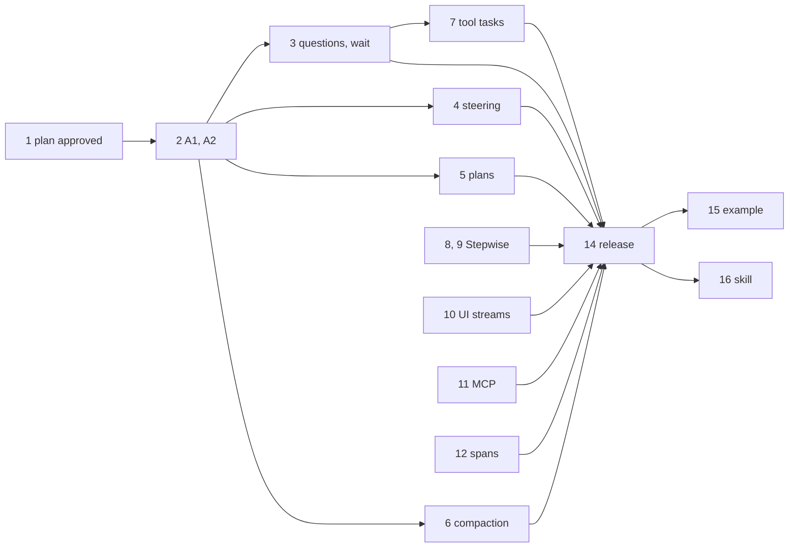

# Agents M2: Built-in Loop, Interrupts, Steering, and Compaction

Status: proposed. Parent design: [long-running-agents.md](../long-running-agents.md)
([#1132](https://github.com/superdurable/dex/pull/1132)), milestone M2.
Current contract: [agent-framework-adapters.md](agent-framework-adapters.md).
Direction: the [owner review of #1132](https://github.com/superdurable/dex/pull/1132#pullrequestreview-5724027276)
and its follow-up comments ([turn replay](https://github.com/superdurable/dex/pull/1132#issuecomment-6546651218),
[Step mode](https://github.com/superdurable/dex/pull/1132#issuecomment-6547044614)).

M1 shipped the session cores in Step mode (#1134, #1136, #1145, #1146) and
nine framework adapters (#1137 to #1144, #1149), and prepared them for PyPI
and npm (#1157). M2 adds the loop for teams without a framework, and the session
features that the hand-built Python AI Agent example has and the cores lack.

This plan specifies:

1. **Stepwise mode**: a built-in agent loop with no framework. It is a runner
   for the existing session Flow, so it produces the same Steps as Step mode.
2. **Core contract additions**, identical in Python and TypeScript: question
   interrupts, `durable_wait`, steering and cancellation, plans, compaction,
   and the two smaller hooks they depend on.
3. **The surfaces other engineers build in parallel**: UI stream adapters, the
   MCP client tool source, and OpenTelemetry GenAI spans. This plan records
   their contracts so the milestone can be reviewed as a whole.
4. **The Python AI Agent example rebuilt on the library**, and an **agent
   deployment guide**.

The contract additions wait for owner approval before their implementation
merges. Everything else can proceed.

## Principles

These come from the owner's review and hold for every addition:

- Reason from Dex's state machine. Steps read and write Attributes. Durable
  waits are **WaitFor** conditions on Channels and Timers. Nothing replays a
  loop, and no application code follows a determinism rule.
- One model call per `RunModel`. Every tool call that leaves the session is
  its own Step. A crash repeats at most the one call that was running.
- No new engine, SDK, or server primitive. Every addition is Steps,
  Attributes, Channels, Timers, and RPCs on the released SDKs
  (`dex-python-sdk==1.30.0`, `@superdurable/dex@1.30.0`).
- Every addition is additive under the Beta compatibility rules. It is inert
  until an application enables it, and adapters need no change to keep
  working.
- Python and TypeScript share every Step type, persistence name, RPC name,
  wire shape, event type, and model-visible text. JSON fields are snake_case
  in both languages.

## Scope

| In M2 | Not in M2 |
| --- | --- |
| Stepwise mode in Python and TypeScript | Dex Agents for Go on the `llm` connector (M3) |
| Questions, `durable_wait`, steering, cancellation, plans, compaction | Budgets and budget interrupts (M3) |
| Incremental turn messages, built-in tool routing, tool input requests, tool tasks | Sub-agents and handoffs (M3) |
| AI SDK UI message stream and plain SSE adapters | AG-UI adapter (M3) |
| MCP client tool source | Dex MCP server (M3) |
| GenAI spans in the agents packages | OpenTelemetry Step spans in the SDKs (separate design) |
| Python AI Agent example on the library | Dex Web agent view (M3) |
| Agent deployment guide | Archived AttributeMap instances (M3) |
| | Hooks such as `before_model_call` (parent C2), until a concrete need |

## Packaging: no new registry names

New features ship as modules and subpath exports of the two existing core
packages. Dependencies that only one feature needs are Python extras or
optional npm peer dependencies. No new PyPI or npm name is registered, so the
release workflows, trusted publishing, and the one-version line from #1157 stay
as they are.

| Feature | Python (`dex-agents`) | TypeScript (`@superdurable/dex-agents`) |
| --- | --- | --- |
| Contract additions | `dex_agents` | `.` |
| Stepwise mode | `dex_agents.stepwise` | `./stepwise` |
| Model client on LiteLLM | `dex_agents.litellm`, extra `dex-agents[litellm]` | n/a |
| Model client on the AI SDK | n/a | `./ai-sdk`, optional peer `ai` |
| UI stream adapters | `dex_agents.streaming` | `./streaming` |
| MCP client tool source | `dex_agents.mcp`, extra `dex-agents[mcp]` | `./mcp`, optional peer `@modelcontextprotocol/sdk` |
| GenAI spans | `dex_agents.telemetry`, extra `dex-agents[otel]` | `./telemetry`, optional peer `@opentelemetry/api` |
| Scripted model client for tests | `dex_agents.testing` | `./testing` |

Rules:

- Importing a module whose extra is missing raises `ImportError` that names
  the extra. A TypeScript subpath whose optional peer is missing fails at
  import with the package name to install.
- Optional npm peers use `peerDependenciesMeta` with `optional: true`. The
  `ai` range matches the Vercel AI SDK adapter's peer range, so an
  application that uses both holds one `ai`.
- `agents/script/smoke-test-built-packages.sh` imports every module and
  subpath from the built artifacts, with and without the optional
  dependencies installed.
- The release that contains this work is `agents/v0.2.0`. The packages are
  before 1.0, and every change here is additive.

## Part 1. Stepwise mode

Stepwise mode is the native Dex Agents loop. The application declares an
agent in Dex terms. A runner that implements the existing
`AgentFrameworkRunner` makes one model call per `RunModel` through a small
model client. The session Flow, its Steps, its approvals, and its events are
the ones every adapter already uses.

### Agent definition

```python
from dex import Registry
from dex_agents import ToolEffect
from dex_agents.litellm import LiteLLMModelClient
from dex_agents.stepwise import (
    AgentDefinition,
    BuiltInTool,
    CompactionPolicy,
    ToolCallContext,
    function_tool,
    stepwise_agent_session_flow,
)


@function_tool(effect=ToolEffect.READ)
async def lookup_order(order_id: str) -> dict[str, str]:
    """Look up an order by its ID."""
    return await orders.get(order_id)


@function_tool(effect=ToolEffect.NON_IDEMPOTENT_WRITE)
async def refund_order(order_id: str, amount_cents: int, context: ToolCallContext) -> str:
    """Refund part of an order."""
    return await payments.refund(order_id, amount_cents, idempotency_key=context.idempotency_key)


support_agent = AgentDefinition(
    name="support",
    instructions=SUPPORT_INSTRUCTIONS,
    model=LiteLLMModelClient("openai/gpt-5-mini"),
    tools=[lookup_order, refund_order],
    built_in_tools={BuiltInTool.ASK_USER, BuiltInTool.DURABLE_WAIT, BuiltInTool.WRITE_TODOS},
    plan_mode_enabled=True,
    compaction=CompactionPolicy(context_window_tokens=400_000),
)

flow = stepwise_agent_session_flow(support_agent, flow_type="SupportAgent")
registry = Registry([flow], allow_async_handlers=True)
```

```ts
import { createAiSdkModelClient } from "@superdurable/dex-agents/ai-sdk";
import { createStepwiseAgentSessionFlow, functionTool } from "@superdurable/dex-agents/stepwise";

const lookupOrder = functionTool({
  name: "lookup_order",
  description: "Look up an order by its ID.",
  parameters: { type: "object", properties: { order_id: { type: "string" } }, required: ["order_id"] },
  effect: "read",
  execute: async ({ order_id }) => orders.get(order_id),
});

export const supportAgentFlow = createStepwiseAgentSessionFlow(
  {
    name: "support",
    instructions: SUPPORT_INSTRUCTIONS,
    model: createAiSdkModelClient(openai("gpt-5-mini")),
    tools: [lookupOrder, refundOrder], // refundOrder: effect "non_idempotent_write"
    builtInTools: ["ask_user", "durable_wait", "write_todos"],
    planModeEnabled: true,
    compaction: { contextWindowTokens: 400_000 },
  },
  "SupportAgent",
);
```

`AgentDefinition` fields. TypeScript uses the same fields in camelCase.

| Field | Default | Meaning |
| --- | --- | --- |
| `name` | required | Agent name, used in span names and events |
| `instructions` | required | System instructions, a string or a function of `InstructionContext` (session, turn, plan). Evaluated in every `RunModel`, so a deploy changes the next model call |
| `model` | required | A `ModelClient` |
| `model_settings` | `ModelSettings()` | Temperature, maximum output tokens, reasoning effort, and provider options passed through unchanged |
| `tools` | `()` | Function tools and tool sources, such as the MCP tool source |
| `tool_policies` | `{}` | `ToolPolicy` by tool name; overrides a function tool's own effect and approval |
| `default_tool_effect` | `UNCLASSIFIED` | Effect of a tool from a source that declares none |
| `built_in_tools` | none | The built-in tools the model sees: `ask_user`, `durable_wait`, `write_todos` |
| `plan_mode_enabled` | `False` | Accept `plan_mode` user messages; requires `write_todos` |
| `compaction` | `None` | `CompactionPolicy`, or no compaction |
| `max_model_calls_per_turn` | 100 | After this many model calls in one turn, the next call offers no tools, so the model must answer |
| `interrupt_deadline` | `None` | Deadline for approvals and questions |
| `event_stream_capacity_bytes` | 10 MiB | `AgentEvents` capacity |

`stepwise_agent_session_flow` builds `AgentSessionFlow(StepwiseAgentRunner(definition), flow_type=..., options=...)`
and derives `AgentSessionOptions` from the definition, so tool policies, built-in tools, plan
mode, compaction, and the deadline are declared once.

### What the runner does in `RunModel`

`StepwiseAgentRunner.run_model_step` makes at most one model call:

1. Build the model input from committed state only: the instructions, the
   `ContextSummary` text when one exists, the stored messages after the
   summary, the tool results of the previous model response (from the final
   records in `turn.tool_calls`), and the current plan when one exists. The
   plan always comes after the summary, so compaction never hides it.
2. Choose the tools for `turn.interaction_mode`. In `planning`, only
   `write_todos` is offered, and the first model call of a `plan_mode` turn
   forces it. In `executing` and `chat`, every function tool and enabled
   built-in tool is offered.
3. Call `ModelClient.call_model` once. Text and provider-authored reasoning
   summaries go to `AgentEvents` as `text_delta` and `reasoning_delta`.
4. If the response asks for tools, return `ToolCallsRequested` with one
   `DeferredToolCall` per call and the policy from `turn.resolve_tool_policy`.
   Its `new_messages` carry the previous round's tool results and the new
   assistant item, so the session stores them now (A1). Its
   `framework_run_state` is a small JSON object with the model call count of
   the turn; it does not grow with the turn.
5. Otherwise return `TurnCompleted` with the tool results and the final
   assistant item that are not stored yet.

`execute_deferred_tool_call` finds the function tool by name, checks the
arguments against its schema, and calls it. A schema mismatch or an unknown
tool raises `ToolExecutionError`, which the model sees.

Stepwise implements every optional runner capability in Part 2:
incremental messages, unfinished-turn messages, plan mode, and compaction.
Its input builder pairs every stored tool call with a result; a missing one
becomes the outcome-unknown text. An orphaned call therefore never reaches a
provider (adk-python #7236 shows the failure).

A turn with a read, an approved write, and a question has this history:

```text
AwaitUserMessage   -> RunModel
RunModel           -> CallTool(lookup_order) | AwaitToolApproval(refund_order) | ResumeTurn(2)
AwaitToolApproval  -> CallSingleAttemptTool(refund_order)       after resolve_interrupt
ResumeTurn         -> RunModel                                  after both results
RunModel           -> AwaitQuestionAnswer(ask_user) | ResumeTurn(1)
ResumeTurn         -> RunModel                                  after answer_question
RunModel           -> AwaitUserMessage                          final answer
```

### Model layer

The model layer is one small interface in each core, with one implementation
behind an optional dependency.

```python
class ModelClient(Protocol):
    async def call_model(self, request: ModelRequest, output: ModelOutputWriter) -> ModelResponse: ...
    def estimate_input_tokens(self, request: ModelRequest) -> int: ...
```

```text
ModelRequest {
  instructions: str
  input_items: list of ModelInputItem   # user text, Dex text, model output items, tool results
  tools: list of ModelToolDefinition    # name, description, JSON Schema parameters
  tool_choice: "auto" | "none" | "required" | { tool_name: str }
  settings: ModelSettings
  metadata: { flow_id, turn_id, step_execution_id, attempt }
}
ModelResponse {
  output_items: list of ModelOutputItem # provider-exact, opaque to Dex
  text: str                             # display projection
  tool_calls: list of { tool_call_id, tool_name, arguments }  # arguments as JSON text
  usage: AgentUsage
  response_model: str
  finish_reason: str
}
ModelOutputWriter { write_text_delta(text), write_reasoning_delta(text) }
```

Rules for every `ModelClient`:

- **One request per call.** The client makes no retries of its own. LiteLLM
  runs with `num_retries=0` and the AI SDK with `maxRetries: 0`. Retries are
  `RunModel` attempts, so each one is visible in history, and a rate-limit
  error waits on the Step retry policy.
- **Dex owns the conversation.** The client sends the whole input every time
  and uses no provider-side conversation state: no `previous_response_id`,
  and `store: false` where the API has it. A session can change model between
  turns.
- **Provider-exact transcript.** A model output item is stored as the
  provider returned it. Opaque fields, such as thinking signatures, encrypted
  reasoning content, and compaction items, are kept as the exact strings the
  provider sent and replayed unchanged. Dex never rebuilds them from display
  text. Providers reject edited history or lose compaction state otherwise.
- **Dex-authored items are neutral.** User text, tool results, the summary,
  the plan, and notes are stored in a provider-neutral form and converted at
  call time.
- **Model switches.** Each output item records its provider and API. An item
  from another provider or API is replayed as its text projection, and its
  reasoning items are dropped.

Python, `dex_agents.litellm` behind `dex-agents[litellm]`:

- `LiteLLMModelClient(model, ...)` uses `litellm.aresponses` for OpenAI
  models, with `include=["reasoning.encrypted_content"]` and `store=False`,
  and keeps each reasoning item. It uses streaming `litellm.acompletion` for
  other providers and keeps Anthropic `thinking_blocks` with their
  `signature`. This is the split the Python example uses today.
- `estimate_input_tokens` uses `litellm.token_counter` plus the stored size
  of opaque items.
- Provider credentials come from the Worker's environment or a credential
  provider passed to the client, never from Flow input or Attributes.

TypeScript, `@superdurable/dex-agents/ai-sdk` with `ai` as an optional peer:

- `createAiSdkModelClient(model: LanguageModel, settings?)` makes one
  `streamText` call with tools that have no `execute`, the request's
  `toolChoice`, `maxRetries: 0`, and the attempt's `cancellationSignal`. Every
  AI SDK provider therefore works.
- It stores the assistant `ModelMessage` parts from the response. Reasoning
  parts keep their `providerOptions`, which hold the provider's signatures and
  encrypted content, unchanged.
- The Vercel AI SDK adapter stays the path for teams that already wrote an AI
  SDK agent. Stepwise is for agents defined in Dex terms. Both produce the
  same Steps.

### Function tools

Python: `@function_tool(effect=..., requires_approval=None, name=None)` on a
plain sync or async function. The name defaults to the function name and the
description to the docstring. The parameter schema is derived from type hints
with the standard library: `str`, `int`, `float`, `bool`, `None`, `list`,
`dict`, `Literal`, `Enum`, `Optional`, dataclasses, `TypedDict`, and
`Annotated[..., "description"]`. A `parameters_schema` argument overrides it.
A parameter typed `ToolCallContext` is excluded from the schema and receives
the idempotency key, attempt, Flow ID, turn ID, event writer, and heartbeat.
A sync function runs in a worker thread. A `str` result is the output; any
other result is serialized as JSON.

TypeScript: `functionTool({ name, description, parameters, effect, requiresApproval?, execute })`
with a JSON Schema object. `execute(args, context)` receives the same context.

Every function tool declares its effect, as parent C4 requires. The effect
picks `CallTool` or `CallSingleAttemptTool` and the default approval, exactly
as for adapter tools.

## Part 2. Core contract additions

Each addition is ordinary Steps with **WaitFor** conditions. The table lists
every new name. Sections A1 to A8 give the behavior, how it touches existing
Steps and locks, and what adapters must do.

| # | Addition | New Steps | New persistence | New RPCs | Adapters |
| --- | --- | --- | --- | --- | --- |
| A1 | Incremental turn messages | none | none | none | Optional |
| A2 | Built-in tool routing | none | none | none | Optional: expose the definitions |
| A3 | Question interrupts | `AwaitQuestionAnswer` | none | `answer_question` | Optional: expose `ask_user` |
| A4 | Durable wait | `AwaitTimer` | none | none | Optional: expose `durable_wait` |
| A5 | Steering and cancellation | `ApplyTurnControl` | `SteeredUserMessages`, `TurnControlRequests`, `TurnCancellationRequest`, `ToolCallCancellations` | `steer_user_message`, `delete_queued_message`, `cancel_turn` | Nothing; optional partial transcript |
| A6 | Plans | none | `AgentPlan`, `PlanExecutions` | `execute_plan` | Optional: expose `write_todos`, honor plan mode |
| A7 | Compaction | `CompactContext` | `ContextSummary` | none | Optional capability |
| A8 | Tool tasks | `PollToolTask` | none | none | Optional |

A1 and A2 are not in the parent design. They came out of reasoning about the
state machine: today a turn stores its messages only when it completes, so a
long turn cannot be compacted or steered with its transcript intact (A1); and
the built-in tools must work under adapters, so the core routes them, not the
runner (A2). A8 is the core hook that the MCP tasks extension needs.

### Shared rules

- **Final statuses do not change.** `ToolCallStatus` keeps its final values:
  `rejected`, `succeeded`, `failed`, `outcome_unknown`. New statuses are
  non-final only: `awaiting_answer`, `waiting_for_timer`, `waiting_for_task`.
  Runners see only final records, so existing adapters keep mapping results
  as they do. A new final value would break an exhaustive mapping, such as
  the one in the Vercel AI SDK adapter's `vercel-ai-model-messages.ts`.
- **Abandoned calls record `rejected`.** A call that steering or cancellation
  abandons before it starts records `rejected`, a `cancellation_reason`, and
  a structured rejection message. Frameworks already map `rejected` to "the
  tool did not run".
- **One writer per record.** `RunModel` creates a record. From then on,
  exactly one Step owns it until it is final: `AwaitToolApproval`,
  `AwaitQuestionAnswer`, `AwaitTimer`, `PollToolTask`, or a tool Step. Every
  final record still publishes exactly one `ToolCallResults` message in the
  same commit. `ResumeTurn` never writes a record.
- **`RunModel` never bypasses `ResumeTurn`.** When `RunModel` finalizes a
  call in its own commit, such as `write_todos` or a cancelled call, it
  publishes that call's result and still moves to `ResumeTurn`.
- **Inert until enabled.** New behavior starts only when an application sets
  the new options or calls the new RPCs. A session started on 0.1.0 continues
  on 0.2.0: new Attributes read as unset, new Channels are empty, and the
  inputs of `RunModel` (none) and `ResumeTurn` (a count) are unchanged.

### A1. Incremental turn messages

Today `TurnCompleted.new_messages` carries every item of the turn, and the
turn's items in between live in `FrameworkRunState`. That rewrites one growing
Attribute after every model call, which counts superseded values toward
`limits.maxFlowStateBytes` (parent open question 2). It also means a long turn
cannot be compacted or steered with its transcript.

Contract:

- `ToolCallsRequested.new_messages`, default empty. `RunModel` appends them in
  the same commit that records the tool calls.
- `TurnCompleted.new_messages` now means the turn's items that the session has
  not stored yet. For a runner that never sets the new field, that is the
  whole turn, as today.
- A runner that sets `ToolCallsRequested.new_messages` must implement
  `build_unfinished_turn_messages(turn) -> Sequence[FrameworkMessage]`. The
  session calls it when a turn ends without a final answer (A5, and
  `RecordTurnFailure`), with every record final. It returns the items not
  stored yet, including a tool result for every tool call already stored or
  returned. It makes no model call.
- `RecordTurnFailure` appends the unfinished-turn messages before its existing
  turn-failure note when the runner implements the method. If the method
  raises, the session stores only the note, so a runner defect cannot block
  the failure route.

Existing Steps: `RunModel` (append), `RecordTurnFailure` (append). Locks: none;
only main-path Steps append. Exactly-once: the append commits with the Step,
so a crash during the model call stores nothing and the rerun stores once.
Adapters: nothing. An adapter can opt in when its framework exposes the turn's
items, such as Pydantic AI messages or AI SDK `ModelMessage` lists.

### A2. Built-in tool routing

The built-in tools are session features, not runner features, so they work
under every adapter.

- `AgentSessionOptions.built_in_tools`, default empty. Values: `ask_user`,
  `durable_wait`, `write_todos`.
- Both cores export `BUILT_IN_TOOL_DEFINITIONS` (`builtInToolDefinitions`):
  name, description, and JSON Schema, with identical text in both languages.
  A runner offers the enabled ones to its model like any other tool.
- In `RunModel`'s commit, a `DeferredToolCall` whose `tool_name` is an enabled
  built-in goes to the built-in's handling instead of a tool Step. Its policy
  is fixed: no approval, and `read` effect for the record.
- An enabled built-in name is reserved. A runner that also exposes an
  application tool with that name is a configuration error at Flow
  construction where the adapter can check, and otherwise at the first call.
  A disabled built-in name is an ordinary tool name.
- `AgentTurnContext.enabled_built_in_tools` tells the runner which to offer.

Arguments are validated in the commit. An invalid call records `failed` with
the validation message and publishes its result at once, so the model sees
the error after `ResumeTurn`.

### A3. Question interrupts

The `ask_user` built-in asks the user a question. The answer becomes the
tool's result, so the model continues the same turn. This replaces the
example's `request_user_input`, which ended the turn and treated the next
user message as the answer.

```text
ask_user arguments: { question: str, choices: list of str (optional), allows_free_text: bool (default true) }
```

Flow:

1. `RunModel`'s commit records the call as `awaiting_answer`, adds an
   `AgentInterrupt` of kind `question` to `PendingInterrupts` with
   `interrupt_id` equal to the tool call ID, writes `interrupt_raised`, and
   moves to `AwaitQuestionAnswer(tool_call_id)`.
2. `AwaitQuestionAnswer` waits on any of `ToolCallCancellations.for_one(id)`,
   `InterruptResolutions.for_one(interrupt_id)`, and the deadline Timer when
   the interrupt has one. Its Execute locks `PendingInterrupts`, as
   `AwaitToolApproval` does.
3. `answer_question(interrupt_id, answer)` locks `PendingInterrupts`, checks
   the answer, removes the interrupt, and publishes
   `AgentInterruptResolution(approved=true, answer=...)` in one commit. It
   returns false when the interrupt is not pending, is not a question, or is
   past its deadline, and when the answer is blank or is not one of
   `choices` while free text is not allowed.
4. `resolve_interrupt(interrupt_id, approved=false, rejection_message)` on a
   question declines it. `resolve_interrupt` with `approved=true` on a
   question returns false, because a question needs an answer.
5. `AwaitQuestionAnswer` records:
   - answered: `succeeded` with output `{"status":"answered","answer":"<text>"}`;
   - declined: `rejected` with the rejection message, or `The user declined to answer.`;
   - deadline passed: `rejected` with `question deadline passed`;
   - cancelled (A5): `rejected` with the cancellation reason.

   It then publishes `ToolCallResults`. A Timer that fires after an answer
   arrived, or early because Timers take whole seconds, moves the Step back
   to itself, as `AwaitToolApproval` does.

**Questions raised by tools.** `execute_deferred_tool_call` may now return
`ToolInputRequested(question, choices, allows_free_text, continuation)`
instead of `ToolExecutionResult`. The MCP tool source uses it for an
`input_required` result. The tool Step records `awaiting_answer` and stores
`continuation`, `question`, `choices`, and `allows_free_text` on its own
record (`input_continuation`, `input_question`, `input_choices`,
`input_allows_free_text`), then moves to `AwaitQuestionAnswer`. Its Execute
raises the question interrupt, with ID `<tool_call_id>-input-<n>`, under the
`PendingInterrupts` lock, so a tool Step never writes shared session state
while other tool Steps run in parallel. An interrupt ID that collides with an
existing one fails the call. The three `input_` question fields are cleared
after an answer or a decline. After the answer, the record returns to `approved`,
and the same tool Step type runs again with
`DeferredToolExecution.input_answers` and the continuation. The tool's later
output, not the answer, is the result. A tool returns `ToolInputRequested`
only when the call took no effect, so a single-attempt tool that runs again
after an answer still never repeats an effect. A crash during the second run
records `outcome_unknown` as before.

Existing Steps: `RunModel` (records and moves), tool Steps (new outcome).
Locks: `answer_question`, `resolve_interrupt`, and `AwaitQuestionAnswer`
Execute serialize on `PendingInterrupts`; the first successful RPC removes the
interrupt, so a second answer is refused. Exactly-once: the answer is one
Channel message consumed once; the record becomes final once. Adapters:
optional. An adapter supports `ask_user` by registering its definition as a
deferred tool, which every adapter already does for application tools.

### A4. Durable wait

The `durable_wait` built-in suspends the turn on a Timer. No model call,
coroutine, or Worker holds the wait.

```text
durable_wait arguments: { duration_seconds: int, reason: str }
```

1. `RunModel`'s commit validates `1 <= duration_seconds <= max_durable_wait`
   (`AgentSessionOptions.max_durable_wait`, default 365 days), records
   `waiting_for_timer` with `wait_until`, writes `timer_started`, and moves to
   `AwaitTimer(tool_call_id)`.
2. `AwaitTimer` waits on any of a Timer for the remaining whole seconds until
   `wait_until`, and `ToolCallCancellations.for_one(id)`. Dex selects Timers
   before Channels, so a wait that ends as a steer arrives completes normally.
3. Execute records `succeeded` with
   `{"status":"completed","waited_seconds":<n>,"reason":"<reason>"}`, or
   `rejected` with the cancellation reason. The remaining seconds are rounded
   up from `wait_until`, so the Timer does not fire before it. A fired Timer
   ends the wait even if the Worker's clock reads earlier, so **SkipTimer**
   from Dex Web or dexcli ends a long wait, and clock skew between Workers can
   shorten a wait by at most that skew.

A steered message interrupts the wait through A5. A queued message does not:
it stays pending and starts its turn after this one. Existing Steps:
`RunModel` only. Locks: none; the record has one owner. Adapters: optional,
as for `ask_user`.

### A5. Steering and cancellation

A user message is either **queued** or **steered**. A queued message waits
until the turn ends, and the user can delete or steer it. A steered
message applies at the next safe Step boundary. Steering never cancels an
in-flight model call or tool call. It abandons the calls that have not
started, records a structured cancellation result for each, ends the running
turn, and starts a new turn with the steered messages. `cancel_turn` does the
same without a new turn.

Persistence:

| Name | Kind | Value | Writers | Readers |
| --- | --- | --- | --- | --- |
| `SteeredUserMessages` | Channel | `AgentUserMessage` | `steer_user_message` | `ApplyTurnControl` consumes; every boundary reads its size |
| `TurnControlRequests` | Channel, internal | `TurnControlRequest` | `steer_user_message`, `cancel_turn` | `ResumeTurn`, `AwaitUserMessage`, and `ApplyTurnControl` consume; it only wakes a waiting Step |
| `TurnCancellationRequest` | Attribute | `TurnCancellationRequest` | `cancel_turn` only | Every boundary |
| `ToolCallCancellations` | ChannelMap, internal, key = tool call ID | `ToolCallCancellation` | `ResumeTurn` | The call's waiting Step |

Two questions decide every boundary, and both read committed state without
consuming anything:

- **Steered?** `SteeredUserMessages.size(context) > 0`.
- **Cancelled?** `TurnCancellationRequest.turn_id` equals the active turn ID.
  Turn IDs never repeat, so a request for an earlier turn never matches.

RPCs:

| RPC | Input | Output | Behavior |
| --- | --- | --- | --- |
| `steer_user_message` | `SteerUserMessageRequest { message_id: str \| null, text: str \| null }`, exactly one set | bool | Transactional; loads `QueuedUserMessages`. With `message_id`, moves that queued message: deletes it and publishes it to `SteeredUserMessages`. With `text`, publishes a new steered message. Then publishes `TurnControlRequest(kind="steer")`. Returns false for a blank text or a message ID that is no longer pending. A message consumed between the check and the commit fails the RPC with CHANNEL_MESSAGE_NOT_FOUND and commits nothing; the client refreshes. |
| `delete_queued_message` | `DeleteQueuedMessageRequest { message_id: str }` | bool | Transactional; loads `QueuedUserMessages`; deletes the message. Returns false when it is no longer pending. |
| `cancel_turn` | `CancelTurnRequest { turn_id: str \| null }` | bool | Transactional. Reads `AgentState`; returns false when no turn is active or `turn_id` names another turn. Otherwise writes `TurnCancellationRequest(turn_id, requested_at)` and publishes `TurnControlRequest(kind="cancel_turn")`. True means the request is recorded; the turn may still complete first. |

`send_user_message` is unchanged and queues. `AgentUserMessage` gains
`plan_mode` (A6). `steer_user_message` replaces the placeholder name
`steer_message` in the parent design, to pair with `send_user_message`.

Boundaries:

| Where | When steered or cancelled |
| --- | --- |
| `RunModel`, before the model call | Moves to `ApplyTurnControl` without a model call. |
| `RunModel`, after the model call | The call is not cancelled. A final answer completes the turn normally. Requested tool calls are recorded `rejected` with the cancellation reason in this commit, their results are published, and the Step moves only to `ResumeTurn`, which then moves to `ApplyTurnControl`. |
| `CallTool`, `CallSingleAttemptTool`, before `tool_call_started` | Records `rejected` with the cancellation reason and publishes the result without running the tool. After `tool_call_started`, the call runs to the end. |
| `ResumeTurn`, waiting | Waits on any of `ToolCallResults.for_n(count)` and `TurnControlRequests.for_range(at_least=1, at_most=MAX)`. On a control wake, Execute locks `PendingInterrupts`, removes the interrupt of every record in `awaiting_approval` or `awaiting_answer`, publishes `ToolCallCancellations[id]` for those records and every `waiting_for_timer` record, and waits again for the same count. A wake with nothing to apply waits again and changes nothing. |
| `ResumeTurn`, all results in | Moves to `ApplyTurnControl` instead of `RunModel`. |
| `AwaitToolApproval`, `AwaitQuestionAnswer`, `AwaitTimer` | Each also waits on `ToolCallCancellations.for_one(id)`, listed before its other Channel condition. A cancellation records `rejected` with the reason and publishes the result. |
| `AwaitUserMessage` | Wakes on the control request and moves to `ApplyTurnControl`, as described next. |

`ResumeTurn` takes the reason from the flags: `turn_cancelled` when the turn
is cancelled, `steered` otherwise.

`AwaitUserMessage` waits on any of, in this order:
`TurnControlRequests.for_range(at_least=1, at_most=MAX)`,
`QueuedUserMessages.for_one()`, and `PlanExecutions.for_one(<revision>)` while
the plan is `draft` or `active` (A6). Channel conditions are selected in
argument order, so steering beats queued messages, which beat plan execution,
as in the example. A control wake moves to `ApplyTurnControl`. `MAX` is
2,147,483,647.

`ApplyTurnControl` (input none) waits on all of
`SteeredUserMessages.at_most(MAX)` and `TurnControlRequests.at_most(MAX)`.
Both conditions are non-blocking, so the wait completes at once and consumes
every steered message and every stale wake. It is the only consumer of
`SteeredUserMessages`. It is reached only when no Step of the turn is
running. Execute:

1. With an active turn, end it. Append the runner's unfinished-turn messages
   when it implements them (A1). Otherwise, when the turn has final records,
   append a note through `build_user_message`, in the turn-failure note's
   line format, with the header
   `[Dex] The user steered the conversation after these tool calls ran:` or
   `[Dex] The user stopped the previous turn after these tool calls ran:`.
   Delete the turn's records and `FrameworkRunState`, increment `turn_count`,
   clear the active turn, and write `turn_steered` or `turn_cancelled`.
2. With consumed steered messages, start a new turn whose user messages are
   all of them, in order, and move to `RunModel`. Otherwise move to
   `AwaitUserMessage`.

A turn that is both cancelled and steered ends as cancelled, and the steered
messages start the next turn, because the user sent them explicitly.

Cancellation results the model sees, as the `rejection_message` of a
`rejected` record:

```text
{"status":"cancelled","reason":"superseded_by_steered_user_message"}
{"status":"cancelled","reason":"turn_cancelled_by_user"}
```

Why steering ends the turn instead of injecting the message into the running
framework: every adapter can end a turn, but few frameworks can take a new
user message into a resumed run state. Ending the turn needs nothing from an
adapter. The note keeps the model from repeating calls. A runner that
implements `build_unfinished_turn_messages` keeps its exact transcript, and
then the next model input matches the example's: the assistant's tool calls,
their results including the cancellations, then the steered message.

Locks and exactly-once:

- `steer_user_message`, `delete_queued_message`, and `cancel_turn` lock
  nothing, so they never fail with a lock conflict while a model call runs.
  They write only Channels, plus `TurnCancellationRequest`, which no Step
  writes.
- `ResumeTurn` Execute now locks `PendingInterrupts`, as `resolve_interrupt`,
  `answer_question`, `AwaitToolApproval`, and `AwaitQuestionAnswer` do. Its
  Execute is short. So either an approval or answer commits first and its
  record moves on, or `ResumeTurn` removes the interrupt first and the RPC
  returns false.
- The flags, not the cancellation messages, are the source of truth. An
  approval that wins the race moves to its tool Step, which sees the flag and
  records `rejected` before the tool starts. A cancellation message that no
  Step consumes stays in its own instance and is never waited on again.
- No write runs twice and no started call is abandoned: the decision is made
  before `tool_call_started`.
- Each steered message is consumed once, by `ApplyTurnControl`.

Adapters: nothing. Optional: implement `build_unfinished_turn_messages`.

### A6. Plans

A plan is a short task list that the model replaces as a whole. Plan review
uses **plan mode** with an `execute_plan` RPC bound to a plan revision, as
parent C5 and the example do.

Persistence:

```text
AgentPlan { revision: int, status: "draft" | "active" | "completed" | "cleared", tasks: list of AgentPlanTask, updated_at: str }
AgentPlanTask { content: str, status: "pending" | "in_progress" | "completed" }
PlanExecutions: ChannelMap, key = revision as decimal, value PlanExecutionRequest { revision: int }
```

`write_todos` arguments are `{ todos: list of { content, status } }`. In
`RunModel`'s commit, the session:

- fails every `write_todos` call of a response that has more than one, with
  `write_todos was called more than once in one response`;
- validates the list, or fails the call with `invalid todos: <reason>`;
- replaces `AgentPlan` with revision + 1: an empty list is `cleared`; in a
  `planning` turn the plan is `draft`; when every task is completed it is
  `completed`; otherwise `active`;
- records `succeeded` with `{"status":"updated","revision":<n>,"task_count":<k>}`
  or `{"status":"cleared","revision":<n>}`, and writes `plan_updated`.

The write commits with the call's record, so a crash before the commit writes
nothing and the rerun writes once. No tool Step runs, because the call has no
effect outside the session.

Plan mode:

- `AgentUserMessage.plan_mode`, default false. `send_user_message` returns
  false for a `plan_mode` message when `AgentSessionOptions.plan_mode_enabled`
  is false.
- `AgentState.interaction_mode` is set when a turn starts: `planning` when a
  message of the turn has `plan_mode` or a `draft` plan exists; `executing`
  when `execute_plan` started the turn; `chat` otherwise. The runner reads it
  from `AgentTurnContext.interaction_mode` and offers only `write_todos` in
  `planning`.
- `execute_plan(ExecutePlanRequest { revision })` is transactional. It
  returns false unless the session is waiting for a user message, the plan
  has this revision and is `draft` or `active`, no execution is pending for
  the revision, and no queued or steered message or interrupt is pending.
  Otherwise it publishes `PlanExecutions[revision]`.
- When `AwaitUserMessage` selects a plan execution, it ignores it unless the
  revision is still current and `draft` or `active`. It then marks the plan
  `active`, starts an `executing` turn whose user message is
  `[Dex] The user approved plan revision <n>. Execute it and keep the task statuses current with write_todos.`,
  writes `plan_execution_started`, and moves to `RunModel`.

Why not a plan-review interrupt: a planning turn hides executable tools, and
changing a framework's tool set between two model calls of one turn is
awkward for adapters, while a turn boundary is clean. A review can take days;
the session is idle meanwhile, so queued messages and plan edits work
unchanged. Feedback is an ordinary user message that revises the draft.

Plan writers are `RunModel` and `AwaitUserMessage`, both on the session's
sequential main path, so no lock is needed. `execute_plan` writes only a
Channel. Compaction never reads or writes `AgentPlan`. Adapters: optional.
They expose `write_todos` like any built-in and honor `interaction_mode` to
support plan mode; until they do, plan mode stays disabled for them.

### A7. Compaction

Compaction keeps the model input under the context window. It changes the
model input, not the durable record.

- `AgentSessionOptions.compaction: CompactionPolicy | None`, with
  `context_window_tokens`, `trigger_ratio` (0.85), and `retained_ratio`
  (0.3). Setting it requires a runner with the compaction capability; the
  Flow constructor raises otherwise.
- The capability, three methods:
  - `estimate_input_tokens(turn) -> int`: the next model input's size.
  - `select_compaction_cutoff(turn, retained_token_budget) -> int | None`:
    the last sequence to summarize. It never separates a tool call from its
    result. `None` means nothing can be summarized.
  - `summarize_context(request: ContextSummaryRequest) -> ContextSummaryResult`:
    one model call that folds the previous summary and the messages of the
    range into new text, with its usage.
- `RunModel` decides before its model call. When the estimate is at least
  `trigger_ratio * context_window_tokens` and the cutoff is past the current
  summary, it moves to `CompactContext(through_sequence)` without a model
  call. Otherwise it calls the model. `CompactContext` moves back to
  `RunModel`, where a second estimate that is still high finds no new cutoff
  and calls the model, so the pair cannot loop.
- `CompactContext` is its own Step with `RunModel`'s options: method timeout
  15 minutes, heartbeat timeout 2 minutes, 3 attempts within 30 minutes, and
  failure route `RecordTurnFailure`. It sets status `compacting_context`,
  writes `compaction_started`, makes the one model call, writes
  `ContextSummary`, records usage, writes `compaction_finished`, and moves to
  `RunModel`.
- `ContextSummary { generation, first_sequence, last_sequence, text, created_at }`
  covers an explicit range. Each new summary includes the previous one, so
  `first_sequence` stays 1 and `last_sequence` advances.
- With a summary, `AgentTurnContext.messages` holds only the messages after
  `last_sequence`, and `AgentTurnContext.context_summary` holds the summary.
  `RunModel` loads only those instances, through per-movement load options as
  the tool Steps already do, so a long session does not load its whole map
  for every model call.
- Messages are never deleted. `list_agent_messages` and `get_agent_snapshot`
  return them as before. They still count toward `limits.maxFlowStateBytes`
  until archived instances ship (M3); the deployment guide states the bound.
- The plan is never summarized. The runner adds it after the summary.

With A1, compaction also covers the stored items of the running turn, so a
turn with a hundred tool calls stays under the window. Without A1, it covers
earlier turns only.

Exactly-once: the summary commits with the Step, so a crash reruns only the
summary call. Locks: none; only `CompactContext` writes `ContextSummary`.
Adapters: optional; an adapter without the capability never compacts.

### A8. Tool tasks

Some tools start remote work and return a handle. The MCP tasks extension is
one. A tool Step must not hold a connection while the work runs.

- `execute_deferred_tool_call` may return
  `ToolTaskStarted(task_id, poll_interval_seconds)`. The tool Step records
  `waiting_for_task` with `task_id` and `task_poll_interval_seconds`, writes
  `tool_task_started`, and moves to `PollToolTask(tool_call_id)`.
- `PollToolTask` waits on a Timer for the poll interval. Execute calls the
  runner's `poll_tool_task(poll)`, which returns a `ToolExecutionResult`, a
  `ToolInputRequested` (to `AwaitQuestionAnswer`, then back to
  `PollToolTask`), or `ToolTaskPending(poll_interval_seconds)` (back to itself).
  Polling is a read: 3 attempts per poll, then the call's failure route,
  `RecordToolFailure` or `RecordToolOutcomeUnknown` by effect.
- The remote work is in flight, so steering and cancellation wait for it.
  Open question 3 asks whether that should change.

Adapters: nothing; only a runner that returns `ToolTaskStarted` implements
`poll_tool_task`.

### Session Steps after M2

| Step type | Input | Wait | Next |
| --- | --- | --- | --- |
| `StartAgentSession` | `AgentSessionStartInput` | none | `RunModel` or `AwaitUserMessage` (unchanged) |
| `AwaitUserMessage` | none | any of `TurnControlRequests`, `QueuedUserMessages`, `PlanExecutions[revision]` | `ApplyTurnControl`, `RunModel` |
| `RunModel` | none | none | `CompactContext`, `ApplyTurnControl`, `AwaitUserMessage`, or tool and built-in Steps plus `ResumeTurn` |
| `CompactContext` | `{ through_sequence }` | none | `RunModel`; failure `RecordTurnFailure` |
| `AwaitToolApproval` | tool call ID | any of `ToolCallCancellations[id]`, `InterruptResolutions[id]`, deadline Timer | tool Step, itself, or end |
| `AwaitQuestionAnswer` | tool call ID | any of `ToolCallCancellations[id]`, `InterruptResolutions[interrupt_id]`, deadline Timer | end, itself, or back to the tool Step or `PollToolTask` |
| `AwaitTimer` | tool call ID | any of Timer, `ToolCallCancellations[id]` | end or itself |
| `CallTool`, `CallSingleAttemptTool` | tool call ID | none | end, `AwaitQuestionAnswer`, `PollToolTask` |
| `PollToolTask` | tool call ID | Timer | end, itself, `AwaitQuestionAnswer` |
| `RecordToolFailure`, `RecordToolOutcomeUnknown` | tool call ID | none | end (unchanged) |
| `ResumeTurn` | expected result count | any of `ToolCallResults.for_n`, `TurnControlRequests` | `RunModel`, `ApplyTurnControl`, itself |
| `ApplyTurnControl` | none | all of `SteeredUserMessages.at_most`, `TurnControlRequests.at_most` | `RunModel`, `AwaitUserMessage` |
| `RecordTurnFailure` | none | none | `AwaitUserMessage` (unchanged) |

Every new Step sets its WaitFor and Execute durability to SYNC, as the
existing Steps do.

### Value types

Additions to the shapes in [agent-framework-adapters.md](agent-framework-adapters.md).
Every new field has a default, so 0.1.0 values decode unchanged.

```text
AgentUserMessage + { plan_mode: bool = false }
AgentState + { interaction_mode: "chat" | "planning" | "executing" = "chat" }
  status + "compacting_context"
AgentToolCall +
  status + "awaiting_answer" | "waiting_for_timer" | "waiting_for_task"   # non-final
  { cancellation_reason: "steered" | "turn_cancelled" | null = null
    wait_until: str | null = null                 # RFC 3339
    input_continuation: str | null = null
    input_answers: list of QuestionAnswer = []
    input_question: str | null = null              # pending tool question
    input_choices: list of str = []
    input_allows_free_text: bool = true
    task_id: str | null = null
    task_poll_interval_seconds: int | null = null }
QuestionAnswer { interrupt_id: str, question: str, answer: str }
AgentInterrupt +
  kind + "question"
  { question: str | null = null, choices: list of str = [], allows_free_text: bool = true }
AgentInterruptResolution + { answer: str | null = null }
AgentSnapshot +
  { queued_messages: list of PendingUserMessage = []
    steered_messages: list of PendingUserMessage = []
    plan: AgentPlan | null = null
    context_summary: ContextSummary | null = null }
PendingUserMessage { message_id: str, message: AgentUserMessage }
SteerUserMessageRequest { message_id: str | null, text: str | null }
DeleteQueuedMessageRequest { message_id: str }
CancelTurnRequest { turn_id: str | null }
AnswerQuestionRequest { interrupt_id: str, answer: str }
ExecutePlanRequest { revision: int }
TurnControlRequest { kind: "steer" | "cancel_turn" }
TurnCancellationRequest { turn_id: str, requested_at: str }
ToolCallCancellation { reason: "steered" | "turn_cancelled" }
AgentPlan, AgentPlanTask, PlanExecutionRequest: see A6
ContextSummary: see A7
CompactContextInput { through_sequence: int }
```

`get_agent_snapshot` adds `load_channels` for `QueuedUserMessages` and
`SteeredUserMessages`, so the UI can show, delete, and steer pending
messages by ID. `queued_message_count` stays.

### Events

New types, payloads as JSON objects:

| Type | Payload |
| --- | --- |
| `turn_steered` | `{"steered_message_count", "message_count"}` |
| `turn_cancelled` | `{"message_count"}` |
| `timer_started` | `{"tool_call_id", "wait_until", "reason"}` |
| `tool_call_progress` | `{"tool_call_id", "tool_name", "message", "progress", "total"}` |
| `tool_task_started` | `{"tool_call_id", "tool_name", "task_id"}` |
| `plan_updated` | `{"revision", "status", "task_count"}` |
| `plan_execution_started` | `{"revision"}` |
| `compaction_started` | `{"through_sequence"}` |
| `compaction_finished` | `{"generation", "through_sequence"}` |

New keys on existing types: `interrupt_raised` gains `kind`, `question`,
`choices`, and `allows_free_text`; `interrupt_resolved` gains `kind`,
`answered`, and `cancellation_reason`. A UI treats `turn_steered` and
`turn_cancelled` like `turn_completed`: it replaces the turn's live text with
the stored messages.

### Runner interface additions

All optional. A runner that implements none of them behaves as in 0.1.0.

```python
class AgentTurnContext:          # new read-only fields
    interaction_mode: InteractionMode
    plan: AgentPlan | None
    context_summary: ContextSummary | None
    enabled_built_in_tools: frozenset[BuiltInTool]

class ToolCallsRequested:        # new field
    new_messages: Sequence[FrameworkMessage] = ()

class DeferredToolExecution:     # new field
    input_answers: Sequence[QuestionAnswer] = ()

# execute_deferred_tool_call may return:
ToolExecutionResult | ToolInputRequested | ToolTaskStarted

class UnfinishedTurnMessageBuilder(Protocol):
    def build_unfinished_turn_messages(self, turn: AgentTurnContext) -> Sequence[FrameworkMessage]: ...

class ContextCompactionRunner(Protocol):
    def estimate_input_tokens(self, turn: AgentTurnContext) -> int: ...
    def select_compaction_cutoff(self, turn: AgentTurnContext, retained_token_budget: int) -> int | None: ...
    async def summarize_context(self, request: ContextSummaryRequest) -> ContextSummaryResult: ...

class ToolTaskPoller(Protocol):
    async def poll_tool_task(self, poll: ToolTaskPoll) -> ToolExecutionResult | ToolInputRequested | ToolTaskPending: ...
```

```text
ToolInputRequested { question: str, choices: list of str = [], allows_free_text: bool = true, continuation: str | null }
ToolTaskStarted { task_id: str, poll_interval_seconds: int }
ToolTaskPending { poll_interval_seconds: int }
ToolTaskPoll { flow_id, tool_call: AgentToolCall, idempotency_key, attempt, input_answers, events, heartbeat }
ContextSummaryRequest { flow_id, turn_id, attempt, previous_summary: ContextSummary | null,
                        messages: list of AgentMessage, through_sequence: int, events, heartbeat }
ContextSummaryResult { text: str, usage: AgentUsage }
```

TypeScript uses optional methods on `AgentFrameworkRunner` with the same
names in camelCase. The new results carry a `kind` discriminator; a result
without `kind` is a `ToolExecutionResult`, so existing runners compile and run
unchanged.

New `AgentSessionOptions` fields: `built_in_tools`, `plan_mode_enabled`,
`compaction`, `max_durable_wait`, and, for spans, `telemetry`.
`interrupt_deadline` now applies to questions too.

### Lock summary

| Writer | Writes | Lock |
| --- | --- | --- |
| `resolve_interrupt`, `answer_question` | `PendingInterrupts`, `InterruptResolutions` | `PendingInterrupts` |
| `AwaitToolApproval`, `AwaitQuestionAnswer` Execute | `PendingInterrupts` on the deadline path, their record | `PendingInterrupts` |
| `ResumeTurn` Execute (new) | `PendingInterrupts`, `ToolCallCancellations` | `PendingInterrupts` |
| `RunModel` Execute | new interrupts, records, plan, messages | none, unchanged: it adds interrupts only when every earlier one is resolved |
| `steer_user_message`, `delete_queued_message`, `execute_plan` | Channels only | none, transactional |
| `cancel_turn` | `TurnCancellationRequest`, `TurnControlRequests` | none, transactional; the only writer of that Attribute |
| `CompactContext`, `ApplyTurnControl`, `AwaitUserMessage` | main-path state | none: the main path is sequential |

No long-running Step takes a lock, so no RPC waits on a model call.

### Compatibility and rollout

- Wire and persisted formats are additive: new fields with defaults, new
  non-final statuses, new event types and keys, new persistence names.
- A session started on 0.1.0 continues on 0.2.0, mid-turn included.
- New Step types run only on Workers that register them; Dex matching
  declines unregistered Step types per Worker. Enable the new options and
  call the new RPCs only after every Worker of the Flow type runs 0.2.0,
  because a 0.1.0 Worker cannot decode the new non-final statuses and does
  not apply steering. The deployment guide says so.
- `agent-framework-adapters.md` stays the contract of record. Each contract PR
  updates its tables in the same change.

## Part 3. Surfaces in M2

Other engineers build these in parallel. They depend only on the contract
above. This part records the contract each one implements.

### UI stream adapters

`dex_agents.streaming` and `@superdurable/dex-agents/streaming` turn the
`AgentEvents` Stream into HTTP responses that an application mounts in its
own server. They need no runtime dependency. The AI SDK UI message stream
protocol version is pinned to AI SDK 7 and tested against `useChat`.

| Function (Python / TypeScript) | Does |
| --- | --- |
| `stream_agent_events_as_sse` / `streamAgentEventsAsSse` | Plain SSE: `event:` is the event type, `data:` the `AgentEvent` JSON, `id:` the Stream resume token |
| `stream_agent_events_as_ui_messages` / `streamAgentEventsAsUiMessages` | AI SDK UI message stream parts |
| `handle_ui_message_chat_request` / `handleUiMessageChatRequest` | Handles a `useChat` POST: new user text calls `send_user_message`; tool approval responses call `resolve_interrupt`; then streams |

Mapping to UI message stream parts:

| `AgentEvent` | Parts |
| --- | --- |
| `turn_started` | `start` with the turn ID as message ID |
| first event of a `(step_execution_id, attempt)` | `start-step` |
| a higher `attempt` of a seen `step_execution_id` | `reset-step`, so the client drops the interrupted attempt's parts |
| `text_delta`, `reasoning_delta` | text and reasoning start, delta, and end parts, one ID per Step attempt |
| `tool_call_deferred` | tool input part; arguments read from `get_agent_snapshot` |
| `tool_call_finished` | tool output part; output read from `get_agent_snapshot` |
| `interrupt_raised`, kind `tool_approval` | `tool-approval-request` |
| `interrupt_raised`, kind `question` | `data-dex-question`, answered through the adapter's answer endpoint, which calls `answer_question` |
| other new events | `data-dex-<type>` |
| `turn_completed`, `turn_failed`, `turn_steered`, `turn_cancelled` | `finish` |

Event payloads stay small. The adapter reads tool arguments and outputs from
the snapshot RPC, because Attributes are the record and Stream messages are
capped. Resume: the client reconnects with `Last-Event-ID` and the adapter
reads from that token. When the token has expired or the Stream has a gap,
the adapter sends `data-dex-resync` (UI stream) or `event: resync` (SSE), and
the client reloads `get_agent_snapshot` and continues from the current token.
The adapter's stop endpoint calls `cancel_turn`; a closed tab is not a stop.
AG-UI follows in M3.

### MCP client tool source

`dex_agents.mcp` (`dex-agents[mcp]`) and `@superdurable/dex-agents/mcp`
(optional peer `@modelcontextprotocol/sdk`) provide an MCP tool source for
Stepwise agents, on the 2026-07-28 specification. Python gains
`tool_effect_from_mcp_annotations`, matching TypeScript's existing
`toolEffectFromMcpToolAnnotations`.

- **Servers** are registered in Worker configuration, never from Flow input,
  a browser, or a model: stdio (command, arguments, environment) or
  Streamable HTTP (URL and headers, with credential references).
- **Stateless.** No session survives a call. Tools are listed at Worker
  start and refreshed on a configured interval. Tool names are
  `<server>__<tool>`, cut to 64 characters with a hash suffix, as the example
  does. Resource and prompt broker tools from the example are `read` tools.
- **Effects.** Annotations are hints. For a server marked trusted,
  `readOnlyHint` maps to `read` and `idempotentHint` without
  `destructiveHint` to `idempotent_write`. Everything else, and every tool of
  an untrusted server, is `unclassified` unless a `ToolPolicy` says
  otherwise.
- **Calls** run in `CallTool` or `CallSingleAttemptTool`. A broken response
  stream is re-issued as a new request only when the effect allows a retry;
  an `unclassified` call records `outcome_unknown`.
- **`input_required`** returns `ToolInputRequested` (A3). The answer goes back
  in the retried call's input responses.
- **Tasks extension.** A call answered with a task handle returns
  `ToolTaskStarted` (A8), and `poll_tool_task` polls with `tasks/get` on the
  Timer until the task finishes or asks for input.
- **Progress** notifications become `tool_call_progress` events.
  `traceparent` goes into `_meta` when telemetry is enabled.

Framework adapters keep running the MCP tools their framework runs by
itself, at least once, as documented. An adapter may use this tool source
instead to make each MCP call a Step.

### OpenTelemetry GenAI spans

`dex_agents.telemetry` (`dex-agents[otel]`, `opentelemetry-api` only) and
`@superdurable/dex-agents/telemetry` (optional peer `@opentelemetry/api`).
Spans are emitted only when `AgentSessionOptions.telemetry` is set; the
application owns the tracer provider and exporter.

- **Spans**: `invoke_agent <agent name>` per activation; `chat <model>` per
  `RunModel` and `CompactContext` attempt, with usage, cached, and reasoning
  tokens where the pinned convention version defines them; `execute_tool
  <tool name>` per tool Step attempt. A retry is a second span of the same
  Step execution, with `dex.step.attempt`.
- **One trace per activation.** An activation starts at a Step whose wait was
  satisfied by a user message, an interrupt resolution, a Timer, or a control
  request, or at `StartAgentSession`. That Step emits the root span and stores
  its span context in a new Attribute, `AgentTraceContext`. Later Steps of the
  activation parent their spans to it as a remote parent. Each new root links
  to the previous activation's root.
- The root span ends with the Step that starts the activation, not when the
  session parks as parent C9 says. A span must end in the process that
  started it, and the Steps of one activation run on different Workers. Open
  question 4 covers the alternative.
- **Conversation ID**: every span carries the Flow ID as
  `gen_ai.conversation.id` and `session.id`, plus `dex.flow.id`,
  `dex.step.type`, `dex.step_execution.id`, and `dex.turn.id`.
- **Content by reference**: by default, spans carry message sequences and the
  Step execution ID, not message content. `capture_content=True` opts in.
- The emitter pins one GenAI convention version and has a switch for the
  next, because the conventions are marked Development.

Out of scope: one span per Step attempt in the Dex SDKs, with OTLP export,
for every Flow. That is an SDK change and gets its own design for the owner.
When it lands, agent spans become children of Step attempt spans.

## Part 4. The Python AI Agent example on the library

`examples/python/dex_examples/products/ai-agent/` is rebuilt on
`dex-agents[litellm,mcp]` after `agents/v0.2.0` is on PyPI, because examples
depend on released packages. It is under 500 lines of application code,
counting every Python file of the product folder and excluding its HTML,
JavaScript, CSS, and tests. It is 3,917 lines today.

| Example feature today | On the library |
| --- | --- |
| Queue and steer, delete queued messages | `send_user_message`, `steer_user_message`, `delete_queued_message`; snapshot pending lists |
| `request_user_input` with choices | `ask_user` and `answer_question`; the answer is the tool result |
| `durable_wait`, interruptible by steering | `durable_wait` built-in, `AwaitTimer` |
| Plan mode, `write_todos`, `execute_plan` | A6 |
| Approvals | `AwaitToolApproval`, `resolve_interrupt` |
| MCP tools, trusted read-only annotations, broker tools | MCP tool source |
| Compaction at 85 percent of the window | `CompactionPolicy` |
| Reasoning, text, and activity Streams | One `AgentEvents` Stream; the routes use `dex_agents.streaming` |
| Snapshot and history RPCs | `get_agent_snapshot`, `list_agent_messages` |
| Provider-exact reasoning items | `LiteLLMModelClient` |

Changes users of the example see:

- The Flow type becomes `AIAgentSession`, so sessions of the old example are
  not resumed by different Steps.
- RPC names follow the library: `send_message` becomes `send_user_message`,
  `steer_message` becomes `steer_user_message`, `approve_tool` becomes
  `resolve_interrupt`, `get_history` becomes `list_agent_messages`, and
  `get_snapshot` and `describe` become `get_agent_snapshot`.
- The model, prompt, and MCP servers become Worker configuration instead of
  per-session start options (open question 7).
- `dex-python-sdk` moves from 1.29.0 to the version `dex-agents` requires.

`examples/python/tests/integ/test_ai_agent.py` and
`test_ai_agent_restarts.py` keep their user-visible scenarios against the
rebuilt example. The change loads the `dex-sdk` skill first, as the repository
requires for examples, and regenerates the Flow definition graph.

## Part 5. Agent deployment guide

A new product page, `docs/content/production/agent-deployment.mdx`, with its
zh-Hans translation, a sidebar entry under Production, and links from Agent
Frameworks and the Production index. It can be written now for the 0.1.0
packages and extended as M2 features release.

Contents:

- **Workers**: `AsyncWorker` with `allow_async_handlers=True`, long-lived
  processes, heartbeats, and the model and tool Step timeouts.
- **Stream backend**: production defaults `streamStore.backend` to
  `disabled`, which drops every agent event. Set `memory`, and know that it
  empties on restart and that UIs recover from the snapshot RPC.
- **Stream sizing**: `AgentEvents` capacity is shared by every session of a
  Flow type. A formula from concurrent sessions and event bytes per turn, and
  the per-message size cap.
- **State limits**: `limits.maxFlowStateBytes` (64 MiB) counts superseded
  values; one message per AttributeMap instance; what compaction does and
  does not free before archived instances ship.
- **Retention**: `retention.closedFlowDuration` (7 days), the history window,
  and syncing `AgentMessages` to an Attribute Store when transcripts must
  outlive the run.
- **Secrets**: provider keys in the Worker's environment or a credential
  provider, never in Flow input or Attributes.
- **MCP servers**: registration in Worker configuration and annotation trust.
- **Telemetry**: tracer provider setup and content capture.
- **Upgrades**: the agents version line, upgrading every Worker before
  enabling new options, and framework pins with turns in flight.
- **Model rate limits**: until Step concurrency groups (M3), `RunModel`
  retries and `Retry-After`.

Application code in the guide comes from runnable files under `examples/` in
`<SdkTabs>` for Python and TypeScript. Server configuration uses `yaml`
fences, as the operations page does.

## Ordering and PR breakdown

**Waits on owner approval**: the contract additions, PRs 2 to 7. They can be
opened as drafts, but none merges before the owner approves Part 2. Each one
changes both cores, adds its integration scenarios in both languages, and
updates `agent-framework-adapters.md`.

Phase 1 (PRs 2, 3, 8 and 9) is open as one PR per core: #1183 for Python
and #1184 for TypeScript, each with A1 to A4 and Stepwise. They share one
wire format, checked value by value, and merge together after approval.
#1183 carries the shared `agent-framework-adapters.md` and
`agents/CHANGELOG.md` changes for both cores, so neither PR conflicts with
the other.

**Proceeds now**: Stepwise on the existing contract (PRs 8 and 9), the
surfaces (PRs 10 to 12), and the guide (PR 13). They wire in each contract
addition after it merges.

| # | PR | Area | Size | Depends on |
| --- | --- | --- | --- | --- |
| 1 | This plan | docs/design | S | #1132 |
| 2 | A1 incremental turn messages, A2 built-in tool routing | agents | M | 1 approved |
| 3 | A3 question interrupts, A4 durable wait | agents | L | 2 |
| 4 | A5 steering and cancellation | agents | L | 2 |
| 5 | A6 plans and plan mode | agents | M | 2 |
| 6 | A7 compaction | agents | L | 2 |
| 7 | A8 tool tasks | agents | M | 3 |
| 8 | Stepwise for Python: definition, function tools, `ModelClient`, runner, scripted client; `dex_agents.litellm` | agents | L | existing contract; features after 2 to 6 |
| 9 | Stepwise for TypeScript; `./ai-sdk` | agents | L | same as 8 |
| 10 | UI stream adapters, Python and TypeScript | agents | M | existing events; new events after 3 to 6 |
| 11 | MCP client tool source, Python and TypeScript | agents | M | calls now; `input_required` after 3; tasks after 7 |
| 12 | GenAI spans | agents | M | none |
| 13 | Agent deployment guide, English and zh-Hans | docs | S | none |
| 14 | Release `agents/v0.2.0`: changelog, compatibility table, smoke test | agents | S | 2 to 12 |
| 15 | Python AI Agent example on the library, AI Agent page | examples, docs | M | 14 |
| 16 | `dex-sdk` skill: rewrite `core/ai-agents.md` around Dex Agents | skills | S | 14 |
| 17 | Adapters opt in: unfinished-turn messages and built-ins, Pydantic AI and Vercel AI SDK first | adapters | M each | 2 to 6; not required for the M2 exit |



Exit, from the parent design: the crash matrix below passes for Stepwise mode
in both languages, and the rebuilt Python example is under 500 lines of
application code.

## Tests

Every scenario runs in both core suites (`agents/python/core/tests`,
`agents/typescript/core/test/integ`) against a private `dexcli dev --engine zd`
with a scripted model client, so CI needs no model key. Kill tests run the
Worker in its own process group through `AgentWorkerProcess` and kill it with
SIGKILL at a `FileGate`. Tests assert Step shapes from the Flow history, as
the adapter suites do. Unit tests are limited to the UI stream event mapping,
whose edge cases integration tests cannot reach.

### Contract additions

| ID | Scenario | Why |
| --- | --- | --- |
| A1-1 | A runner that stores items incrementally shows the assistant tool-call item in the snapshot during the tool phase, and the turn's sequences are contiguous after `TurnCompleted` | The append order is a new invariant |
| A1-2 | SIGKILL during `RunModel` of an incremental runner stores each item once | The append must commit with the Step |
| A1-3 | `RecordTurnFailure` with an incremental runner stores a result for every stored tool call, then the note; a runner whose method raises still gets the note | No orphaned tool call; the failure route never blocks |
| A2-1 | An enabled built-in is routed to its Step; a disabled built-in name runs as an ordinary tool; an enabled name that collides with an application tool is refused | Routing by name must be unambiguous |
| A3-1 | `ask_user` with choices raises a `question` interrupt; `answer_question` resumes the turn and the model's next input has the answer as the tool result; a second answer returns false; an answer outside the choices with free text off returns false | The core question contract |
| A3-2 | SIGKILL while `AwaitQuestionAnswer` waits; a new Worker; the answer still resumes the turn | The wait is durable |
| A3-3 | Declining with `resolve_interrupt(approved=false)` and a passed deadline both record `rejected` with the documented text | Every way out of the wait reaches the model |
| A3-4 | A single-attempt tool returns `ToolInputRequested`, the answer arrives, the tool runs a second time with the answer, and SIGKILL during that run records `outcome_unknown` with no third run | Tool questions must not weaken single-attempt semantics |
| A3-5 | Pydantic AI adapter with `ask_user` exposed passes A3-1 | Built-ins work under adapters |
| A4-1 | `durable_wait` of 2 seconds completes; a one-day wait completes through **SkipTimer**; an invalid duration fails at once with no Step | The Timer path and validation |
| A4-2 | SIGKILL while `AwaitTimer` waits; the Timer still fires once | The wait is durable |
| A4-3 | A queued message during a wait does not end it; a steered message does, within one Step round trip, and the model sees the cancellation result | Only steering interrupts |
| A5-1 | Steer during a model call: the scripted model sees exactly one call, the requested tools record `rejected` with `superseded_by_steered_user_message`, and a new turn starts with the steered message | Never cancel an in-flight model call |
| A5-2 | Steer during `CallSingleAttemptTool`: the tool runs exactly once and the steer applies after it | Never cancel an in-flight tool call |
| A5-3 | Steer while an approval waits in parallel with a running read: the approval is cancelled, a later `resolve_interrupt` returns false, the read finishes, and `ResumeTurn` moves to `ApplyTurnControl` | The supervisor path |
| A5-4 | `resolve_interrupt` and `steer_user_message` race 50 times: every call has one final record and one result, no tool starts after the steer is applied, and no `ResumeTurn` stalls | The lock and flag argument |
| A5-5 | SIGKILL during `ApplyTurnControl`: the rerun ends the turn once and consumes each steered message once | Exactly-once consumption |
| A5-6 | `delete_queued_message` removes a message before it starts a turn and returns false for a consumed one; steering a stale message ID returns false | Queue changes are safe against consumption |
| A5-7 | `cancel_turn` during an approval wait ends the turn with `turn_cancelled`, and a queued message then starts the next turn; `cancel_turn` during a model call does not abort it, and a final answer is stored | Cancellation semantics |
| A5-8 | An adapter without unfinished-turn messages gets the steered note; Stepwise gets its exact transcript | Both paths of the turn end |
| A5-9 | A steer while idle starts a turn through `ApplyTurnControl`, and a stale `cancel_turn` wake changes nothing | Stale wakes are harmless |
| A6-1 | `write_todos` replaces the plan and advances the revision; two calls in one response both fail; an empty list clears | Atomic replace |
| A6-2 | A `plan_mode` message offers only `write_todos`, forces it first, and drafts; `execute_plan` with a stale revision returns false; with the current one it starts an `executing` turn with every tool | Plan mode and revision binding |
| A6-3 | SIGKILL after `execute_plan` and before `AwaitUserMessage` commits: the plan executes once | Exactly-once execution |
| A6-4 | At idle, a steered message beats a queued one, which beats a plan execution | Priority order |
| A7-1 | Crossing the threshold runs `CompactContext` once before the model call; the model input excludes summarized messages; `list_agent_messages` still returns all of them; the plan is present after the summary | The compaction contract |
| A7-2 | A Stepwise turn with 60 tool calls compacts mid-turn and never separates a tool call from its result | Long turns, with A1 |
| A7-3 | SIGKILL during `CompactContext` reruns only the summary call and commits one generation | Exactly-once summary |
| A7-4 | A failing summary call fails the turn through `RecordTurnFailure`, and the next message compacts again | No loop, clear failure |
| A7-5 | A 2,000-turn session with compaction reports its storage use against `limits.maxFlowStateBytes` | Calibrates the guide until archiving ships |
| A8-1 | A tool returns `ToolTaskStarted`; `PollToolTask` polls until done; SIGKILL during the poll wait resumes polling; a task that asks for input raises a question | The task path |
| U-1 | A session started on a 0.1.0 Worker waits for an approval; the Worker is replaced by 0.2.0; the approval resolves and the next turn uses the new features | In-flight sessions survive the upgrade |

### Stepwise mode

| ID | Scenario | Why |
| --- | --- | --- |
| S-1 | The parent crash matrix: SIGKILL during a streamed model call, a read tool, a non-idempotent tool, an approval wait, a Timer wait, a question wait, and compaction. Each case repeats at most the running call, never repeats a write, reports an interrupted write as an unknown outcome, keeps the snapshot consistent, and lets the UI stream resume | The M2 exit |
| S-2 | A changed system prompt deployed between two `RunModel` Steps of one turn takes effect at the next call | No determinism rule |
| S-3 | `max_model_calls_per_turn` reached: the next call offers no tools and the turn ends with an answer | Loop guard |
| S-4 | A function tool's argument schema rejects bad arguments with a model-visible error; `ToolCallContext` carries the same idempotency key on every attempt | Tool contract |
| S-5 | Model client conformance against recorded provider responses: an OpenAI encrypted reasoning item and an Anthropic thinking block with a signature round-trip byte for byte; a model switch drops reasoning and keeps text; no client retries | Provider-exact transcript; no key in CI |
| S-6 | The AI SDK client against the AI SDK's mock language model: one `streamText` call per `RunModel`, reasoning `providerOptions` preserved | TypeScript model layer |

Live-provider smoke tests are manual and need keys; CI does not run them.

### Surfaces

| ID | Scenario | Why |
| --- | --- | --- |
| UI-1 | A `useChat` client reconnects mid-stream and resumes from its token; a retried attempt produces `reset-step`; an approval round trip goes through `tool-approval-response`; Stop calls `cancel_turn` | The UI stream contract |
| UI-2 | SSE resumes from `Last-Event-ID`; an expired token produces `resync` and the snapshot rebuilds the view | Resume without an extra store |
| MCP-1 | Against the in-repo test MCP server over stdio and Streamable HTTP: trusted and untrusted annotations map to effects; a task is polled; `input_required` becomes a question; a broken stream is re-issued only when the effect allows | The MCP contract |
| MCP-2 | SIGKILL during an `unclassified` MCP call records `outcome_unknown` and the call is not repeated | Effects hold for MCP |
| OT-1 | An in-memory span exporter receives one trace per activation, every span has the conversation ID, content is absent by default, a retry produces two attempt spans, and nothing is emitted when telemetry is off | The span contract |

### Example

The existing `test_ai_agent.py` and `test_ai_agent_restarts.py` scenarios pass
against the rebuilt example: chat, MCP tools with approval, durable wait and
its interruption, questions with choices, plan mode and execution, queue
deletion and steering, compaction, and Worker restarts at each wait.

## Documentation

- This plan, `docs/design/plan/agents-m2-stepwise.md`.
- `docs/design/plan/agent-framework-adapters.md`: each contract PR updates the
  Steps, persistence, values, RPCs, events, and adapter interface tables.
- `agents/python/core/README.md` and `agents/typescript/core/README.md`:
  Stepwise, built-in tools, questions, steering, plans, compaction, extras and
  subpaths. Module READMEs or package docs for the streaming, MCP, and
  telemetry modules.
- `agents/README.md`: the modules and extras table and a 0.2.0 compatibility
  row. `agents/CHANGELOG.md`: the 0.2.0 entry.
- Adapter READMEs: which optional capabilities and built-ins each adapter
  supports.
- Product docs, English and zh-Hans: the agent deployment guide (Part 5); the
  AI Agent use case page updated to the rebuilt example, with snippets copied
  from it and its Flow definition graph regenerated with
  `npm run generate:flow-definitions`; a Stepwise section on the Agent
  Frameworks page. Every docs PR runs `cd docs && npm run check`.
- Skills: after `agents/v0.2.0` is released, rewrite
  `skills/dex-sdk/references/core/ai-agents.md` around Dex Agents, Step mode,
  Stepwise, and the adapters, following the repository's skill release rules.

## UI/UX

N/A for Dex Web: M2 adds no Dex Web UI. The Dex Web agent view (M3) will read
the snapshot fields and events defined here. The AI Agent example's own page
keeps its features and is rewired to the library: an answer panel with choice
buttons for questions, delete and steer controls on pending messages,
a Stop button that calls `cancel_turn`, and plan review with Execute.

## Open questions

1. **Steering and calls that have not started.** This plan cancels a call
   that steering finds before `tool_call_started`, including reads that need
   no approval, as the example does. The alternative lets them run.
   Recommendation: cancel, because the user asked the agent to change course.
2. **Aborting a model call on `cancel_turn`.** A model call has no effect
   outside the session, so aborting it would be safe and faster. Dex has no
   way for an RPC to stop a running Step attempt today. Recommendation: do
   not abort in M2; a UI can stop rendering text after Stop.
3. **Steering during a long remote task (A8).** Waiting for the task keeps
   the never-cancel-in-flight rule. Abandoning it would record
   `outcome_unknown` and send a best-effort cancel. Recommendation: wait in
   M2, and revisit with a real long-task case.
4. **Root span duration.** A root span that covers the whole activation needs
   span IDs chosen before the span starts, which the OpenTelemetry API does
   not offer without a custom ID generator. Recommendation: the short root in
   Part 3.
5. **Function tool schemas in Python.** This plan derives schemas from type
   hints with the standard library, so the core gains no dependency. The
   alternative depends on Pydantic. Recommendation: standard library, and
   accept Pydantic models as parameter types when Pydantic is installed.
6. **Long sessions before archiving.** Compaction leaves messages in
   `AgentMessages`, so their bytes stay in the run budget until archived
   instances ship in M3. Recommendation: state the bound in the guide, using
   the A7-5 measurement.
7. **Per-session settings.** The example's start form chooses the model,
   prompt, and MCP servers per session. The library has no place for that:
   `AgentSessionStartInput` holds only the initial message. One option is an
   optional `session_settings` JSON object kept in its own Attribute and
   exposed on `AgentTurnContext`. Recommendation: leave it out of M2 and move
   these choices to Worker configuration in the example, unless the owner
   wants it in this contract.
